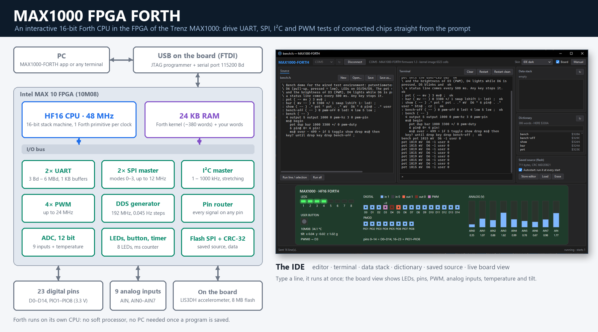

# MAX1000 FPGA FORTH

**An interactive 16-bit Forth on the Trenz MAX1000**



MAX1000 FPGA FORTH puts a complete Forth system into the Intel MAX 10 FPGA of the low-cost
Trenz MAX1000 board (TEI0001-02). Its CPU, the HF16, is a 16-bit stack machine that runs one
Forth primitive per clock at 48 MHz. The Forth kernel is part of the FPGA configuration, so
the board starts straight into Forth: no soft processor, no loader, and only a USB cable,
since the programmer is built into the board.

**Why Forth?** Forth is interactive: type a line and it runs at once, with no
compile-and-flash cycle. It is fast, small and easy to learn. That makes it ideal for trying
out and testing chips and circuits connected to the board. Two UARTs, two SPI masters, an I²C
master, four PWM channels and a DDS generator can each be put on any of the 23 header pins.
You can talk to a sensor, set up a clock chip or watch a serial device in a few typed lines.
One Forth program can be saved in the board's flash, so it runs at every start without a PC.

**IDE included.** The MAX1000-FORTH app for Windows combines a source editor and a terminal
with the data stack and the dictionary. It also shows the saved program and a live view of
the board: LEDs, pins, PWM channels, analog inputs, temperature and tilt. F1 opens the full
user manual.

Open source (MIT): firmware, Forth kernel, cross-compiler, simulator and app, with a user
manual and implementation details.

## Features

- **HF16** at 48 MHz, one Forth primitive per clock, with 24 KB of RAM: 16 KB for code and
  the dictionary, 8 KB data RAM.
- A **Forth kernel** of about 380 words, written in Forth and cross-compiled on the PC: the
  interpreter and compiler, 32-bit mixed arithmetic, and the board's I/O.
- **Board I/O:** 8 user LEDs and the user button; 23 digital pins (D0..D14 and the Pmod's
  PIO1..PIO8) with four PWM channels, a 192 MHz DDS square-wave generator, two UARTs, two
  SPI masters and an I2C master, each on any pin; 9 analog inputs (12 bits, 0..3.3 V); the
  MAX 10's temperature sensor; the on-board LIS3DH accelerometer.
- **Saved source:** one Forth source in the board's 8 MB serial flash runs at every start;
  hold the user button (or send ESC) to skip it.
- **Any terminal** (PuTTY, Tera Term) talks to Forth at 115200 baud. The **MAX1000-FORTH
  app** for Windows (in the release zip: `app\Max1000Forth.exe`, no installation) adds an
  editor, the data stack, the dictionary, the saved source and a live view of the board: the
  kernel answers its service requests itself.

## Get started

1. Download `MAX1000-FORTH-<version>.zip` from the
   [releases](https://github.com/andiepp/MAX1000-FORTH/releases) (under *Assets*), or the
   repository with **Code → Download ZIP**, and unpack it. Both have the firmware in
   `firmware\` and the app as `app\Max1000Forth.exe`.
2. Install the **Arrow USB Blaster** driver (the MAX1000 has its programmer on board, so no
   other hardware is needed) and the **Quartus Prime Programmer** (or Quartus Prime Lite,
   which contains it).
3. Plug in the MAX1000 and write MAX1000-FORTH into its flash, once (in PowerShell, in the
   unpacked folder):

   ```powershell
   .\firmware\program_flash.ps1          # internal flash: starts at every power-up
   .\firmware\program_flash.ps1 -Sram    # or only until power-off
   ```

   Writing the flash takes a while (up to a few minutes); the script says when it is done.
   Then press the board's **Reset** button: LED1 lights up.
4. Start the **MAX1000-FORTH app**: `app\Max1000Forth.exe`. Choose the board's serial port
   (the second of the two the MAX1000 brings, the FTDI's channel B), click **Connect**, and
   type Forth into the input line under the terminal. The app also shows the data stack, the
   dictionary, the saved source and a live view of the board; **F1** opens the manual. The
   app from the release zip runs as it is; the one from Code → Download ZIP is the small build
   and needs Microsoft's free .NET 10 Desktop Runtime (Windows offers it on the first start).

   Or use any terminal program (PuTTY, Tera Term) on the same port at **115200 8N1**, press
   Enter, and type Forth:

   ```
   HF16 Forth on MAX1000
   2 3 + .  5  ok
   : blink 10 0 do 0 output 0 toggle 200 ms loop ;  ok
   accel@ . . .  1024 -10 34  ok
   .temp  31.7 C  ok
   ```

**Ctrl-R** restarts Forth at any time, even out of an endless loop. The board's **Reset**
button reloads the whole FPGA.

The [user manual](docs/Manual.md) ([PDF](docs/Manual.pdf)) covers the app, the interpreter,
every word, examples and troubleshooting. The implementation details
([docs/design.md](docs/design.md), [PDF](docs/Implementation-Details.pdf)) describe how it is
built: the HF16 CPU and its instruction set, memory and I/O, every peripheral, the Forth
kernel, the service protocol, the tools and the design decisions.

## Words at a glance

| Area | Words |
|---|---|
| LEDs (1..8), button, time | `led!` `led@` `led-on` `led-off` `led-toggle` `btn@` `ms@` `ms` |
| Digital pins (0..14 = D0..D14, 16..23 = PIO1..PIO8) | `output` `input` `high` `low` `toggle` `pin!` `pin@` |
| PWM | `pwm-hz` `pwm-khz` `pwm-duty` `pwm-pin` `pwm-off` |
| DDS square wave (0.045 Hz steps) | `dds-hz` `dds-khz` `dds-tuning` `dds-pin` `dds-off` |
| UART 0, 1 (8N1, baud as a double: `115200.`) | `uart-open` `uart-close` `uart-emit` `uart-type` `uart-key?` `uart-key` `uart-status` |
| SPI 0, 1 (modes 0..3, 8/16 bits, up to 12 MHz) | `spi-open` `spi-close` `spi-khz` `spi-mode` `spi-lsb` `spi-bits` `spi-xfer` `spi-write` `spi-read` |
| I2C (up to 1 MHz, clock stretching) | `i2c-open` `i2c-close` `i2c!` `i2c@` `i2c-probe` `i2c-scan` `i2c-start` `i2c-stop` `i2c-addr` `i2c-write` `i2c-read` |
| Who has a pin | `owner` |
| Analog (0..7 = AIN0..AIN7, 8 = AIN) | `adc@` `mv@` `adc-ch@` |
| Temperature, accelerometer | `temp@` `.temp` `temp-code@` `accel@` `accel?` `acc@` `acc!` |
| Data RAM | `buffer:` `unused` `unused-data` |
| Saved source | `.source` `load-source` `autostart` `erase-source` `source?` |
| Serial flash | `flash-id` `f-read` `f-prog` `f-erase` `f-erase64` `spi` `crc@` |

`tools/mforth.py` sends lines or files from the PC and saves a source in the flash (needs
pyserial):

```powershell
python tools/mforth.py -p COMx -f examples/bench.fs        # send a file
python tools/mforth.py -p COMx --store examples/bench.fs   # save it; runs at every start
python tools/mforth.py -p COMx --skip                      # restart without it
```

## Building

Needs Quartus Prime Lite 18.1 (MAX 10 support) and Python 3; the app needs the .NET 10 SDK.

```powershell
scripts\build.ps1                      # kernel + FPGA (build\output_files\max1000_forth.pof/.sof)
scripts\build.ps1 -PullUps             # the same with weak pull-ups on the digital pins
scripts\program_flash.ps1 [-Sram]      # write it to the board
sim\run_flash_tests.ps1                # simulator tests: flash and saved source
python sim\test_protocol.py            # simulator tests: the app's service requests
python sim\test_serial.py              # simulator tests: UART, SPI, I2C, pin owners
sim\run_serial.ps1                     # Verilog testbench of UART/SPI/I2C (Vivado 2023.2)
python tools\hf16.py run forth\kernel.fs -i "2 3 + ."      # the kernel in the simulator
dotnet test app\Max1000Forth.slnx                             # the app's tests
scripts\Build-Release.ps1 -Version 1.3.1                    # release zip in dist\ (with the app)
```

`build.ps1` finds Quartus via `-Quartus`, `QUARTUS_ROOTDIR` or `<drive>:\Quartus\18.1\quartus`.
The design uses about 6.5k of 8,064 logic elements, 40 of the 42 M9K blocks and 18
multiplier elements, with about 1.0 ns of slack at 48 MHz (CPU) and at 192 MHz (DDS).

## Repository

| Path | Content |
|---|---|
| `rtl/` | Verilog: `hf16_cpu.v` (the HF16 CPU), `max1000_forth.v` (top), FIFOs, UART, PWM, DDS, ADC scanner, SPI master; UART, SPI and I2C for the pins (`uart_port.v`, `spi_port.v`, `i2c_port.v`) |
| `forth/kernel.fs` | the Forth kernel |
| `tools/hf16.py` | cross-compiler and instruction-set simulator |
| `tools/mforth.py` | line sender and source store |
| `tools/manual_pdf.py` | builds `docs/Manual.pdf` (`manual`) and `docs/Implementation-Details.pdf` (`design`) |
| `tools/manual_contents.py` | rewrites the manual's contents list (chapters and sections, as links) from its headings |
| `scripts/` | build, flash and release scripts |
| `sim/` | simulator tests and the testbench of the serial interfaces |
| `docs/` | user manual, implementation details, images |
| `examples/` | example programs |
| `firmware/` | the released FPGA configuration (`.pof`, `.sof`) and `program_flash.ps1`, as in the release zip |
| `app/` | the MAX1000-FORTH app for Windows (C#, WPF, .NET 10): terminal, editor, stack, dictionary, saved source, board view; `Max1000Forth.exe` built (needs the .NET 10 Desktop Runtime) |

## License

MIT, see [LICENSE](LICENSE).
