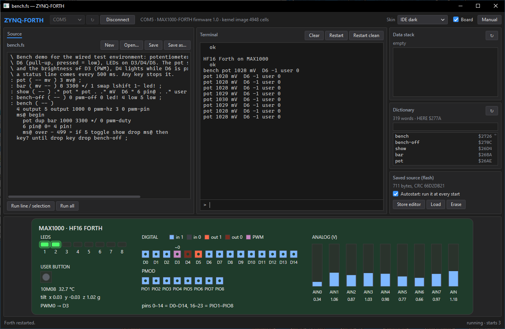

# MAX1000-FORTH — User Manual

MAX1000-FORTH is a small interactive Forth system for the Trenz **MAX1000** (TEI0001-02,
Intel MAX 10 10M08SAU169C8G). Its CPU, the **HF16**, is the 16-bit stack machine of
[ZYNQ-FORTH](https://github.com/andiepp/ZYNQ-FORTH), built in the FPGA. Every HF16
instruction is a Forth primitive. There is no soft processor and no second processor:
the Forth kernel is part of the FPGA configuration, and Forth talks directly over the
board's USB serial port, where the **ZYNQ-FORTH app** or any terminal program talks to it.

Besides the board's 8 LEDs and its user button, Forth reaches the 23 digital pins of the
Arduino-style header and the Pmod header, with four PWM channels, a DDS square-wave
generator, two UARTs, two SPI masters and an I2C master on any of them, the 9 analog inputs and
the temperature diode of the MAX 10's built-in converter, the board's LIS3DH
**accelerometer**, and its 8 MB **serial flash**, which also keeps one Forth source that runs
at every start.

This manual covers how to use the system, how the implementation works, and every word in
the kernel. It describes MAX1000-FORTH 1.3. For the hardware details (I/O map, pins, ADC
channels, service requests), see [design.md](design.md).

Contents:

- **[1. Getting started](#1-getting-started)**
  - [1.1 What you need](#11-what-you-need)
  - [1.2 Put MAX1000-FORTH on the board](#12-put-max1000-forth-on-the-board)
  - [1.3 Connect](#13-connect)
  - [1.4 First session](#14-first-session)
- **[2. The ZYNQ-FORTH app](#2-the-zynq-forth-app)**
  - [2.1 Connecting](#21-connecting)
  - [2.2 The layout](#22-the-layout)
  - [2.3 How the app talks to the MAX1000](#23-how-the-app-talks-to-the-max1000)
  - [2.4 The terminal](#24-the-terminal)
  - [2.5 The editor](#25-the-editor)
  - [2.6 The data stack and the dictionary](#26-the-data-stack-and-the-dictionary)
  - [2.7 The saved source](#27-the-saved-source)
  - [2.8 The board view](#28-the-board-view)
  - [2.9 A worked session](#29-a-worked-session)
- **[3. Working with the interpreter](#3-working-with-the-interpreter)**
  - [3.1 Input line](#31-input-line)
  - [3.2 Words and numbers](#32-words-and-numbers)
  - [3.3 Stack notation](#33-stack-notation)
  - [3.4 Errors](#34-errors)
- **[4. How the implementation works](#4-how-the-implementation-works)**
  - [4.1 The pieces](#41-the-pieces)
  - [4.2 The HF16 CPU](#42-the-hf16-cpu)
  - [4.3 Memory map](#43-memory-map)
  - [4.4 Dictionary entries](#44-dictionary-entries)
  - [4.5 What a colon definition compiles to](#45-what-a-colon-definition-compiles-to)
  - [4.6 Start-up and restarts](#46-start-up-and-restarts)
  - [4.7 The saved source (autostart)](#47-the-saved-source-autostart)
  - [4.8 Service requests (the app)](#48-service-requests-the-app)
- **[5. Word reference](#5-word-reference)**
  - [5.1 Data stack](#51-data-stack)
  - [5.2 Return stack](#52-return-stack)
  - [5.3 Arithmetic](#53-arithmetic)
  - [5.4 Logic and shifts](#54-logic-and-shifts)
  - [5.5 Comparison](#55-comparison)
  - [5.6 Memory](#56-memory)
  - [5.7 Dictionary space and data RAM](#57-dictionary-space-and-data-ram)
  - [5.8 Terminal input and output](#58-terminal-input-and-output)
  - [5.9 Number base](#59-number-base)
  - [5.10 Board I/O](#510-board-io)
  - [5.11 Digital pins](#511-digital-pins)
  - [5.12 Analog inputs and temperature](#512-analog-inputs-and-temperature)
  - [5.13 PWM](#513-pwm)
  - [5.14 DDS square-wave generator](#514-dds-square-wave-generator)
  - [5.15 Serial interfaces: UART, SPI, I2C](#515-serial-interfaces-uart-spi-i2c)
  - [5.16 Accelerometer](#516-accelerometer)
  - [5.17 Serial flash](#517-serial-flash)
  - [5.18 Saved source](#518-saved-source)
  - [5.19 Defining words](#519-defining-words)
  - [5.20 Control structures](#520-control-structures)
  - [5.21 Compiler and execution](#521-compiler-and-execution)
  - [5.22 Comments](#522-comments)
  - [5.23 Interpreter and system](#523-interpreter-and-system)
  - [5.24 Variables and constants used by the system](#524-variables-and-constants-used-by-the-system)
  - [5.25 Internal words](#525-internal-words)
- **[6. Examples](#6-examples)**
  - [6.1 LEDs and the user button](#61-leds-and-the-user-button)
  - [6.2 Digital pins](#62-digital-pins)
  - [6.3 Analog inputs, temperature and accelerometer](#63-analog-inputs-temperature-and-accelerometer)
  - [6.4 PWM and DDS](#64-pwm-and-dds)
  - [6.5 Serial interfaces](#65-serial-interfaces)
  - [6.6 A buffer in the data RAM](#66-a-buffer-in-the-data-ram)
  - [6.7 Data in the serial flash](#67-data-in-the-serial-flash)
  - [6.8 The bench demo: examples/bench.fs](#68-the-bench-demo-examplesbenchfs)
  - [6.9 An application that starts with the board](#69-an-application-that-starts-with-the-board)
- **[7. Differences from standard Forth](#7-differences-from-standard-forth)**
- **[8. Changing the kernel](#8-changing-the-kernel)**
- **[9. Troubleshooting](#9-troubleshooting)**

---

## 1. Getting started

### 1.1 What you need

- A Trenz **MAX1000** with the **10M08SAU169C8G** (TEI0001-02) and a micro-USB cable.
  MAX1000-FORTH is built for this device; a board with another MAX 10 needs its own build
  (chapter 8).
- To write MAX1000-FORTH into the FPGA, once: the **Arrow USB Blaster** driver (the
  MAX1000's on-board programmer) and the Intel **Quartus Prime Programmer**, either the
  standalone Programmer or the one that comes with Quartus Prime.
- To work with it: on Windows the **ZYNQ-FORTH app**, release 2.4 or later. Any system can
  use a terminal program instead.
- Optionally Python 3 with pyserial (`pip install pyserial`) for `tools/mforth.py`, which
  sends files and saves a source in the board's flash from the command line.

### 1.2 Put MAX1000-FORTH on the board

Paths in this manual are relative to the **MAX1000-FORTH folder**: the folder of an unpacked
release, or the repository. Commands run in that folder.

1. Download `MAX1000-FORTH-1.0.zip` from
   [the releases](https://github.com/andiepp/MAX1000-FORTH/releases) and unpack it. It
   holds:

   | Path | Content |
   |---|---|
   | `firmware\max1000_forth.pof` | the configuration for the MAX 10's internal flash |
   | `firmware\max1000_forth.sof` | the same configuration for the FPGA only, until power-off |
   | `firmware\program_flash.ps1` | writes one of the two to the board |
   | `tools\mforth.py` | sends lines and files, saves a source in the flash |
   | `examples\` | Forth examples (`bench.fs`, section 6.8) |
   | `docs\` | this manual (`Manual.pdf`) and `design.md` |
   | `README.md`, `LICENSE`, `CHANGELOG.md` | |

2. Install the Arrow USB Blaster driver and the Quartus Prime Programmer.
3. Plug the board in and run the script in PowerShell:
   ```powershell
   .\firmware\program_flash.ps1
   ```
   It finds `quartus_pgm` from Quartus Prime or the standalone Programmer and writes
   `firmware\max1000_forth.pof` into the MAX 10's internal configuration flash.
4. Press the board's **RESET** button (or unplug and plug the board in again). The MAX 10
   loads the new configuration and Forth starts: **LED1** lights up.

The internal flash keeps MAX1000-FORTH until something else is written there; it replaces
the configuration the board had before (for example the factory demo). The 8 MB serial
flash is a separate chip, and the Forth source you save there (section 2.7) is not touched
by programming the FPGA.

To try MAX1000-FORTH without replacing the board's configuration,
`.\firmware\program_flash.ps1 -Sram` loads `firmware\max1000_forth.sof` into the FPGA
only. It runs until the board loses power or RESET is pressed; then the configuration in the
internal flash starts again.

From the repository, after building (chapter 8), the same is done with `quartus_pgm`:

```powershell
quartus_pgm -c 1 -m JTAG -o "p;build/output_files/max1000_forth.pof"    # internal flash
quartus_pgm -c 1 -m JTAG -o "p;build/output_files/max1000_forth.sof"    # FPGA only
```

### 1.3 Connect

The MAX1000's USB chip (from FTDI) has two channels: channel A is the JTAG
programmer, channel B the serial port Forth uses. Windows shows channel B as a USB serial
port. Its number differs from PC to PC (COM3, COM5, COM17 …); the Device Manager lists it
under *Ports*, and this manual writes it as **COMx**. Start the app, choose that port and
click **Connect** (chapter 2). Or use a terminal program:

| Setting | Value |
|---|---|
| Port | the board's USB serial port, COMx |
| Speed | 115200 baud, 8 data bits, no parity, 1 stop bit, no handshake |
| Enter key | sends CR (PuTTY's default) |
| Local echo | off (Forth echoes what you type) |

Only one program can use the serial port at a time.

### 1.4 First session

```
HF16 Forth on MAX1000
2 3 + . 5  ok
: square dup * ;  ok
7 square . 49  ok
```

Type a line and press Enter. Forth runs the line from left to right and answers ` ok`.
Output appears on the same line as your input, as is usual in Forth. (To see the banner in a
terminal program, connect first and then press Ctrl-R.)

**Ctrl-R** restarts Forth. It is handled in hardware, so it works at any time, also while a
word is caught in an endless loop. It removes all words you have defined: the dictionary goes
back to the kernel's. In the app, the **Restart** button does the same.

The board's **RESET** button is something else: it is the MAX 10's nCONFIG input and reloads
the whole FPGA configuration from the internal flash, which also restarts Forth. Forth cannot
read it. The **USER** button beside it belongs to Forth (`btn@`, section 5.10).

---

## 2. The ZYNQ-FORTH app

The app of the sister project [ZYNQ-FORTH](https://github.com/andiepp/ZYNQ-FORTH) works with
MAX1000-FORTH since its release 2.4. Download `ZYNQ-FORTH-2.4-windows-x64.zip` (or a later
release) from [its releases](https://github.com/andiepp/ZYNQ-FORTH/releases), unpack it and
start **ZynqForth.exe**. The app recognises the MAX1000 by its answer to the `version`
request and adapts itself. Its **Manual** button (F1) opens the ZYNQ-FORTH manual, which
describes the app in full; this chapter covers what you need with a MAX1000.

The app is a small development environment for the HF16 on Windows:

- an **editor** for Forth source files, sent to Forth in whole or in part;
- a **terminal** that sends lines to Forth and shows what it prints;
- the **data stack** and the **dictionary**, read from the running Forth;
- the one **saved source** kept in the board's serial flash, which runs at every start;
- the **board view**: LEDs, user button, digital pins, PWM channels and analog inputs, live;
- five **skins**.



*The IDE dark skin after **Run all** of `examples/bench.fs` and `bench` (section 6.8): the
potentiometer on AIN3 stands at about 2.5 V, so LED1 to LED6 are lit and PWM channel 0
drives D3; D4 and D5 are outputs at 0, and a status line comes every 500 ms.*

### 2.1 Connecting

1. Start **ZynqForth.exe**.
2. Choose the board's port in the list at the top left (**↻** looks for ports again) and click
   **Connect**. The app remembers the port.
3. The line beside the button shows the port, *MAX1000-FORTH firmware 1.0* and the size of
   the kernel image. The data stack, dictionary and saved-source boxes fill.

If the board does not answer, the app says so and disconnects: check that MAX1000-FORTH is
on the board (chapter 1), that you chose channel B's port, and that no other program has the
port open. **Disconnect** frees the port for a terminal program. While the app is connected,
only it can use the port.

Start options, for a shortcut: `ZynqForth.exe [--skin "Lab panel"] [--connect [COMx]] [file.fs]`
connects at once (to COMx, or without it to the port the app remembers), chooses a skin, or
opens a file in the editor.

### 2.2 The layout

| Area | Place | What it is for |
|---|---|---|
| Top bar | top | Port, *Connect*, firmware; **Skin**, **Board** and **Manual** at the right |
| **Editor** | left | Forth source files, sent to Forth in whole or in part |
| **Terminal** | middle | Forth's output, the input line, the restarts |
| **Data stack** | top right | The stack at the last prompt, top first |
| **Dictionary** | right | The words Forth knows, newest first |
| **Saved source (flash)** | bottom right | The program in the board's flash and its autostart |
| Board view | below | The board's I/O, live (tick **Board**) |
| Status line | bottom | The last action's result (red for an error); at the right Forth's state and the starts since the configuration was loaded |

The bars between the columns, and above the board view, can be dragged. **Skin** at the top
right changes the look at once: *IDE dark*, *IDE light*, *Green phosphor*, *Amber* or *Lab
panel* (which also switches the board view on).

### 2.3 How the app talks to the MAX1000

On the MAX1000 there is no second processor: the Forth kernel itself answers the app's
requests (section 4.8). It answers them **at the prompt**, and whenever a program **waits in
`ms`, polls `key?`, reads `key` or prints**. A word that only computes, such as a long
`begin … until` loop without `ms` or output, gets no answers until it ends; meanwhile the
status line shows *no answer* and the board view stands still until the word ends or
waits.

**Restart** sends Ctrl-R, which the MAX1000 handles in hardware even during such a loop.
**Restart clean** sends Ctrl-R and then ESC, which skips the saved source (section 4.7).

### 2.4 The terminal

- **Output** shows what Forth printed since the app connected, including the echo of each
  line it received. **Clear** empties it; Forth is not affected.
- **Input line** (the `>` at the bottom). Type a line and press **Enter**. **Up** and
  **Down** bring back earlier lines. The rules of section 3.1 apply: at most 80 characters
  per line, plain ASCII (other characters are sent as `?`).
- **Restart** restarts Forth (Ctrl-R). All words you defined are gone, and with autostart
  on, the saved source runs. **Restart clean** does the same without the saved source.
  Restart is also the way to stop a word that never returns, such as a `begin … again` loop
  or one waiting for `key`.

After each line the app reads the data stack; after a line that defines words (`:`,
`create`, `variable`, `constant`, …) it also reads the dictionary.

### 2.5 The editor

- The title shows the file's name, or *untitled.fs*, and a star while there are unsaved
  changes; the window title repeats it.
- **New**, **Open…**, **Save** (Ctrl+S) and **Save as…** work on files, usually with the
  extension `.fs`. *New*, *Open…*, *Load* and closing the app ask before they discard
  unsaved changes.
- **Run line / selection**, or **F5** in the editor, sends the selected text. With nothing
  selected, it sends the line with the caret and moves the caret to the next line, so F5
  steps through a file line by line.
- **Run all** (Ctrl+F5) sends the whole text to Forth, as if it were typed. The status line
  shows the progress; long texts go in pieces of 4 KB as Forth reads them, so nothing is
  lost. When Forth has read everything, the app reads the stack and the dictionary.

The text goes to Forth exactly as typed, so the rules of chapter 3 apply. A definition may
span several lines. An error discards the rest of its line only (section 3.4): the following
lines still run, so check the terminal after a long run. If an error interrupted a
definition, fix it and run the definition again.

There is no *Pattern* tab with a MAX1000: the board has no pattern generator.

### 2.6 The data stack and the dictionary

Both are answers of the kernel; **↻** asks again.

**Data stack**

- It is the stack as Forth left it at the last ` ok`, exactly what `.s` would print then,
  but top first: before each line, `quit` copies the stack into a buffer that the kernel
  sends to the app (`snap`, section 4.6). While a word runs, the box keeps showing the
  stack of the last prompt.
- Each item shows its position (0 is the top), its value in signed decimal and in hex. The
  line above gives the depth, or says the stack is empty.

**Dictionary**

- The line above the list gives the number of words and `HERE`, the next free byte
  (section 4.3).
- Each word shows its flags (`immediate`, `inline`, section 4.4) and the byte address of its
  code in hex. Your own words come first.
- The box above the list shows only the words containing its text.
- **Double-click** a word to add it to the terminal's input line.

### 2.7 The saved source

The serial flash keeps one Forth source. With **autostart** on, Forth reads it after the
kernel starts, at power-up, after RESET and after every restart, as if it were typed
(section 4.7).

- The line under the heading shows **none**, the length in bytes and the CRC, or
  **damaged** (its check failed: store it again or erase it).
- **Store editor** writes the editor's text to the flash; a source already stored is
  replaced only after you confirm. The app stores at most 65,520 bytes (`mforth.py` up to
  65,535). Writing takes about one second per 10 KB, mostly the time the serial port needs.
  Storing does not run the source. It keeps the autostart setting of the source it replaces;
  a first source is stored with autostart on. A line end is added after the last line if it
  has none.
- **Load** puts the saved source into the editor, for changes or a file of its own.
- **Erase** removes the saved source after you confirm.
- **Autostart: run it at every start** switches the autostart. It can be ticked only while
  a source is stored.

A saved source should end at the prompt. Its last line may start an application that runs
until a key is pressed (section 6.9); one that loops for ever, or waits for `key`, holds
Forth at every start. To get past it, **hold the USER button** while you press RESET or
restart, or click **Restart clean**; then switch the autostart off or erase the source.

### 2.8 The board view

Tick **Board** at the top right (the Lab panel skin ticks it for you). The view shows the
board as Forth sees it, read several times a second:

- the **LEDs** LED1..LED8 (`led!`) and the **USER** button, highlighted while pressed;
- the **digital pins** D0..D14 (Forth's pins 0..14) and, below them, PIO1..PIO8 on the Pmod
  header (pins 16..23). Each pin is coloured by what it does: an input reading 1 or 0, an
  output driving 1 or 0, or a pin owned by a PWM channel (marked `~` and the channel
  number). Open inputs have no pull-ups and may show either level (section 5.11);
- which PWM channels are on, and their pins (*PWM0 → D3*). A pin the DDS drives shows as an
  output (section 5.14), and so do the output pins of the serial interfaces (TX, SCK, MOSI;
  an I2C line only while it is pulled low). The app does not name the serial functions yet;
  the `board` answer carries them (section 4.8);
- the **analog inputs** AIN0..AIN7 and AIN as bars with their voltage, 0 to 3.3 V
  (section 5.12);
- the chip **temperature** and the **tilt** from the accelerometer in g (x, y, z), with an
  app newer than 2.4 (sections 5.12 and 5.16).

The view only reads: Forth's I/O is never changed by it. It is updated only while Forth
answers (section 2.3).

### 2.9 A worked session

This session writes a small program, tries it, and makes it start with the board. The
program is a running light on LED1 to LED8:

```forth
\ lights.fs - a running light on LED1..LED8
: step ( n -- n' ) 2* dup 256 = if drop 1 then ;
: lights ( n -- ) 1 swap 0 do dup led! step 100 ms loop drop 0 led! ;
: hello ." lights ready" cr ;
hello
```

1. Click **New**, type the program into the editor, click **Save as…** and save it as
   `lights.fs`.
2. Click **Run all**. The terminal shows each line followed by ` ok`, and the last line
   prints `lights ready`. `hello`, `lights` and `step` are now the first three words in the
   dictionary.
3. Tick **Board**. In the input line, type `16 lights` and press Enter. LED1 to LED8 light
   one after the other, twice, in 1.6 seconds, on the board and in the view. Press **Up**
   and Enter to run it again.
4. Type `1 2 3`: the data stack shows `3`, `2`, `1`, top first. Type `+` and it shows `5`,
   `1`. Type `drop drop`.
5. Click **Store editor**. The saved-source line shows the length and CRC, and
   **Autostart** is ticked.
6. Click **Restart**. Forth starts again, and the terminal shows the banner followed by
   `lights ready`: the saved source ran (without echo). From now on, `lights` is there
   every time the board starts.
7. To remove it, untick **Autostart** (the source stays in flash) or click **Erase**.

---

## 3. Working with the interpreter

### 3.1 Input line

- A line holds up to 80 characters; characters after the 80th are dropped (and not echoed).
- **Backspace** (or Delete) removes the last character.
- **Enter** runs the line. A CR or an LF ends a line, so a terminal that sends CR LF makes
  an extra empty line, which only prints another ` ok`.
- After the line, Forth prints ` ok` if it is interpreting. While you are in the middle of a
  colon definition (compiling), it prints no ` ok`. A definition may span several lines.
- Characters typed while a word runs wait in the receive buffer (8 KB) until Forth reads
  them. Ctrl-R empties it.

### 3.2 Words and numbers

The input is split at spaces (control characters count as spaces). Each piece is looked up
in the dictionary; if it is a word, it runs (or is compiled, inside a definition). If not,
Forth tries to read it as a number. If that fails too, it is an error.

- **Names are case-insensitive:** `DUP`, `Dup` and `dup` are the same word.
- **Names** may contain any characters except space, up to 31 characters.
- **Numbers** are read in the current `base` (10 at start-up):

| Input | Value |
|---|---|
| `42` | 42 |
| `-42` | −42 |
| `$2A` | 42 (hex regardless of `base`) |
| `-$2A` | −42 |
| `2A` after `hex` | 42 |
| `115200.` | a double number: 49664 and 1 (115200 = 1 × 65536 + 49664), two cells |
| `$1C200.` | the same in hex |

Numbers are 16 bits. Larger numbers wrap around silently: `70000 .` prints `4464`
(70000 − 65536). A number with a **trailing dot** is an unsigned **double number**, two cells
with the high cell on top (`ud`, 0..4,294,967,295); the baud rate of `uart-open` is one
(section 5.15). A minus sign is not allowed there.

### 3.3 Stack notation

This manual describes each word's effect on the data stack as `( before -- after )`, with
the top of the stack on the right. `( a b -- c )` means the word takes `b` (top) and `a`,
and leaves `c`.

| Symbol | Meaning |
|---|---|
| `n` | signed number (−32768..32767) |
| `u` | unsigned number (0..65535) |
| `x` | any cell |
| `f` | flag: 0 = false, −1 = true (any non-zero counts as true) |
| `c` | character or byte (0..255) |
| `a`, `addr` | byte address |
| `ud` | unsigned double number, two cells: low cell, then the high cell on top |
| `lo hi` | a 24-bit flash address: `lo` = bits 15..0, `hi` = bits 23..16 (section 5.17) |
| `xt` | execution token (address of a word's code) |
| `h` | header address of a dictionary entry |
| `"name"` | a name that follows in the input line |

### 3.4 Errors

| Message | Cause | What happens |
|---|---|---|
| `name ?` | word not found and not a number | data stack cleared, back to interpreting |
| ` stack underflow` | a word took more items than were on the stack | data stack cleared |
| ` stack overflow` | more than 20 items on the data stack | data stack cleared |
| ` bad led` | `led-on`, `led-off`, `led-toggle` or `led-mask` got a number outside 1..8 (section 5.10) | data stack cleared |
| ` bad pin` | a pin word got a number that is not a pin (section 5.11) | data stack cleared |
| ` bad input` | `adc@` or `mv@` got an input above 8 (section 5.12) | data stack cleared |
| ` bad channel` | a PWM word got a channel above 3 (section 5.13) | data stack cleared |
| ` bad frequency` | `pwm-hz` got 0, `pwm-khz` a value outside 1..24000, `spi-khz` one outside 1..12000, `i2c-open` one outside 1..1000 | data stack cleared |
| ` pin taken` | a PWM channel, the DDS or a serial interface was to get a pin another one has (section 5.15) | data stack cleared, nothing changed |
| ` bad uart`, ` bad spi` | a UART number other than 0 and 1, an SPI number other than 0 and 1 | data stack cleared |
| ` bad baud` | `uart-open` got 0 or less than 3 Bd | data stack cleared |
| ` bad bits` | `spi-bits` got a width other than 8 and 16 | data stack cleared |
| ` no ack` | the I2C device did not acknowledge in `i2c!` or `i2c@` (wrong address, no device, no pull-ups); a stop was sent | data stack cleared |
| ` i2c timeout` | SCL stayed low for 22 ms (a device stretching too long, or no pull-up on SCL) | data stack cleared |
| ` data RAM full` | `buffer:` asked for more than `unused-data` (section 5.7) | data stack cleared |

After an error, Forth discards the rest of the line, clears the data stack and returns to
interpreting. If the error happened inside a colon definition, that definition stays
unfinished and hidden. It cannot be called, but it still occupies memory. If the error
happened while the saved source was running, the message is followed by
` (in the saved source)` and the rest of the saved source is skipped (section 4.7).

The stack check runs after each word typed at the terminal, not inside definitions. A word
that pushes more than 28 items wraps the stack pointer around, and this is reported as
underflow.

A few words report a problem without an error: `autostart` prints ` no saved source`, and
`store` ` store timeout` or ` store failed` (section 5.18). They leave the rest of the line
running.

---

## 4. How the implementation works

### 4.1 The pieces

```
 app / PuTTY ── USB ── FTDI channel B ── UART ──┐
                                                │
 HF16 system in the MAX 10 ─────────────────────┘
   ├─ HF16 CPU, 48 MHz
   ├─ 24 KB RAM: 16 KB kernel + your words, 8 KB data
   ├─ 8 KB receive and 1 KB send FIFO
   ├─ 8 user LEDs, user button, ms timer
   ├─ 23 digital pins: D0..D14, PIO_01..PIO_08
   ├─ PWM: 4 channels on any pin
   ├─ DDS: square wave on any pin, 192 MHz clock
   ├─ 2 UARTs, 2 SPI masters, I2C master: any pin
   ├─ ADC: AIN, AIN0..AIN7, temperature diode
   ├─ SPI: serial flash (8 MB), LIS3DH accelerometer
   └─ CRC-32 unit
```

There is no ARM, no soft processor and no loader. The RAM's initial contents, the kernel
image, are part of the FPGA configuration, so the kernel is in place the moment the MAX 10
has loaded its configuration. The serial port is connected straight to the CPU's FIFOs.

| Part | File |
|---|---|
| HF16 CPU (from ZYNQ-FORTH; only a RAM-style hint for the stacks added) | `rtl/hf16_cpu.v` |
| Top level: PLL, RAM, UART, I/O registers, pins | `rtl/max1000_forth.v` |
| UART and its FIFOs | `rtl/uart.v`, `rtl/fifo_bram.v` |
| PWM (from ZYNQ-FORTH) | `rtl/pwm.v` |
| DDS square-wave generator | `rtl/dds.v` |
| UART, SPI master, I2C master for the pins (after ZYNQ-FPGA-FORTH32) | `rtl/uart_port.v`, `rtl/spi_port.v`, `rtl/i2c_port.v` |
| ADC scanner around Intel's Modular ADC core | `rtl/adc_scan.v` |
| SPI master (flash, accelerometer) and CRC-32 unit | `rtl/spi_flash.v` |
| Forth kernel, written in Forth | `forth/kernel.fs` |
| Cross-compiler and simulator | `tools/hf16.py` |
| Line sender, source storing | `tools/mforth.py` |
| Build scripts | `scripts/build.ps1`, `scripts/build.tcl` |

The app belongs to the ZYNQ-FORTH project.

### 4.2 The HF16 CPU

- **16-bit cells.** Numbers, addresses and flags are all 16 bits.
- **Two stacks in hardware**, 32 entries each. The **data stack** holds parameters. Its
  top (T) is a register, and the item below it (N) is directly available, so `+`, `swap`
  or `over` each take one clock. The **return stack** holds return addresses, loop
  indices and items moved there with `>r`.
- **One instruction per clock** at 48 MHz (the board's 12 MHz oscillator times 4), so
  about 48 million primitives per second.
- **Five instruction types:** literal (push a number 0..32767), jump, conditional jump,
  call, and ALU. A single ALU instruction can also move the stack pointers, store to
  memory and return from a subroutine.
- **Fast calls and returns:** a call takes one clock. A return is usually merged into the
  last instruction of a word for free.
- Jumps and calls hold 13-bit cell addresses, so **code must lie in the first 16 KB** of the
  RAM. The 8 KB above are for data only.

The instruction encoding is described in ZYNQ-FORTH's `docs/design.md`; it is the same here.

### 4.3 Memory map

| Address | Content |
|---|---|
| `$0000` | jump to `cold` (start-up) |
| `$0002`–`$3165` | the kernel: 376 words with their headers and variables |
| `$3166`–`$3FFF` | free for your definitions (3,738 bytes). `here` shows the next free byte, `unused` how much is left |
| `$4000`–`$5BFF` | data RAM for `buffer:` (7,168 bytes); `unused-data` shows how much is left |
| `$5C00`–`$5FFF` | the kernel's buffers (below; `$5E40`–`$5EFF` is not used) |
| `$6000`–`$7FFF` | no RAM; stores there are ignored |
| `$8000`–`$80FF` | I/O registers (below); they repeat every 256 bytes up to `$FFFF` |

Cells are stored little-endian, low byte first. Cell addresses must be even: `@` and `!`
ignore bit 0. There is no check for a full dictionary: watch `unused`. A definition that
grows past `$3FFF` lands in the data RAM, where it cannot run, and overwrites the data of
`buffer:`.

The kernel's buffers:

| Address | Name | Use |
|---|---|---|
| `$5C00`–`$5CFF` | `pbuf` | one flash page while a source is stored |
| `$5D00`–`$5D51` | `tib` | the input line (82 bytes) |
| `$5D60`–`$5D9F` | `rq` | a service request from the app |
| `$5DA0`–`$5DDF` | `sbuf` | `.s` parks the stack here |
| `$5DE0`–`$5E07` | `ssnap` | the stack at the last prompt, for the app |
| `$5E10`–`$5E1F` | `hdr` | the saved source's header |
| `$5E20`–`$5E3F` | `pin-owner` | the owner of each pin (section 5.15) |
| `$5F00`–`$5FFF` | `lbuf` | the piece of saved source being interpreted |

The I/O registers can also be read and written directly with `@` and `!`:

| Address | Read | Write |
|---|---|---|
| `$8000` | next received byte (removes it from the receive FIFO) | send a byte |
| `$8002` | bit 0 = a byte has arrived, bit 1 = room to send, bit 2 = sending finished | – |
| `$8004` | LED1..LED8 (bits 0..7) | LED1..LED8 |
| `$8006` | bit 0 = USER button pressed | – |
| `$8008` | – | any value: restart Forth, like Ctrl-R |
| `$800A` | millisecond counter | – |
| `$800C` | next received byte without removing it | – |
| `$800E` | number of bytes in the receive FIFO | – |
| `$8010`, `$8018` | port 0, 1: pin levels | – |
| `$8012`, `$801A` | port 0, 1: output latch | output latch |
| `$8014`, `$801C` | port 0, 1: direction, 1 = output | direction |
| `$8016`, `$801E` | port 0, 1: pins driven now (outputs and the pins of PWM, DDS and serial interfaces) | – |
| `$8020` | SPI: the byte received last | SPI: send a byte (starts an exchange) |
| `$8022` | bit 0 = flash selected, bit 1 = busy, bit 2 = accelerometer selected | bit 0 = select the flash, bit 1 = select the accelerometer |
| `$8024` | – | reset the CRC |
| `$8026` | – | add the low byte to the CRC |
| `$8028`, `$802A` | CRC-32, bits 15..0 and 31..16 | – |
| `$8040`–`$8052` | ADC channels 0..8 and the temperature diode (slot 9), 12 bits | – |
| `$8060`–`$8064` | DDS: tuning low, high, control (section 5.14) | DDS registers |
| `$8080`–`$809E` | PWM channels 0..3 (section 5.13) | PWM registers |
| `$80A0`–`$80B8` | UART 0, 1 (section 5.15) | UART registers |
| `$80C0`–`$80DA` | SPI 0, 1 (section 5.15) | SPI registers |
| `$80E0`–`$80E4` | I2C (section 5.15) | I2C registers |

Section 5.11 explains the ports, 5.12 the ADC, 5.13 the PWM registers, 5.14 the DDS, 5.15 the serial interfaces and
5.17 the flash SPI and CRC registers.

### 4.4 Dictionary entries

Every word has a header followed by its code:

```
h:      link     cell: address of the previous header (0 ends the list)
h+2:    count    byte: bits 0..4 = name length, bit 5 = inline, bit 6 = hidden,
                       bit 7 = immediate
h+3:    name     the name's characters, padded to an even address
xt:     code     HF16 instructions
```

`latest` holds the address of the newest header. Searching starts there and follows the
links backwards, so a new definition with an existing name replaces the old one for
everything compiled afterwards.

- **Immediate** words run even while compiling. Examples: `if`, `;`, `."`.
- **Hidden** marks a word whose definition isn't finished yet, so it can't be found.
- **Inline** words are copied into new definitions instead of being called. The
  primitives `dup`, `+`, `@` and others are single instructions. The return-stack words
  `>r`, `r>`, `r@`, `i` and `unloop` *must* be inline: as subroutines they would
  disturb their own return address.

### 4.5 What a colon definition compiles to

`: name ... ;` lays down a header and then, word by word:

| In the source | Compiled as |
|---|---|
| a primitive (`dup`, `+`, `!`, `>r`, ...) | its instruction(s), copied inline |
| any other word | one call instruction |
| a number 0..32767 | one literal instruction |
| any other number | a literal and an `invert` instruction |
| `if` / `while` / `until` | a conditional jump |
| `else` / `again` / `repeat` | a jump |
| `do` | `swap >r >r`, inline |
| `loop` / `+loop` | a call to `(loop)` / `(+loop)`, a conditional jump back, then `unloop` |
| `." text"` | a call to `(.")` followed by the text |
| `;` | a return instruction |

Example: `: square dup * ;` compiles to three instructions: `dup`, `*`, return.

The cross-compiler that builds the kernel also merges a word's final return into the last
instruction when that is free, and turns a final call into a jump. Definitions typed at the
terminal don't get these two optimizations.

### 4.6 Start-up and restarts

**Power-up or RESET.** The MAX 10 loads its configuration from its internal flash, which
also fills the RAM with the kernel image. When the PLL runs, the CPU starts at address 0,
which jumps to `cold`.

**Ctrl-R.** The serial receiver catches the byte 0x12 (Forth never sees it) and resets the
CPU, both serial FIFOs (typed-ahead input is discarded), the LEDs, the pins (all inputs
again), the PWM channels, the DDS and the serial interfaces. The RAM keeps its contents, and the CPU starts at address 0
again. A program can do the same by writing any value to `$8008`. The millisecond counter
keeps running.

**`cold`** then makes Forth fresh: it restores `here` and `latest` from `dp0` and `latest0`,
so the dictionary is the kernel's again, frees the data RAM, counts the start, switches the
accelerometer on (`accel-on`), switches the PWM channels, the DDS and the serial interfaces off
and frees their pins (`units-off`), sets `base` to 10, prints the banner, switches LED1 on, runs
the saved source if autostart is on (`autoload`, section 4.7) and enters `quit`, the
interpreter loop. `quit` copies the data stack for the app's stack view (`snap`), reads a
line (`accept-line`), interprets it (`interpret`), prints ` ok`, and repeats.

Typing `cold` (or `0 execute`) runs the same word without the hardware reset: the
dictionary is reset and the saved source runs again, but the pins keep their state
(the PWM channels, the DDS and the serial interfaces are switched off).

### 4.7 The saved source (autostart)

One Forth source can be kept in the serial flash (from the app, section 2.7, or with
`python tools/mforth.py -p COMx --store file.fs`). It lives in the ZYNQ-FORTH format:

| Flash address | Content |
|---|---|
| `$000000` (a 4 KB sector) | header, 16 bytes, little-endian: magic `HF16`, length (32 bits), CRC-32 of the text, flags (bit 0 = autostart) |
| `$010000` (a 64 KB block) | the text, at most 65,535 bytes, lines end in CR |

With autostart on, `cold` feeds it to Forth at power-up, after RESET and after every
restart, exactly as if it were typed: the definitions are compiled and the commands run.
Its lines are not echoed and get no ` ok` (only the last one, which becomes the first prompt); only what they print appears. The words it
defines are there when the first prompt comes, and its last line may start an application
(section 6.9). The kernel itself is never changed, so a faulty source cannot break the
start for good:

- **ESC within 200 ms** of the start skips it. The app's *Restart clean* and
  `mforth.py --skip` send Ctrl-R followed by ESC.
- **Hold the USER button** while you press RESET or restart, until ` autostart skipped`
  appears (about a quarter of a second after the banner: the button is read after the
  wait for ESC). Forth prints ` autostart skipped` in both cases.
- An **error** in a line of the source stops it: the message is followed by
  ` (in the saved source)`, the words defined before the error exist, the rest of the source
  is not run.
- A source that never returns to the prompt (`begin again`, waiting for `key`) blocks all
  further input; restart clean, then fix or erase it.

Before it runs the source, `cold` checks the header and the CRC of the whole text; a
damaged source does not run. `key` then takes its bytes from the saved source, which the
kernel copies from the flash 256 bytes at a time into a buffer (`lbuf`). The flash is
selected only while a piece is copied, so the lines of a saved source may use every word,
including the flash and accelerometer words. Requests from the app are answered while the
source runs, wherever it waits (`ms`, `key?`, output).

### 4.8 Service requests (the app)

The app speaks protocol 1 of ZYNQ-FORTH (ZYNQ-FORTH's `docs/Protocol.md`): a request is the
byte SOH (0x01), a line of text and LF; the answer is `SOH ok <name> <length> LF <payload>`
or `SOH err <name> <reason> LF`. On the Zynq board an ARM answers; here the kernel does.

Requests arrive in the receive FIFO between terminal bytes. `service?` answers every
request at the head of the FIFO; `key?` calls it and decides on the head byte itself, so a
SOH is never taken as terminal input. `key`, `ms` and the wait in `emit` (while the send
FIFO is full) go through `key?` or `service?`, which is why the app gets answers at the
prompt and whenever a program waits, polls `key?` or prints. A request queued behind
terminal input waits until Forth has read that input. A 0x01 in Forth's own output is sent
twice, so the app can tell it from the start of an answer; a terminal program shows both.

| Request | Answer |
|---|---|
| `version` | `firmware max1000-forth 1.3`, `protocol 1`, `kernel <cells> <checksum>` |
| `status` | state, receive FIFO bytes, starts, the saved source's state, length, CRC, autostart, and whether it ran at the last start |
| `stack`, `words` | the data stack at the last prompt; the dictionary |
| `board` | LEDs and button, both pin ports with the pins driven now, PWM channels, the 9 ADC codes, the temperature code, the accelerometer, the DDS (control and tuning) and the pin functions of the serial interfaces (`fn`: UART0 TX, RX, UART1 TX, RX, SPI0 SCK, MOSI, MISO, SPI1 SCK, MOSI, MISO, I2C SCL, SDA; bit 15 = on, bits 5..0 = the pin) |
| `source`, `store`, `erase`, `autostart on\|off` | the saved source |
| `echo`, `restart [skip]` | a test echo; a restart |

The details are in [design.md](design.md). There is no HASE mode on the MAX1000.

---

## 5. Word reference

The kernel has 376 words. About a third of them are internal: they serve the interpreter,
the compiler, the saved source and the app's requests (sections 5.24 and 5.25). Where a
word differs from standard Forth, its entry says so.

### 5.1 Data stack

| Word | Stack | Description |
|---|---|---|
| `dup` | `( x -- x x )` | Copy the top item. |
| `drop` | `( x -- )` | Remove the top item. |
| `swap` | `( x1 x2 -- x2 x1 )` | Exchange the top two items. |
| `over` | `( x1 x2 -- x1 x2 x1 )` | Copy the second item to the top. |
| `nip` | `( x1 x2 -- x2 )` | Remove the second item. |
| `tuck` | `( a b -- b a b )` | Copy the top item below the second. |
| `rot` | `( a b c -- b c a )` | Rotate the third item to the top. |
| `-rot` | `( a b c -- c a b )` | Rotate the top item to third place. |
| `2dup` | `( a b -- a b a b )` | Copy the top two items. |
| `2drop` | `( a b -- )` | Remove the top two items. |
| `?dup` | `( x -- x x \| 0 )` | Copy the top item only if it is not zero. |
| `depth` | `( -- n )` | Number of items on the data stack, before `depth` itself pushes. |
| `.s` | `( -- )` | Show the stack without changing it: `<3> 1 2 3`, with the depth and the top on the right. |

```
1 2 3 rot .s <3> 2 3 1  ok
```

### 5.2 Return stack

The return stack holds return addresses and, inside `do` loops, the loop index and limit.
You can use it for temporary storage within one definition, but every `>r` needs a
matching `r>` before the word ends or leaves a loop.

| Word | Stack | Description |
|---|---|---|
| `>r` | `( x -- )  R: ( -- x )` | Move the top item to the return stack. |
| `r>` | `( -- x )  R: ( x -- )` | Move the top of the return stack back. |
| `r@` | `( -- x )  R: ( x -- x )` | Copy the top of the return stack. |

These three are inline. They work inside definitions; typed directly at the terminal
they would corrupt the interpreter's own return address.

### 5.3 Arithmetic

All arithmetic is on 16 bits and wraps around without warning.

| Word | Stack | Description |
|---|---|---|
| `+` | `( n1 n2 -- n3 )` | Sum. |
| `-` | `( n1 n2 -- n3 )` | Difference n1 − n2. |
| `*` | `( n1 n2 -- n3 )` | Product, low 16 bits; one instruction (hardware multiplier). |
| `/` | `( n d -- quot )` | Quotient, rounded toward zero: `-7 2 /` gives −3. |
| `mod` | `( n d -- rem )` | Remainder, with the sign of n: `-7 2 mod` gives −1. |
| `/mod` | `( n d -- rem quot )` | Remainder and quotient (symmetric division). |
| `u/mod` | `( u d -- rem quot )` | Unsigned division: `-7 2 u/mod` gives 1 32764. |
| `*/` | `( n1 n2 n3 -- n4 )` | n1 × n2 / n3 with a 32-bit intermediate product, so the product may exceed 16 bits: `3000 1000 4096 */` gives 732. Rounds toward zero. |
| `um*` | `( u1 u2 -- ud )` | Full 32-bit unsigned product as two cells, the high cell on top: `-1 -1 um*` gives 1 −2 (65534). |
| `um/mod` | `( ud u -- rem quot )` | Divide a 32-bit unsigned number by u. The quotient must fit in 16 bits (high cell < u). |
| `1+` | `( n -- n+1 )` | Add one. |
| `1-` | `( n -- n-1 )` | Subtract one. |
| `2*` | `( n -- n*2 )` | Double. |
| `2/` | `( n -- n/2 )` | Arithmetic shift right; keeps the sign (`-8 2/` gives −4). |
| `negate` | `( n -- -n )` | Change the sign. |
| `abs` | `( n -- u )` | Absolute value. `-32768 abs` stays −32768 (as u: 32768). |
| `min` | `( a b -- min )` | Smaller of two signed numbers. |
| `max` | `( a b -- max )` | Larger of two signed numbers. |
| `umin` | `( u1 u2 -- u )` | Smaller of two unsigned numbers: `-1 3 umin` gives 3. |

Division is done in software by shift-and-subtract (16 steps). Division by zero gives no
error: `u/mod` then returns −1 as the quotient. `*/` and `um/mod` give a meaningless
result if the quotient doesn't fit in 16 bits.

`*/` is the usual way to scale with fractions: `x 3300 4096 */` turns an ADC code into
millivolts without losing the high bits of the product (that is what `mv@` does). `um*`
gets its high cell from a dedicated CPU instruction (the high half of the hardware
multiplier).

### 5.4 Logic and shifts

| Word | Stack | Description |
|---|---|---|
| `and` | `( x1 x2 -- x3 )` | Bitwise AND. |
| `or` | `( x1 x2 -- x3 )` | Bitwise OR. |
| `xor` | `( x1 x2 -- x3 )` | Bitwise exclusive OR. |
| `invert` | `( x -- ~x )` | Invert all bits. Also turns a true flag into false and back. |
| `lshift` | `( x u -- x' )` | Shift left by u bits; u ≥ 16 gives 0. |
| `rshift` | `( x u -- x' )` | Logical shift right by u bits (fills with 0); u ≥ 16 gives 0. |

### 5.5 Comparison

The comparison words return −1 (true) or 0 (false). `if`, `until` and `while` treat any
non-zero value as true.

| Word | Stack | Description |
|---|---|---|
| `=` | `( x1 x2 -- f )` | Equal. |
| `<>` | `( a b -- f )` | Not equal. |
| `<` | `( n1 n2 -- f )` | n1 less than n2, signed. |
| `>` | `( a b -- f )` | a greater than b, signed. |
| `u<` | `( u1 u2 -- f )` | Less than, unsigned: `-1 1 u<` is false. |
| `u>` | `( a b -- f )` | Greater than, unsigned. |
| `0=` | `( x -- f )` | x is zero; also a logical NOT. |
| `0<>` | `( x -- f )` | x is not zero. |
| `0<` | `( n -- f )` | n is negative. |
| `0>` | `( n -- f )` | n is positive. |
| `within` | `( n lo hi -- f )` | lo ≤ n < hi; works for signed and unsigned ranges. |

### 5.6 Memory

| Word | Stack | Description |
|---|---|---|
| `@` | `( a -- x )` | Fetch the cell at a (bit 0 of a ignored). |
| `!` | `( x a -- )` | Store x at a. |
| `c@` | `( a -- c )` | Fetch the byte at a. |
| `c!` | `( c a -- )` | Store the low byte of c at a. |
| `+!` | `( n addr -- )` | Add n to the cell at addr. |
| `?` | `( a -- )` | Print the cell at a, like `@ .`. |
| `cells` | `( n -- n*2 )` | Size of n cells in bytes. |
| `cell+` | `( a -- a+2 )` | Address of the next cell. |
| `aligned` | `( a -- a' )` | Round a up to an even address. |
| `cmove` | `( src dst n -- )` | Copy n bytes from src to dst, lowest address first. |

```
variable x  5 x !  3 x +!  x ? 8  ok
```

### 5.7 Dictionary space and data RAM

New definitions and data are added at `here`, the next free byte of the code space
(`$0000`..`$3FFF`). Larger data, such as sample buffers, belong in the **data RAM**
(`$4000`..`$5BFF`), which `buffer:` hands out; it does not use up the space for code.

| Word | Stack | Description |
|---|---|---|
| `here` | `( -- a )` | Address of the next free byte. |
| `allot` | `( n -- )` | Reserve n bytes at `here` (a negative n gives memory back). |
| `align` | `( -- )` | Make `here` even. |
| `,` | `( x -- )` | Align, store x at `here`, advance by one cell. |
| `c,` | `( c -- )` | Store a byte at `here`, advance by one byte. |
| `unused` | `( -- n )` | Free code space: `$4000` minus `here`. |
| `buffer: name` | `( n "name" -- )` | Reserve n bytes of data RAM (rounded up to even, so cells stay aligned); `name` then pushes their address. ` data RAM full` if fewer than n bytes are left. |
| `unused-data` | `( -- n )` | Free data RAM in bytes. |

A fresh kernel leaves 3,738 bytes of code space and 7,168 bytes of data RAM. `buffer:`
rounds odd sizes up, so every buffer starts at an even address. The data RAM is not cleared, and a restart frees all of it, together with the
words that named the buffers.

```
create table 1 , 2 , 4 , 8 ,
table 2 cells + ? 4  ok
100 buffer: buf  ok
buf . unused-data . 16384 7068  ok
```

### 5.8 Terminal input and output

| Word | Stack | Description |
|---|---|---|
| `key` | `( -- c )` | Wait for a character from the terminal. Answers the app's requests while it waits. |
| `key?` | `( -- f )` | True if a character is waiting (does not take it). Answers the app's requests waiting before it. |
| `emit` | `( c -- )` | Send a character (waits while the 1 KB send FIFO is full). |
| `cr` | `( -- )` | New line (sends CR and LF). |
| `space` | `( -- )` | Send one space. |
| `spaces` | `( n -- )` | Send n spaces (nothing for n ≤ 0). |
| `type` | `( a n -- )` | Send n characters starting at a. |
| `.` | `( n -- )` | Print a signed number in the current base, then a space. |
| `u.` | `( u -- )` | Print an unsigned number, then a space: `-1 u.` gives 65535. |
| `." text"` | `( -- )` | Compile only: print `text` when the definition runs. |
| `.( text)` | `( -- )` | Print `text` immediately, in a definition or at the terminal. |

Digits above 9 print as capital letters: `255 hex . decimal` gives `FF`.

```
: hello ." Hello, MAX1000!" cr ;
hello Hello, MAX1000!
 ok
```

### 5.9 Number base

| Word | Stack | Description |
|---|---|---|
| `base` | `( -- a )` | Variable holding the base for number input and output (2..36). |
| `hex` | `( -- )` | Set the base to 16. |
| `decimal` | `( -- )` | Set the base to 10. |

`5 2 base ! . decimal` prints 5 in binary: `101`. The base applies to input as well,
so the 5 has to be typed before switching. After `2 base !`, typing `5` gives `5 ?`.
An error doesn't reset `base`; type `decimal` to get back.

### 5.10 Board I/O

| Word | Stack | Description |
|---|---|---|
| `led!` | `( n -- )` | Set LED1..LED8 from bits 0..7 of n (1 = on; bit 0 = LED1). |
| `led@` | `( -- n )` | Read back the LED state. |
| `led-on` | `( n -- )` | Switch LED n (1..8) on; the other LEDs stay as they are. |
| `led-off` | `( n -- )` | Switch LED n (1..8) off; the other LEDs stay as they are. |
| `led-toggle` | `( n -- )` | Change LED n (1..8): on becomes off, off becomes on. |
| `led-mask` | `( n -- mask )` | The bit of LED n in `led!` (1 for LED1 … 128 for LED8); ` bad led` for n outside 1..8. |
| `btn@` | `( -- f )` | The USER button: true while pressed. Debounced (sampled every 10 ms). |
| `ms` | `( n -- )` | Wait n milliseconds (0..32767). Answers the app's requests while it waits. |
| `ms@` | `( -- n )` | Millisecond counter; wraps every 65.536 s. |

`led!` sets all eight LEDs at once; `led-on`, `led-off` and `led-toggle` change one LED and
leave the others alone (they read the state with `led@`, change one bit and write it back).
The LED numbers are those printed on the board, LED1..LED8. `ms` waits at least n ms and
less than n + 1. `btn@` reads "not pressed" for the first 10 ms after a restart. The RESET
button cannot be read (section 1).

```
$81 led!          \ LED1 and LED8 on, all others off
3 led-on          \ LED3 on as well: LED1, LED3 and LED8 are lit
1 led-off         \ LED1 off: LED3 and LED8 stay on
led@ .            \ prints 132 ($84)
: blink3 10 0 do 3 led-toggle 200 ms loop ;
btn@ .            \ hold the USER button while pressing Enter: prints -1
```

### 5.11 Digital pins

The digital pins are numbered after their labels on the board:

| Pin numbers | Label | Header |
|---|---|---|
| 0..14 | D0..D14 | the Arduino-style digital header |
| 16..23 | PIO_01..PIO_08 | the Pmod header (PIO1..PIO8 in the app) |

Pin 15 and pins 24 and up do not exist; the pin words answer ` bad pin` for them. Every
pin is an **input after start-up** and after Ctrl-R. `output` makes it drive the level of
its output latch, which starts low.

| Word | Stack | Description |
|---|---|---|
| `output` | `( n -- )` | Make pin n an output. |
| `input` | `( n -- )` | Make pin n an input again. |
| `high` | `( n -- )` | Set the pin's output latch to 1 (3.3 V when it is an output). |
| `low` | `( n -- )` | Set the output latch to 0. |
| `toggle` | `( n -- )` | Invert the output latch. |
| `pin!` | `( f n -- )` | `high` if f is true, otherwise `low`. |
| `pin@` | `( n -- f )` | Read the level at the pin: true = high. Also works on outputs, where it reads back the driven level. |
| `pin` | `( n -- mask a )` | Bit mask and port address of pin n; ` bad pin` for numbers that are not pins. |
| `bset` | `( mask a -- )` | Set the mask bits in the cell at a (a general helper). |
| `bclr` | `( mask a -- )` | Clear the mask bits in the cell at a. |
| `owner` | `( n -- id )` | Who has pin n (section 5.15): 0 = nobody (the pin follows its latch and direction), 1..4 = PWM channel 0..3, 5, 6 = UART 0, 1, 7, 8 = SPI 0, 1, 9 = I2C, 10 = DDS. |

`high` and `low` work on inputs too: they only set the latch. Setting the level first and
then calling `output` makes the pin start at that level without a short glitch.

```
3 output  3 high            \ D3 to 3.3 V
3 pin@ . -1  ok
3 low  3 input              \ back to an input
```

**No pull-ups.** The pins have no pull-up or pull-down resistors, so **an open input reads at
random**. A push button from a pin to GND needs a resistor of about 10 kΩ from the pin to
3.3 V. Alternatively, the FPGA can be built with its weak pull-ups switched on for all D and
PIO pins (`scripts\build.ps1 -PullUps`, chapter 8); then an open input reads high and a
button to GND needs no resistor. The pull-ups are fixed in the configuration; Forth cannot
switch them.

**Electrical.** The pins are **3.3 V only; they are not 5 V tolerant.** Keep the current to
a few mA, which is enough for an LED with a resistor of 330 Ω to 1 kΩ.

**Speed.** `toggle`, `high`, `low` and `pin@` take about 1 µs each, so a loop of `toggle`
makes a square wave of a few hundred kHz. Each input is synchronized to the 48 MHz clock
through two flip-flops.

**Whole ports.** The pins are bits of two 16-bit ports. Pin n is bit n mod 16 of port
n / 16. Each port has three registers: pin levels at `$8010 + 8p`, the output latch at
`$8012 + 8p`, and the direction at `$8014 + 8p` (1 = output); a fourth, `$8016 + 8p`, reads
which pins are driven now, by their latch or by a peripheral. Writing whole ports
changes several pins at once:

```
255 $8014 !                 \ D0..D7 as outputs
170 $8012 !                 \ D1, D3, D5, D7 high, the others low
$8010 @ 255 and .           \ read D0..D7 at once
```

### 5.12 Analog inputs and temperature

The MAX 10 contains a 12-bit **ADC**. It converts the nine analog inputs and the chip's
temperature sensing diode continuously in the background, so reading a value takes no
waiting; each input is refreshed many times per millisecond. The reference is the 3.3 V
supply: 0..3.3 V give the codes 0..4095.

The inputs are numbered after their labels on the board:

| `adc@` input | 0 | 1 | 2 | 3 | 4 | 5 | 6 | 7 | 8 |
|---|---|---|---|---|---|---|---|---|---|
| Board label | AIN0 | AIN1 | AIN2 | AIN3 | AIN4 | AIN5 | AIN6 | AIN7 | AIN |
| ADC channel | 8 | 2 | 5 | 1 | 3 | 4 | 7 | 6 | 0 |

AIN is the MAX 10's dedicated analog input; AIN0..AIN7 are dual-purpose pins. The table
`ain` maps the inputs to the converter's channels, which `adc-ch@` reads directly.

| Word | Stack | Description |
|---|---|---|
| `adc@` | `( n -- u )` | Raw result of input n (0..8, the table above): 0..4095 for 0 to 3.3 V. ` bad input` for other numbers. |
| `mv@` | `( n -- mv )` | The input's voltage in millivolts: 0..3299. |
| `adc-ch@` | `( c -- u )` | Raw result of ADC channel c, 0..8, in the converter's own numbering; 9 is the temperature diode. |
| `ain` | `( -- a )` | Table of 9 bytes: the ADC channel of each input (used by `adc@`). |
| `temp-code@` | `( -- u )` | Raw code of the temperature sensing diode, a running average of 64 samples. It falls as the chip warms. |
| `temp@` | `( -- n )` | Chip temperature in tenths of a degree Celsius: 346 means 34.6 °C. |
| `.temp` | `( -- )` | Print the chip temperature, for example `34.6 C`. |

```
3 mv@ . 1650  ok            \ for example: a potentiometer half way
.temp 34.6 C  ok
temp-code@ . 3640  ok
```

The readings shown come from the simulator (chapter 8); on the board your values differ.

**Range.** Keep every analog input between 0 and 3.3 V. Voltages near 3.3 V read as
3299 mV.

**Open inputs.** An input with nothing connected does not read 0: it shows the charge left
on the converter by the channel converted before it. Only driven inputs give meaningful
values. To make high-impedance sources (a potentiometer of tens of kΩ) read right, the
converter samples each channel four times in a row and keeps only the last result.

**Temperature.** `temp@` interpolates linearly between two points of Intel's table for the
diode, −40 °C = 3798 and 96 °C = 3510, so it is approximate: expect a few degrees of error.
It is the die temperature, typically somewhat above the room.

### 5.13 PWM

Four PWM channels, 0..3, make square waves of variable frequency and duty cycle in the
FPGA, independently of Forth: once set, a channel runs on its own, also while Forth
computes or waits for input. Each channel drives **any digital pin** (section 5.11).

| Word | Stack | Description |
|---|---|---|
| `pwm-pin` | `( pin ch -- )` | Route channel ch to the pin and start it. The pin becomes an output driven by the channel; ` bad pin` for numbers that are not pins, ` pin taken` if another channel, the DDS or a serial interface has it. A channel that had another pin lets it go. |
| `pwm-off` | `( ch -- )` | Stop the channel. Its pin returns to its own latch and direction (an input after start-up). |
| `pwm-hz` | `( u ch -- )` | Frequency in Hz, 1..65535; ` bad frequency` for 0. |
| `pwm-khz` | `( u ch -- )` | Frequency in kHz, 1..24000; ` bad frequency` outside. |
| `pwm-duty` | `( permille ch -- )` | Duty cycle in ‰ (tenths of a percent), 0..1000: 0 is always low, 1000 always high; values outside are clamped. |
| `pwm-clocks` | `( ud ch -- )` | The period directly, in 48 MHz clocks (20.8 ns), as a double number: low cell, then high cell. At least 2. |
| `pwm` | `( ch -- a )` | Register address of channel ch; ` bad channel` for ch above 3. |
| `ud/u` | `( ud u -- ud' )` | Unsigned double divided by an unsigned single, giving a double quotient (used by `pwm-hz`). |

The order does not matter: frequency, duty and pin can be set in any order and changed at
any time. **A change takes effect at the end of the running cycle,** so a pulse is never
cut short and the frequency or duty can be swept while the channel runs. After start-up,
and after Ctrl-R, every channel is off with a period of 2 clocks (24 MHz) and duty 0.

```
1000 0 pwm-hz  250 0 pwm-duty  3 0 pwm-pin    \ D3: 1 kHz, 25 % high
500 0 pwm-duty                                \ now 50 %
2 1 pwm-hz  100 1 pwm-duty  4 1 pwm-pin       \ D4: 2 Hz, 50 ms pulses
0 pwm-off  1 pwm-off
```

**Resolution.** The period is counted in clocks of 20.8 ns, so a frequency is exact when
48,000,000 divided by it is a whole number; otherwise the period is rounded down
(`pwm-khz` divides 48,000 by the kHz value). The duty cycle is set in steps of 1/65536 of the
period, and the pulse is a whole number of clocks: at 1 kHz (48,000 clocks) the duty can be
set to about 0.002 %, at 1 MHz (48 clocks) only in steps of about 2 %. For a fine duty
cycle, keep the frequency well below 1 MHz.

A pin belongs to one channel at a time (section 5.15). The pin's level can be read with
`pin@` like any output.

**Checking it without an instrument.** A PWM pin filtered by a resistor and a capacitor
(10 kΩ from the pin to an analog input, 1 µF from that input to GND) gives a DC voltage of
duty × 3.3 V, which the ADC reads (section 6.4).

**Registers.** Channel c is at `$8080` + 8c:

| Address | Register |
|---|---|
| +0 | period, low 16 bits (taken when the high half is written) |
| +2 | period, high 16 bits; writing it sets the period in clocks |
| +4 | duty, in 1/65536 of the period; `$FFFF` = always high |
| +6 | bit 15 = on, bits 5..0 = pin number |

```
1000 0 pwm-hz  0 pwm @ u. 48000  ok
```

### 5.14 DDS square-wave generator

For a square wave of an exact, finely set frequency there is a DDS (direct digital
synthesis) generator: a 32-bit phase accumulator on its own 192 MHz clock, whose top bit is
the output. It drives **any digital pin**, like a PWM channel, and runs on its own once set.

| Word | Stack | Description |
|---|---|---|
| `dds-hz` | `( u -- )` | Frequency in Hz, 0..65535. |
| `dds-khz` | `( u -- )` | Frequency in kHz, 0..65535 (up to 65.5 MHz). |
| `dds-tuning` | `( ud -- )` | The phase step directly: f = ud × 192 MHz / 2³² (low cell, then high cell). |
| `dds-pin` | `( pin -- )` | Route the DDS to the pin and start it at phase 0; ` bad pin` for numbers that are not pins, ` pin taken` if a PWM channel or a serial interface has it. |
| `dds-off` | `( -- )` | Stop it; the pin returns to its own latch and direction. |
| `dds-sync` | `( -- )` | Wait until the generator has taken over the last change (the others do this themselves). |

The frequency resolution is 192 MHz / 2³² = 0.0447 Hz, so `1 dds-hz` gives 0.98 Hz and
`1000 dds-hz` 1000.01 Hz: the error is below 0.05 Hz everywhere, which matters only at very low
frequencies. The edges fall on a 5.2 ns grid. A frequency that does not divide 192 MHz
evenly is therefore made of periods that differ by one 5.2 ns step, which averages to the exact
value (at 1 MHz: ±0.5 % jitter per period, at 10 MHz ±5 %). Above about 20 MHz the
shape is limited by the pin and its wiring. A change of frequency takes effect at once and
keeps the phase running, so a sweep has no gaps; `dds-pin` restarts the phase.

```
1000 dds-hz  3 dds-pin        \ D3: 1 kHz
1500 dds-khz                  \ now 1.5 MHz
dds-off
```

`dds-hz` and `dds-khz` compute the phase step hz × 2³² / 192,000,000 = hz × 2²⁰ / 46875 by
long division, 16 bits at a time with `um/mod`, and round it (`(dds-hz) ( ud -- )` takes the
frequency in Hz as a double number; `dds-d` is the constant 46875). The
DDS registers are at `$8060`:

| Address | Register |
|---|---|
| `$8060` | tuning, low 16 bits (taken when the high half is written) |
| `$8062` | tuning, high 16 bits; writing it sets the frequency |
| `$8064` | bit 15 = on, bits 5..0 = pin number; read: bit 14 = a change not yet taken over |

```
1000 dds-hz  $8060 @ hex . decimal 5762  ok
```

### 5.15 Serial interfaces: UART, SPI, I2C

Two **UARTs**, two **SPI** masters and an **I2C** master run in the FPGA, as in
ZYNQ-FPGA-FORTH32, and put each of their signals on **any digital pin** (section 5.11). They
work on their own once started: a UART receives into its buffer while Forth computes, and an
SPI or I2C transfer runs while Forth waits for it.

**Pins belong to one user.** A pin given to an interface, a PWM channel or the DDS belongs to
it until that one is closed or switched off: its latch and direction no longer count, and
nobody else can take it (` pin taken`). The open words check all their pins first, so a
refused open changes nothing. `owner` tells who has a pin. A restart, Ctrl-R or `cold`
closes everything.

| Word | Stack | Description |
|---|---|---|
| `owner` | `( pin -- id )` | 0 = nobody, 1..4 = PWM channel 0..3, 5, 6 = UART 0, 1, 7, 8 = SPI 0, 1, 9 = I2C, 10 = DDS. ` bad pin` for numbers that are not pins. |

**UART** u = 0 or 1: 8 data bits, no parity, 1 stop bit (8N1). Each has a 1 KB receive
buffer and a 1 KB send buffer in the FPGA, so nothing is lost while Forth does something else
for a while.

| Word | Stack | Description |
|---|---|---|
| `uart-open` | `( ud-baud tx rx u -- )` | Open UART u at the baud rate, a double number (`115200.`), with TX and RX on the given pins. ` bad baud` for 0 or less than 3 Bd; above 6,000,000 Bd it runs at 6 MBd. Opening an open UART again moves it to the new pins and rate. |
| `uart-close` | `( u -- )` | Close it and empty its buffers; its pins return to their own latch and direction. |
| `uart-emit` | `( c u -- )` | Send a byte; waits only while the send buffer is full. |
| `uart-type` | `( a n u -- )` | Send n bytes from a. |
| `uart-key?` | `( u -- f )` | True if a byte has arrived. |
| `uart-key` | `( u -- c )` | The next byte, waiting for it. The app's requests are answered while it waits. |
| `uart-status` | `( u -- bits )` | Bit 2 = everything sent, bit 3 = bytes were lost (the receive buffer was full), bit 4 = a framing error (wrong baud rate, or a break). Reading clears bits 3 and 4. |

The UART counts **48,000,000 / baud** clocks per bit, rounded: 115,200 Bd gives 417 clocks
(115,108 Bd, 0.08 % slow), 9600 gives 5000 (exact), 230,400 gives 208 and 921,600 gives 52
(both 0.16 % fast), 1,000,000 and 3,000,000 are exact. A UART tolerates about 2 %, so every
usual rate works. The levels are 3.3 V: a PC's RS-232 port needs a level converter, a USB
serial adapter for 3.3 V can be connected directly (its TX to our RX, its RX to our TX, GND
to GND).

```
115200. 0 1 0 uart-open      \ UART 0: TX on D0, RX on D1
72 0 uart-emit 105 0 uart-emit
0 uart-key? .                \ -1 if something came back
0 uart-close
```

A **loopback** needs no wire: TX and RX on the same pin receive what is sent, since a pin
reads back the level it drives (`115200. 7 7 0 uart-open`).

**SPI** s = 0 or 1: master, modes 0..3, 8 or 16 bits per transfer, most significant bit
first unless `spi-lsb` says otherwise. After start-up: 1 MHz, mode 0, 8 bits, MSB first;
these settings are kept when the interface is closed and opened again. **Chip selects are
ordinary pins**: make the pin an output and drive it low around the transfers. (The words `spi`
and `spi-cs` of section 5.17 belong to the on-board flash and accelerometer, not to these.)

| Word | Stack | Description |
|---|---|---|
| `spi-open` | `( sck mosi miso s -- )` | Open SPI s with SCK, MOSI and MISO on the given pins. |
| `spi-close` | `( s -- )` | Close it; its pins return to their own latch and direction. |
| `spi-khz` | `( khz s -- )` | Clock in kHz, 1..12000; ` bad frequency` outside. The clock is 24,000 / n kHz for a whole n, the nearest one not above the value: 12000, 8000, 6000, 4800, 4000, …, 1000 (exact), … |
| `spi-mode` | `( mode s -- )` | Mode 0..3: bit 1 = CPOL (the clock's idle level), bit 0 = CPHA (0: data taken on the first edge, 1: on the second). |
| `spi-lsb` | `( f s -- )` | True: least significant bit first. |
| `spi-bits` | `( n s -- )` | 8 or 16 bits per transfer; ` bad bits` for anything else. |
| `spi-xfer` | `( out s -- in )` | Send out and return what came back at the same time (8 or 16 bits). |
| `spi-write` | `( a n s -- )` | Send n bytes from a; what comes back is dropped. |
| `spi-read` | `( a n s -- )` | Receive n bytes into a, sending zeros. |

```
10 output 10 high               \ D10 = chip select, idle high
13 11 12 0 spi-open             \ SCK D13, MOSI D11, MISO D12
1000 0 spi-khz
10 low $9F 0 spi-xfer drop 0 0 spi-xfer . 10 high
```

A transfer at 1 MHz takes 8 µs per byte, at 12 MHz under 1 µs. MISO is sampled at the end of
each bit, as late as possible, which also suits slow devices and long wires.

**I2C:** master, 7-bit addresses, 1..1000 kHz, clock stretching by the device (up to 22 ms,
then ` i2c timeout`). SCL and SDA are **open drain**: the FPGA pulls them low or lets go, so
both lines need **pull-up resistors** to 3.3 V. Most I2C modules have them; otherwise use
4.7 kΩ from each line to 3.3 V. (The weak pull-ups of the `-PullUps` build, section 5.11, are
too weak except for slow, short connections.)

| Word | Stack | Description |
|---|---|---|
| `i2c-open` | `( khz scl sda -- )` | Open with SCL and SDA on the given pins; 100 = standard, 400 = fast mode; the clock is at most the value given. ` bad frequency` outside 1..1000. |
| `i2c-close` | `( -- )` | Close it; the pins are free again. |
| `i2c!` | `( b reg addr -- )` | Write byte b into register reg of the device at addr. |
| `i2c@` | `( reg addr -- b )` | Read register reg of the device at addr (a write of reg, a repeated start, a read). |
| `i2c-probe` | `( addr -- f )` | True if a device acknowledges addr. |
| `i2c-scan` | `( -- )` | Print the addresses $08..$77 that answer, in hex. |
| `i2c-start` | `( -- )` | A start condition (or a repeated start). |
| `i2c-stop` | `( -- )` | A stop condition. |
| `i2c-addr` | `( addr rw -- ack? )` | A start, then the address byte: rw 0 = write, 1 = read. True if the device acknowledged. |
| `i2c-write` | `( b -- ack? )` | Send a byte; true if the device acknowledged. |
| `i2c-read` | `( ack? -- b )` | Receive a byte; true: acknowledge it (more will be read), false: it is the last. |

`i2c!` and `i2c@` stop with ` no ack` when the device does not acknowledge (wrong address,
nothing connected, no pull-ups); they send a stop first. Devices with other register layouts
are reached with the low-level words, for example two bytes from register 0 of a sensor at
`$48`:

```forth
: rd16 ( -- n )
  $48 0 i2c-addr drop 0 i2c-write drop
  $48 1 i2c-addr drop -1 i2c-read 8 lshift 0 i2c-read or i2c-stop ;
```

**Registers.** UART u at `$80A0` + 16u, SPI s at `$80C0` + 16s, I2C at `$80E0`:

| Offset | UART | SPI | I2C |
|---|---|---|---|
| +0 | read: bit 8 = a byte, bits 7..0 the byte (the read takes it); write: send | write: start a transfer; read: the value received last | write: bits 10..8 command (1 start, 2 stop, 3 write byte, 4 read + ACK, 5 read + NACK), bits 7..0 byte; read: bit 15 busy, bit 9 timeout, bit 8 ACK, bits 7..0 byte |
| +2 | status (as `uart-status`, bit 0 = a byte, bit 1 = room to send); write: clear bits 3, 4 | bit 0 = busy | clocks per quarter SCL period |
| +4 | clocks per bit, bits 15..0 (at least 8) | bit 0 CPHA, bit 1 CPOL, bit 2 LSB first, bit 4 16 bits | bit 15 on, bits 13..8 SDA pin, bits 5..0 SCL pin |
| +6 | clocks per bit, bits 23..16 | clocks per half SCK period (at least 2) | – |
| +8 | bit 15 on, bits 13..8 RX pin, bits 5..0 TX pin | bit 15 on, bits 13..8 MOSI pin, bits 5..0 SCK pin | – |
| +10 | – | bits 5..0 MISO pin | – |

The words keep the owner table (`pin-owner`, section 4.3) in step with these registers;
writing the pin registers directly bypasses it.

### 5.16 Accelerometer

The MAX1000 carries an ST **LIS3DH** three-axis accelerometer on its own SPI pins, driven
by the same SPI master as the flash. `cold` switches it on (`accel-on`): 100 readings per
second on all three axes, ±2 g, high resolution, so one digit is 1 mg.

| Word | Stack | Description |
|---|---|---|
| `accel@` | `( -- x y z )` | The acceleration on the three axes in mg (thousandths of g). Lying flat, components up, the board reads about 0 0 1000. |
| `accel?` | `( -- f )` | True if the accelerometer answers (its WHO_AM_I register reads `$33`). |
| `accel-on` | `( -- )` | Set it up as above: 100 Hz, X/Y/Z on, block data update, high resolution, ±2 g. |
| `acc@` | `( reg -- c )` | Read LIS3DH register reg. |
| `acc!` | `( c reg -- )` | Write c to LIS3DH register reg. |

```
accel? . -1  ok
accel@ rot . swap . . 0 0 1000  ok          \ x y z, the board lying flat
```

A board at rest measures gravity: 1 g (about 1000 mg) shared between the axes as you tilt
it. The values are updated 100 times a second; `accel@` returns the latest set. With `acc!`
other settings of the LIS3DH are possible (see its data sheet); for example `$98 $23 acc!`
selects ±4 g, after which `accel@` returns units of 2 mg. `accel-on` (or a restart) sets
±2 g again.

### 5.17 Serial flash

The MAX1000 has a Winbond **W25Q64** serial flash of 8 MB. The FPGA does not configure from
it (the MAX 10 has its own internal flash), so all of it is available to Forth. The saved
source uses two areas (section 4.7); the rest is free for your own data:

| Flash address | Use |
|---|---|
| `$000000`–`$000FFF` | the saved source's header |
| `$001000`–`$00FFFF` | free |
| `$010000`–`$01FFFF` | the saved source's text |
| `$020000`–`$7FFFFF` | free (8,064 KB) |

Flash addresses have 24 bits and are given as two cells, `( lo hi )`: lo = bits 15..0,
hi = bits 23..16. `$123456` is `$3456 $12`; `0 $10` is `$100000`, 1 MB into the flash.

| Word | Stack | Description |
|---|---|---|
| `f-read` | `( lo hi -- )` | Start reading at the address. Then each `0 spi` returns the next byte; the read runs on across the whole flash. End it with `f-end`. |
| `f-end` | `( -- )` | Deselect the flash (and the accelerometer): ends a read or a command. |
| `f-prog` | `( a n lo hi -- )` | Program n bytes from RAM address a into the flash. They must stay within one 256-byte page (lo's low byte + n ≤ 256), and the area must be erased. Waits until done. |
| `f-erase` | `( lo hi -- )` | Erase the 4 KB sector that holds the address (all bytes become `$FF`). Waits until done. |
| `f-erase64` | `( lo hi -- )` | Erase the 64 KB block that holds the address. Waits until done. |
| `flash-id` | `( -- mfr type size )` | The JEDEC ID: `$EF $40 $17` for the W25Q64. |
| `spi` | `( c -- c' )` | Exchange one byte with the selected device: send c, return the byte received. |
| `spi-cs` | `( f -- )` | Select the flash if bit 0 of f is set, else deselect it. |
| `f-cmd` | `( c -- )` | Select the flash and send the command byte c. |
| `f-adr` | `( lo hi -- )` | Send a 24-bit address, high byte first. |
| `f-wren` | `( -- )` | Send *write enable* (needed before every program or erase command). |
| `f-wait` | `( -- )` | Wait until the flash has finished programming or erasing. |
| `crc-reset` | `( -- )` | Start a new CRC-32. |
| `crc+` | `( c -- )` | Add a byte to the CRC. |
| `crc@` | `( -- lo hi )` | The CRC-32 so far, as two cells. It is the standard CRC-32 (as zlib computes it). |

Programming can only turn 1 bits into 0 bits: **erase before you program.** Programming over
old data without erasing gives the AND of the old and the new bytes. An erase typically
takes tens of milliseconds (4 KB) to a few hundred (64 KB), programming a page about a
millisecond; Forth answers no app requests meanwhile.

```
hex flash-id . . . decimal 17 40 EF  ok
variable v  4711 v !  ok
0 $10 f-erase  v 2 0 $10 f-prog  ok          \ 2 bytes to $100000
: f@ ( lo hi -- x ) f-read 0 spi 0 spi f-end 8 lshift or ;  ok
0 $10 f@ . 4711  ok
: crc-test crc-reset 58 49 do i crc+ loop crc@ ;  ok    \ the bytes "123456789"
hex crc-test u. u. decimal CBF4 3926  ok
```

**Don't damage the saved source.** `f-erase` or `f-erase64` at addresses below `$020000`
can destroy the saved source or its header; `f-erase64` at `0 0` erases both the header and
the free area behind it.

**The SPI master is shared** between the flash and the accelerometer: selecting one
deselects the other. While a read started by `f-read` is open (until `f-end`), call no
accelerometer word (`accel@`, `acc@`, …) and no other flash word, or the read ends. The
app cannot get in the way: while the flash or the accelerometer is selected, the kernel
answers no request (they wait until `f-end`), so you may print or wait inside an open read.
`key?` answers false while such a request waits at the head of the input, and terminal input
behind the request waits as well, so end the read before you read the keyboard.

### 5.18 Saved source

These words work on the source kept in the flash (section 4.7). The app does the same with
its saved-source box (section 2.7).

| Word | Stack | Description |
|---|---|---|
| `.source` | `( -- )` | List the saved source. |
| `load-source` | `( -- )` | Run the saved source now, after the rest of the current line. |
| `autostart` | `( f -- )` | Switch the autostart on (true) or off (false). ` no saved source` if there is no valid source. |
| `erase-source` | `( -- )` | Delete the saved source (its header). |
| `source?` | `( -- len \| 0 )` | The length of the saved source if its header and CRC are right, else 0. |
| `store` | `( len flags -- )` | Receive and save a source: prints ` ready`, then reads len raw bytes from the serial port and stores them with the flags (bit 0 = autostart). Prints ` stored n bytes`, ` store timeout` (2 s without a byte) or ` store failed`. Used by `mforth.py --store`. |

`store` is not meant to be typed: the text must follow at once and byte for byte. From the
command line:

```powershell
python tools/mforth.py -p COMx --store examples/bench.fs                 # save, autostart on
python tools/mforth.py -p COMx --store examples/bench.fs --no-autostart  # save only
python tools/mforth.py -p COMx --skip                                    # restart without it
```

```
source? . 711  ok                 \ for example
0 autostart  ok
.source \ Bench demo for the wired test environment: potentiometer on AIN3, button on
...
```

### 5.19 Defining words

| Word | Stack | Description |
|---|---|---|
| `: name` | `( -- )` | Start a new definition called `name` and switch to compiling. |
| `;` | `( -- )` | End the definition, make it findable, switch back to interpreting. |
| `variable name` | `( -- )` | Create a variable (one cell, initially 0). `name` then pushes its address. |
| `constant name` | `( n -- )` | Create a constant. `name` then pushes n. |
| `create name` | `( -- )` | Create a word that pushes the address of the data space following it; reserve that space with `allot`, `,` or `c,`. |
| `buffer: name` | `( n "name" -- )` | Create a word that pushes the address of n bytes of data RAM (section 5.7). |
| `immediate` | `( -- )` | Make the newest word immediate: it runs during compilation instead of being compiled. |

```
variable count
10 constant ten
create buffer 20 allot
: bump 1 count +! ;
```

The name of a definition can't be found until `;`. So a word can be redefined in terms
of its old version:

```
: sq dup * ;
: sq sq 1+ ;      \ the inner sq is the old one
5 sq . 26  ok
```

Use `recurse` to call the word being defined.

### 5.20 Control structures

These are immediate and work **only inside colon definitions**.

| Structure | Description |
|---|---|
| `f if ... then` | Run the code if f is true. |
| `f if ... else ... then` | Choose between two branches. |
| `begin ... f until` | Repeat until f is true (runs at least once). |
| `begin ... f while ... repeat` | Repeat while f is true, test in the middle. |
| `begin ... again` | Repeat forever (leave with `exit`, or Ctrl-R from the terminal). |
| `limit start do ... loop` | Counted loop: the index runs from start to limit − 1. |
| `limit start do ... n +loop` | Like `loop`, but adds n to the index; ends when the index is ≥ limit. Counts upward only. |
| `exit` | Return from the current word immediately. |
| `recurse` | Call the word being defined. |

Words for use inside `do` loops:

| Word | Stack | Description |
|---|---|---|
| `i` | `( -- n )` | Index of the innermost loop. |
| `j` | `( -- n )` | Index of the next outer loop (in the same definition). |
| `unloop` | `( -- )` | Remove the loop parameters from the return stack. Required before `exit` inside a loop. |

`do` always runs the body at least once, and the index runs up to the limit with
wrap-around. So `0 0 do ... loop` runs 65536 times. There is no `?do` and no `leave`.

```
: fact ( n -- n! ) dup 1 > if dup 1- recurse * then ;
7 fact . 5040  ok
: evens 10 0 do i . 2 +loop ;
evens 0 2 4 6 8  ok
: table 3 1 do 3 1 do j i * . loop loop ;
table 1 2 2 4  ok
: find3 10 0 do i 3 = if ." found" unloop exit then loop ." none" ;
```

### 5.21 Compiler and execution

| Word | Stack | Description |
|---|---|---|
| `' name` | `( -- xt \| 0 )` | Execution token of `name`; **0 if not found** (standard Forth signals an error). |
| `['] name` | `( -- )` | Compile only: compile `name`'s xt as a literal. |
| `execute` | `( xt -- )` | Run the word with this execution token. `0 execute` runs `cold` (section 4.6). |
| `[` | `( -- )` | Switch to interpreting inside a definition (immediate). |
| `]` | `( -- )` | Switch back to compiling. |
| `literal` | `( n -- )` | Compile n as a number (immediate). Use it with `[` and `]` to compute values at compile time. |
| `compile,` | `( xt -- )` | Compile a call to xt. |
| `state` | `( -- a )` | Variable: −1 while compiling, 0 while interpreting. |

```
: five [ 2 3 + ] literal ;  ok
five . 5  ok
' five execute . 5  ok
: shout ." loud" ; immediate
: quiet shout ; loud ok        \ shout ran while quiet was compiled
```

### 5.22 Comments

| Word | Description |
|---|---|
| `( text)` | Ignore everything up to the closing `)`. Commonly used for stack comments. |
| `\ text` | Ignore the rest of the line. |

Both work at the terminal and inside definitions. Like every Forth word, each needs a
space after it.

### 5.23 Interpreter and system

| Word | Stack | Description |
|---|---|---|
| `words` | `( -- )` | List all words, newest first (internal words included). |
| `quit` | `( -- )` | Return to the interpreter loop (the data stack is kept). |
| `abort` | `( -- )` | Clear the data stack and return to the interpreter loop; stops a running saved source. |
| `cold` | `( -- )` | Restart in software: the kernel's dictionary, PWM, DDS and serial interfaces off, decimal base, banner, LED1 on, the saved source if autostart is on, interpreter loop. Pins keep their state (section 4.6). |

### 5.24 Variables and constants used by the system

| Word | Content |
|---|---|
| `dp` | Dictionary pointer: the value `here` returns. |
| `latest` | Header address of the newest word. |
| `dp0`, `latest0` | `dp` and `latest` of the fresh kernel; `cold` restores them. |
| `dp2` | Next free byte of the data RAM (`buffer:`). |
| `data0`, `data-end` | Constants: `$4000` and `$5C00`, the data RAM `buffer:` hands out. |
| `state` | Compile state (section 5.21). |
| `base` | Number base (section 5.9). |
| `tib` | Constant: the terminal input buffer, `$5D00` (82 bytes). |
| `#tib` | Number of characters in the current input line. |
| `>in` | Parse position in `tib`. |
| `'a`, `'n` | Address and length of the name being searched by `find-name`. |
| `sbuf`, `sn` | Buffer and count used by `.s`. |
| `ssnap`, `sdepth` | The copy of the data stack `snap` makes before each line (20 cells, bottom first) and its depth, −1 while copying; the `stack` request sends them. |
| `starts` | Starts since the configuration was loaded (the app's status line shows it). |
| `last-start` | 0: no saved source ran at the last start, 1: it ran, 2: it was skipped. |
| `kcheck` | The sum of the kernel image's cells, set by the cross-compiler (part of the `version` answer). |

### 5.25 Internal words

These words are visible in `words` and can be used, but they mainly exist for the kernel.

**Loop and string runtime:** these are compiled by `loop`, `+loop`, `."` and `.`.

| Word | Stack | Description |
|---|---|---|
| `(loop)` | `( -- done? )` | Increment the loop index; true when it reached the limit. |
| `(+loop)` | `( n -- done? )` | Add n to the loop index; true when it is ≥ the limit. |
| `(.")` | `( -- )` | Print the counted string stored after the call and continue behind it. |
| `(s")` | `( -- a n )` | Push the counted string stored after the call (used by the kernel's own `s"` strings, which only the cross-compiler understands). |
| `(u.)` | `( u -- )` | Print u without a trailing space. |
| `digit` | `( u -- c )` | Convert 0..35 to the character `0`..`9`, `A`..`Z`. |

**Parsing** the current input line:

| Word | Stack | Description |
|---|---|---|
| `parse-name` | `( -- a n )` | Skip spaces, return the next space-delimited word (n = 0 at end of line). |
| `parse` | `( c -- a n )` | Return the text up to character c and skip past c. |
| `more?` | `( -- f )` | True if unparsed characters remain on the line. |
| `in-char` | `( -- c )` | The character at the parse position. |
| `/string` | `( a n k -- a+k n-k )` | Remove k characters from the front of a string. |
| `upper` | `( c -- c' )` | Convert a lower-case letter to upper case. |

**Dictionary search:**

| Word | Stack | Description |
|---|---|---|
| `find-name` | `( a n -- h \| 0 )` | Find a visible word by name (case-insensitive), newest first. |
| `match?` | `( h -- f )` | True if header h is visible and matches the name in `'a`/`'n`. |
| `same?` | `( a1 a2 n -- f )` | Compare two strings of length n, case-insensitive. |
| `name>count` | `( h -- a n )` | Name string of a header. |
| `name>xt` | `( h -- xt )` | Execution token of a header. |

**Numbers:**

| Word | Stack | Description |
|---|---|---|
| `number?` | `( a n -- x f )` | Convert a string with optional `-` and `$` prefix; f is true on success. |
| `>number` | `( acc a n -- acc' a' n' )` | Accumulate digits into acc until a non-digit; returns the rest of the string. |
| `digit?` | `( c -- n f )` | Value of a digit character and whether it is valid in `base`. |
| `dnumber?` | `( a n -- lo hi f )` | Convert a string with a trailing dot (and an optional `$`) to an unsigned double number. |
| `>dnumber` | `( lo hi a n -- lo' hi' f )` | Accumulate the digits into a double number; f is true if all were digits. |
| `d*base+` | `( lo hi n -- lo' hi' )` | Multiply a double number by `base` and add n. |
| `m+u` | `( ud u -- ud' )` | Add a single to a double number. |

**Compiler:**

| Word | Stack | Description |
|---|---|---|
| `header` | `( a n -- )` | Lay down a header with this name and make it `latest`. |
| `flags!` | `( mask -- )` | OR mask into the count byte of `latest`. |
| `hide` | `( -- )` | Mark `latest` hidden (used by `:`). |
| `reveal` | `( -- )` | Clear the hidden flag of `latest` (used by `;`). |
| `compile-call` | `( xt -- )` | Compile a call instruction to xt. |
| `inline,` | `( xt -- )` | Copy xt's instructions up to its return into the definition. |
| `>resolve` | `( orig -- )` | Patch the jump at orig to point to `here` (used by `then`, `else`, `repeat`). |

**Interpreter:**

| Word | Stack | Description |
|---|---|---|
| `snap` | `( -- )` | Copy the data stack into `ssnap` and its depth into `sdepth`, leaving the stack as it was; `quit` runs it before each line, for the app's stack view (section 2.6). |
| `accept-line` | `( -- )` | Read one line into `tib`, with echo and backspace (no echo while the saved source is read). |
| `interpret` | `( -- )` | Interpret or compile the rest of the line. |
| `interpret-word` | `( a n -- )` | Handle one word: execute, compile, inline, or convert as a number. |
| `?stack` | `( -- )` | Check for stack underflow or overflow (section 3.4). |

**Serial port:**

| Word | Stack | Description |
|---|---|---|
| `rx?` | `( -- f )` | A byte is waiting in the receive FIFO (terminal byte or request). |
| `soh?` | `( -- f )` | The next byte is a SOH, the start of an app request. |
| `tx` | `( c -- )` | Send a byte as it is (no doubling of 0x01), answering requests while the send FIFO is full. |

**Serial interfaces and pin owners** (section 5.15): `pin-owner` (the table, 32 bytes at
`$5E20`), `(free) ( pin id -- pin )` (refuses a pin another owner has), `claim ( pin id -- )`,
`(claim) ( pin id -- pin )`, `release ( id -- )` (frees every pin of that owner),
`units-off ( -- )` (what `cold` runs), `cid` (the owner being opened), `uart-a ( u -- a )` and
`spi-a ( s -- a )` (register addresses; ` bad uart`, ` bad spi`), `uart-div ( ud-baud u -- )`
(sets the divider), `d2/u ( ud -- ud' )` (halves a double number), `spi-ctl ( bits mask s -- )`
(changes control bits), `(i2c) ( cmd -- status )` (runs one I2C command and waits) and
`(ack?) ( f -- )` (stops and reports ` no ack`).

**Accelerometer:** `acc-sel ( -- )` and `acc-end ( -- )` select and deselect the LIS3DH;
`mg ( lo hi -- mg )` turns its two output bytes into mg.

**Saved source.** `autoload ( -- )` is what `cold` runs: it checks the source
(`scan-source ( -- )`, which reads the header with `hdr@ ( -- )`, checks it with
`hdr-ok? ( -- f )` and the text with `text-crc ( len -- lo hi )`), waits up to 200 ms for an
ESC (`esc? ( -- f )`), reads the button and starts the load (`(load) ( len -- )`). During the
load, `key` takes its bytes from `fkey ( -- c )`, which refills `lbuf` 256 bytes at a time
with `lfill ( -- )`, and `echo? ( -- f )` is false. `store`
uses `receive ( len -- f )`, `page-in ( n -- f )`, `rx-t ( -- c | -1 )` (a byte within
2 s), `make-hdr ( flags -- )` and `write-hdr ( -- )`. Their variables and buffers: `hdr`,
`pbuf`, `lbuf`, `fsrc`, `fcr`, `loff`, `lpos`, `lend`, `slen`, `soff`, `dl`, and the state found by the last check:
`s-state` (0 none, 1 stored, 2 damaged), `s-len`, `s-auto`, `s-crclo`, `s-crchi`. `skip1` makes
the next start skip the saved source (the `restart skip` request).

**Service requests** (section 4.8). `service? ( -- )` answers the requests at the head of
the receive FIFO; `serve ( -- )` reads one (`rq-line ( -- f )`) and `dispatch ( -- )` picks
the answer. The others build answers and exist for the app's protocol only: `answer`,
`answer-n`, `refuse`, `rq-word`, `rq-c`, `rq=`, `=s`, `hexnum`, `hexd`, `hex4`, `hex8`,
`lf`, `noop`, `on/off`, `dec16` (the length of `store`: decimal, at most 65535), the request words `rq-restart`, `rq-source`, `rq-store`,
`rq-autostart`, the payload words `p-echo`, `p-version`, `p-status`, `p-words`, `p-stack`,
`p-board`, `p-source`, the helpers `pwm-ctl`, `port-word`, `pwm-word`, `fnx`, `fn2`,
`tx-idle`, and the variables and buffers `serving`, `counting`, `acount`, `rq`, `rq#`,
`rq>`, `rqn-a`, `rqn-n`, `ea`, `en`, `rlen`, `rclo`, `rchi`, `rflag`, `pp`, `s-in` (the
`input` count of a `status` answer, taken once), `dacc`.

---

## 6. Examples

Each example can be typed at the terminal line by line, or run from the app's editor. The
ones that loop until a key is pressed stop on any key. An input line holds 80 characters, so
longer definitions are split over several lines or into smaller words.

Readings shown come from the simulator (chapter 8); on the board you get your own values.

### 6.1 LEDs and the user button

**Count in binary on the LEDs** (about 8 seconds)
```forth
: count256 256 0 do i led! 30 ms loop 0 led! ;
count256
```

**Running light**
```forth
: runner begin 8 0 do 1 i lshift led! 100 ms loop key? until key drop 0 led! ;
runner
```

**Two LEDs blinking in turn** (one LED at a time with `led-on` and `led-toggle`)
```forth
: alternate ( -- )   \ LED1 and LED2 take turns; any key stops
  0 led! 1 led-on
  begin 1 led-toggle 2 led-toggle 250 ms key? until key drop 0 led! ;
alternate
```

**The button lights all LEDs**
```forth
: mirror begin btn@ led! key? until key drop 0 led! ;
mirror
```
`btn@` gives −1 while the button is pressed, which switches all eight LEDs on.

**Reaction timer**
```forth
: wait-btn begin btn@ until ;
: wait-free begin btn@ 0= until ;
: react
  ." wait for the LEDs..." cr
  2000 ms 255 led! ms@
  wait-btn ms@ swap - 0 led!
  ." reaction time " . ." ms" cr
  wait-free ;
react
```

**Button counter**: each press of the USER button counts up, in binary on the LEDs
```forth
variable presses
: count-press 1 presses +! presses @ led! begin btn@ 0= until ;
: counter
  0 presses !
  begin btn@ if count-press then key? until key drop
  ." pressed " presses ? ." times" cr ;
counter
```

### 6.2 Digital pins

These need a few parts on the header. Pin numbers are the labels D0..D14 (0..14) and
PIO_01..PIO_08 (16..23).

**Blink an LED on D3** (LED with a 330 Ω to 1 kΩ resistor from D3 to GND)
```forth
: blink3 3 output begin 3 toggle 250 ms key? until key drop 3 low ;
blink3
```

**A button on D6** (push button from D6 to GND, 10 kΩ from D6 to 3.3 V; with the
`-PullUps` build the resistor is not needed). LED1 shows the button.
```forth
: watch6 begin 6 pin@ 0= 1 and led! key? until key drop 0 led! ;
watch6
```

**Loopback:** connect D0 to D1 with a wire
```forth
0 output  0 high  1 pin@ .  0 low  1 pin@ .  0 input
```
prints `-1 0`.

**The Pmod header:** a counter on PIO_01..PIO_04, through the port register of pins 16..31
```forth
15 $801C !                  \ PIO_01..PIO_04 as outputs
: pio-count 16 0 do i $801A ! 250 ms loop 0 $801A ! ;
pio-count
```

### 6.3 Analog inputs, temperature and accelerometer

**Voltmeter on AIN3:** prints the voltage every half second
```forth
: volts begin 3 mv@ . ." mV" cr 500 ms key? until key drop ;
volts
```
prints `1650 mV` for 1.65 V, for example.

**Bar graph:** a potentiometer (ends to 3.3 V and GND, wiper to AIN3) lights 0 to 8 LEDs
```forth
: level ( -- n ) 3 adc@ 9 4096 */ 1 swap lshift 1- ;
: bar begin level led! 50 ms key? until key drop 0 led! ;
bar
```
In the middle position four LEDs are lit (`level .` prints `15`).

**A pin measured by the ADC:** connect D3 to AIN0 with a wire
```forth
3 output  3 high  10 ms  0 mv@ .  3 low  10 ms  0 mv@ .  3 input
```
The first reading is close to 3300 mV, the second close to 0.

**Thermometer:** one line per second
```forth
: thermo begin .temp cr 1000 ms key? until key drop ;
thermo
```
prints lines like `34.6 C`.

**Tilt:** the three axes twice a second
```forth
: tilt begin accel@ rot . swap . . cr 500 ms key? until key drop ;
tilt
```
prints `0 0 1000` with the board lying flat; tilt it and the 1000 mg move to another axis.

**Spirit level:** one LED shows the tilt along the x axis
```forth
: x-led ( -- n ) accel@ 2drop 1000 + 250 / 0 max 7 min ;
: spirit begin 1 x-led lshift led! 50 ms key? until key drop 0 led! ;
spirit
```
Flat, the board lights LED5 (`x-led .` prints `4`); tilted one way or the other, the light
moves toward LED1 or LED8.

**Which side is up**
```forth
: up? accel@ nip nip 0> if ." face up" else ." face down" then cr ;
up?
```

### 6.4 PWM and DDS

**Dim an LED on D3** (LED and resistor as in 6.2)
```forth
1000 0 pwm-hz  100 0 pwm-duty  3 0 pwm-pin     \ 10 % brightness
0 pwm-off
```

**Breathing LED on D3**
```forth
: ramp-up 100 0 do i 10 * 0 pwm-duty 10 ms loop ;
: ramp-down 100 0 do 1000 i 10 * - 0 pwm-duty 10 ms loop ;
: breathe 1000 0 pwm-hz 3 0 pwm-pin
  begin ramp-up ramp-down key? until key drop 0 pwm-off ;
breathe
```
`+loop` counts upward only, so `ramp-down` computes the falling duty from a rising index.

**A tone:** a piezo buzzer from D7 to GND
```forth
440 1 pwm-hz  500 1 pwm-duty  7 1 pwm-pin  500 ms  1 pwm-off
```

**PWM measured by the ADC:** 10 kΩ from D3 to AIN0, 1 µF from AIN0 to GND
```forth
10 0 pwm-khz  3 0 pwm-pin
250 0 pwm-duty  100 ms  0 mv@ .
750 0 pwm-duty  100 ms  0 mv@ .
0 pwm-off
```
prints about 825 and 2475 mV: the filter turns the duty cycle into a share of 3.3 V.

**A DDS frequency, counted by Forth.** The pin's level can be read while the DDS drives it, so
Forth can count the edges itself (good up to some tens of kHz):
```forth
variable epin  variable elast  variable ecount
: edges ( pin ms -- n )   \ level changes on the pin within ms milliseconds
  swap epin ! 0 ecount ! epin @ pin@ elast !
  ms@ + begin
    epin @ pin@ dup elast @ <> if 1 ecount +! then elast !
    dup ms@ - 0<
  until drop ecount @ ;
1000 dds-hz  3 dds-pin  3 1000 edges .  dds-off
```
prints about 2000 (two edges per period; on the board it printed 2001).

**A DDS sweep:** 100 Hz to 10 kHz in 100 steps on D7 (a piezo buzzer from D7 to GND makes it
audible); the phase keeps running from step to step, so the sweep has no gaps
```forth
: sweep ( -- )
  100 dds-hz 7 dds-pin
  100 0 do i 100 * 100 + dds-hz 20 ms loop dds-off ;
sweep
```

### 6.5 Serial interfaces

**A UART loopback on one pin** (nothing to connect: the pin reads back what TX drives)
```forth
115200. 7 7 0 uart-open                 \ UART 0, TX and RX on D7
: send ( -- ) 10 0 do 48 i + 0 uart-emit loop ;
: show ( -- ) begin 0 uart-key? while 0 uart-key emit repeat ;
send 2 ms show
0 uart-close
```
prints `0123456789`. The ten bytes take about a millisecond at 115200 Bd; they wait in the
receive buffer until `show` reads them.

**A bridge between the terminal and a serial device**, for example a GPS module or another
board with 3.3 V levels: its TX to D1, its RX to D0, GND to GND
```forth
: bridge ( -- )   \ terminal <-> UART 0; ESC ends
  begin
    0 uart-key? if 0 uart-key emit then
    key? if key dup 27 = if drop exit then 0 uart-emit then
  again ;
9600. 0 1 0 uart-open bridge
```
Everything the device sends appears in the terminal, and what you type goes to the device.

**Eight LEDs on a 74HC595 shift register:** SCK (D13) to SH_CP, MOSI (D11) to DS, D10 to
ST_CP (the latch), OE to GND, MR to 3.3 V
```forth
13 11 12 0 spi-open  10 output 10 low   \ MISO (D12) is not used
: >595 ( c -- ) 0 spi-xfer drop 10 high 10 low ;
: count595 ( -- ) 256 0 do i >595 20 ms loop ;
count595
```
counts from 0 to 255 in binary on the eight LEDs. `spi-xfer` shifts the byte out MSB first,
the pulse on D10 copies it to the outputs.

**An I2C EEPROM (24C02 or similar)** at address `$50`, with SCL on PIO3 and SDA on PIO4
(pins 18 and 19) and pull-ups on both
```forth
100 18 19 i2c-open
i2c-scan                         \ prints 50
65 0 $50 i2c!  5 ms              \ 65 into cell 0; writing takes 5 ms
0 $50 i2c@ .                     \ 65
i2c-close
```
The value stays in the EEPROM over power-off. `i2c-scan` is the first thing to try with a new
module: it shows whether the device answers and at which address.

### 6.6 A buffer in the data RAM

64 readings of AIN3 at 10 ms intervals, kept in the data RAM, then their smallest and
largest value:
```forth
128 buffer: samples
: sample ( i -- a ) cells samples + ;
: record 64 0 do 3 mv@ i sample ! 10 ms loop ;
: span ( -- min max ) 32767 -32768 64 0 do i sample @ tuck max >r min r> loop ;
record span . .
```
prints the largest, then the smallest value (`1650 1650` for a steady 1.65 V). `samples` uses
128 bytes of data RAM and leaves the code space alone: `unused-data .` now prints `7040`.

### 6.7 Data in the serial flash

The flash keeps data over power-off. This example writes the 64 readings of 6.6 to
`$100000` (1 MB into the flash) and reads one back:
```forth
: f@ ( lo hi -- x ) f-read 0 spi 0 spi f-end 8 lshift or ;
0 $10 f-erase                    \ erase the 4 KB sector at $100000
samples 128 0 $10 f-prog         \ program 128 bytes (within one page)
0 $10 f@ .                       \ the first reading
```
After a power cycle (and `f@` typed in again), `0 $10 f@ .` still prints it. A page holds 256 bytes; for more data,
program one page after another (`$100000`, `$100100`, …), and erase each 4 KB sector once
before.

**A look at the saved source's header**
```forth
: fdump ( lo hi -- ) f-read 16 0 do 0 spi . loop f-end ;
hex 0 0 fdump decimal
```
prints, for example, `48 46 31 36 11 0 0 0 E8 A3 A1 76 0 0 0 0`: the magic `HF16`, the
length ($11 = 17 bytes), the CRC and the flags (autostart off).

### 6.8 The bench demo: examples/bench.fs

`examples/bench.fs` uses a small bench wiring:

| Part | Connection |
|---|---|
| potentiometer | ends to 3.3 V and GND, wiper to AIN3 |
| push button | from D6 to GND, with a 10 kΩ pull-up to 3.3 V (or the `-PullUps` build) |
| three LEDs | D3, D4 and D5, each with a resistor to GND |

```forth
: pot ( -- mv ) 3 mv@ ;
: bar ( mv -- ) 8 3300 */ 1 swap lshift 1- led! ;
: show ( -- ) ." pot " pot . ." mV  D6 " 6 pin@ . ." user " btn@ . cr ;
: bench-off ( -- ) 0 pwm-off 0 led! 4 low 5 low ;
: bench ( -- )
  4 output 5 output 1000 0 pwm-hz 3 0 pwm-pin
  ms@ begin
    pot dup bar 1000 3300 */ 0 pwm-duty
    6 pin@ 0= 4 pin!
    ms@ over - 499 > if 5 toggle show drop ms@ then
  key? until drop key drop bench-off ;
```

Run it (**Run all** in the app, or `python tools/mforth.py -p COMx -f examples/bench.fs`),
then type `bench`. The potentiometer sets the LED bar and the brightness of the LED on D3
(PWM channel 0 at 1 kHz), the LED on D4 lights while the button on D6 is pressed, the one on
D5 blinks, and a status line comes every 500 ms:

```
bench pot 2500 mV  D6 -1 user 0
pot 2499 mV  D6 -1 user 0
```

Any key stops it and switches everything off.

### 6.9 An application that starts with the board

A saved source whose last line starts a loop turns the MAX1000 into a stand-alone device.
For example `night.fs`, which lights LED1..LED8 as the input on AIN3 rises:

```forth
\ night.fs - LED bar from AIN3, runs at power-up
: level ( -- n ) 3 adc@ 9 4096 */ 1 swap lshift 1- ;
: night begin level led! 50 ms key? until key drop 0 led! ;
night
```

Store it with **Store editor** in the app, or with
`python tools/mforth.py -p COMx --store night.fs`, and press RESET: the bar runs without a PC.
With a terminal connected, any key ends `night` and gives the prompt back, with `level` and
`night` defined. Because `night` waits in `ms`, the app can connect while it runs.

The last line is the only one that may run without returning: lines after it would never be
read. To change the program, press a key (or restart clean), then store the new version.

---

## 7. Differences from standard Forth

HF16 Forth follows the usual Forth conventions (ANS Forth / Forth 2012) where it has the
same words, with these differences:

**Behaviour**

- `'` returns 0 for an unknown word instead of signalling an error, and `0 execute`
  restarts Forth through `cold`.
- `/`, `mod` and `/mod` use symmetric division, rounding toward zero (the standard allows
  this or floored division).
- `+loop` counts upward only.
- No warning when a word is redefined.
- Number overflow is not detected; values wrap around at 16 bits.
- The data stack holds at most 20 items at the terminal (section 3.4); the return stack
  has 32 entries.
- Compile-only words (`if`, `do`, `."`, `[']`, ...) are not checked. Typed outside a
  definition, they write stray code into the dictionary and leave junk on the stack.
- `buffer:` takes its memory from a separate data RAM (section 5.7) and rounds the size up to even, so buffers stay cell-aligned.
- Code must lie below `$4000`; there is no check for a full dictionary.

**Not implemented**

- Most double-cell words (`d+`, `d.`, `m*`, `*/mod`, `#`, `<# #>`, ...); only `um*`,
  `um/mod`, `*/`, `ud/u` and `m+u` exist. Double numbers can be typed with a trailing dot
  (`115200.`), unsigned only
- `char`, `[char]` and `s"` (the last two exist only in the cross-compiler), `accept`,
  `evaluate`, `source`
- `?do`, `leave`, `case`, `does>`, `postpone`, `defer`, `marker`, `forget`
- `pick`, `roll`, `2swap`, `2over`, `fill`, `move`, `erase`, `see`, `dump`

Most of these can be added as definitions in `forth/kernel.fs` (chapter 8), or typed in and
kept in the saved source.

---

## 8. Changing the kernel

The kernel lives in `forth/kernel.fs`, written in Forth. `tools/hf16.py` cross-compiles it
on the PC. Because the kernel image is part of the FPGA configuration, a changed kernel
needs a new FPGA build. Everything here works in the repository, not in a release.

The cross-compiler understands this subset:

- **Outside definitions:** numbers, `:`, `:inline`, `variable`, `constant`, `create`,
  `allot`, `,`, `c,`, `immediate`, and comments.
- **Inside definitions:** primitives (always inline), calls to other words (including words
  defined further down), numbers, `if else then begin until again while repeat do loop
  +loop i unloop exit recurse ." s" [char] [']`, and `[op] name`, which compiles the opcode
  of primitive `name` as a number (used by the target compiler).
- `:inline name ... ;` makes a word that the target compiler copies inline.

The kernel and the words typed later share the 16 KB code space, and the kernel's buffers
must stay at `$5C00`..`$5FFF` (or move together with `data-end`).

Workflow:

1. Edit `forth/kernel.fs`.
2. Test in the instruction-set simulator. It runs the kernel and feeds it input lines from
   a file, one Forth line per line (use a file rather than `-i` for lines with double
   quotes: PowerShell mangles quotes in native arguments):
   ```powershell
   python tools/hf16.py run forth/kernel.fs -f test.txt
   python tools/hf16.py run forth/kernel.fs -i "2 3 + ."
   ```
   The simulator models the LEDs, the pins (inputs read low, except D6, which reads high
   like the bench button), the ADC (AIN3 at 1.65 V, AIN0 at 3.3 V, the others 0), the
   temperature code 3640 (about 34.6 °C), the accelerometer (x 0, y 0, z 1000 mg), the serial
   flash and the CRC unit. Its millisecond counter advances once per 100 instructions, so
   `ms` runs much faster than on the board. The run ends when all input is read and Forth
   waits for more (also inside a long `ms` loop), or after `--steps n` instructions.
   `--flash image.bin` keeps the flash in a file between runs, `--button` holds the USER
   button. The serial interfaces are modelled per transfer, without timing: `--wire 0-1`
   joins two pins as a jumper wire would (a UART reaches the UARTs whose RX pin is joined to
   its TX pin, SPI reads back MOSI when MISO is joined to it), and `--i2c-dev $50` puts a
   256-byte register memory on the I2C bus.
3. Run the tests: `sim\run_flash_tests.ps1` (flash words and the saved source),
   `python sim\test_protocol.py` (the app's requests), `python sim\test_serial.py` (serial
   interfaces, pin owners, double numbers) and, with Vivado 2023.2 installed,
   `sim\run_serial.ps1` (the Verilog of the UART, SPI and I2C units against models in a
   testbench).
4. Build the kernel image and the FPGA configuration. This needs **Quartus Prime Lite 18.1**
   (with MAX 10 support) and Python 3:
   ```powershell
   scripts\build.ps1                 # kernel + FPGA
   scripts\build.ps1 -PullUps        # the same with weak pull-ups on D0..D14 and PIO1..PIO8
   ```
   `build.ps1` finds Quartus through `-Quartus <path>`, `QUARTUS_ROOTDIR` or
   `<drive>:\Quartus\18.1\quartus`. It writes `build\output_files\max1000_forth.sof` and
   `.pof`.
5. Load it: the `.sof` into the FPGA to try it (until power-off), the `.pof` into the
   internal flash to keep it (section 1):
   ```powershell
   quartus_pgm -c 1 -m JTAG -o "p;build/output_files/max1000_forth.sof"
   quartus_pgm -c 1 -m JTAG -o "p;build/output_files/max1000_forth.pof"
   ```

`tools/hf16.py build forth/kernel.fs -o build/forth` writes the image alone, with
`build/forth.map`, the address of every word. The app recognises the board by the name
`max1000-forth` in the `version` answer (`p-version`); keep it when you change the version
number.

---

## 9. Troubleshooting

| Symptom | Cause and remedy |
|---|---|
| No banner, nothing happens | The banner came before you connected: press Ctrl-R (or *Restart* in the app). Check the port (channel B of the board's USB chip) and 115200 baud. If LED1 is dark, MAX1000-FORTH is not running: program it (chapter 1) and press RESET. |
| `program_flash.ps1` finds no cable or no `quartus_pgm` | Install the Arrow USB Blaster driver and the Quartus Prime Programmer, and plug the board in. `quartus_pgm -l` lists the cables Quartus sees. |
| The app says the board does not answer | Another program has the port, the wrong port is chosen, or the board runs another configuration. |
| The app's status line shows *no answer* while a word runs | The word only computes: Forth answers the app only at the prompt and in `ms`, `key?`, `key` and output (section 2.3). Wait, or click *Restart*. |
| The board hangs at power-up, or misbehaves from the start | The saved source does it: hold the USER button while you press RESET, or *Restart clean* in the app (section 4.7). Then switch the autostart off or erase it. |
| An error ends in `(in the saved source)` | A line of the saved source failed; the lines after it were not run. Fix the source and store it again. |
| Forth stops responding | A word is in an endless loop or waiting for `key`. Press any key, or Ctrl-R (*Restart* in the app). |
| Your words are gone | A restart or a power cycle brings back the original kernel. Keep useful definitions in a file and run it, save it as the board's source (section 2.7), or add them to `kernel.fs`. |
| Pasting a long text into a terminal program loses characters | Forth's receive buffer holds 8 KB. Paste in parts, or use the app's *Run all* or `mforth.py -f`, which wait for Forth. |
| Numbers look wrong, or every number gives `?` | Check `base`: after `hex` or `2 base !`, input and output both use that base, and an error doesn't reset it. `decimal` switches back. |
| A long line gives an error near its end | Only 80 characters fit on a line; the rest is dropped, possibly in the middle of a word. Split the line. |
| A digital input reads at random | It is open: the pins have no pull-ups. Connect it, add a resistor, or build with `-PullUps` (section 5.11). |
| An output pin doesn't change | The pin is still an input (`n output` first), or a PWM channel, the DDS or a serial interface owns it (`n owner .` tells which; switch it off or close it). Check the pin number against the label (section 5.11). |
| An analog input shows a voltage with nothing connected | Open inputs show the charge of the channel converted before them (section 5.12). |
| `1 dds-hz` gives 0.98 Hz | The DDS steps are 0.0447 Hz; at low frequencies the error is a few percent. For an exact value use `dds-tuning` (section 5.14). |
| ` pin taken` | Another PWM channel, the DDS or a serial interface has the pin: `n owner .` tells which (section 5.15). Close it, or pick another pin. |
| A UART receives nothing or garbage | TX of one side goes to RX of the other, both sides share GND and use the same baud rate and 8N1; 3.3 V levels only (no RS-232 without a level converter). `uart-status` shows lost bytes (8) and framing errors (16). |
| `i2c-scan` finds nothing, or ` i2c timeout` | SCL and SDA need pull-up resistors to 3.3 V (most modules have them). Check the pins given to `i2c-open` and the module's supply. |
| SPI reads only 0 or 255 | MISO is on the wrong pin or the device is not selected: drive its chip-select pin low around the transfers. Check the mode (`spi-mode`) in the device's data sheet. |
| A PWM change does not show at once | It waits for the end of the running cycle, so a channel at 1 Hz takes up to a second (section 5.13). |
| `accel@` returns nonsense inside a flash read | The accelerometer and the flash share the SPI master: end the read with `f-end` first (section 5.17). |
| Data read back from the flash is wrong | The sector was not erased before programming, or `f-prog` crossed a 256-byte page boundary (section 5.17). |
| ` data RAM full` | `buffer:` asked for more than is left (`unused-data`). A restart frees the data RAM. |
| The temperature looks a few degrees off | `temp@` is approximate (section 5.12). |
