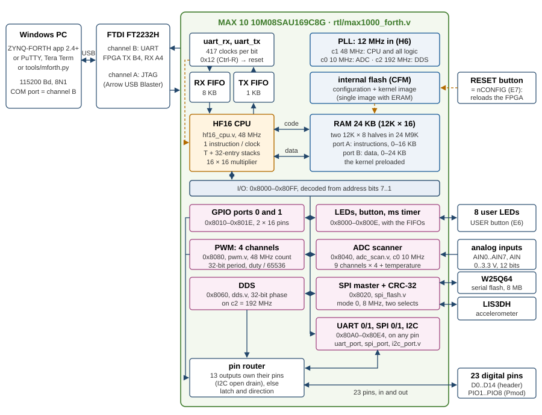
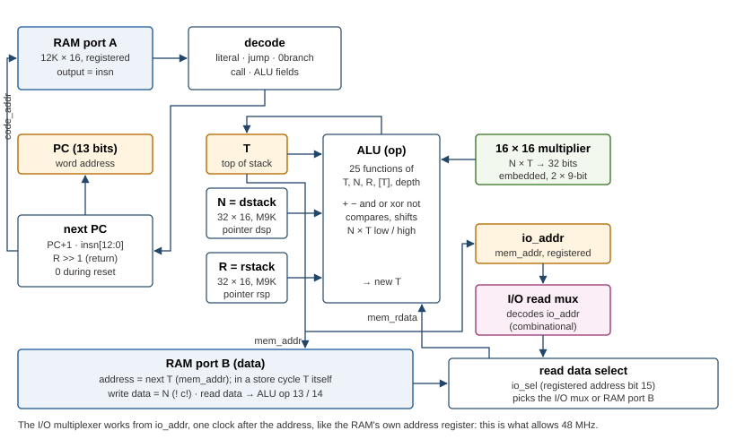
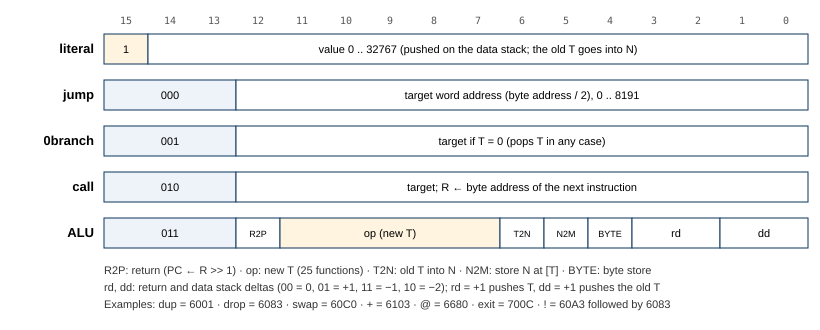
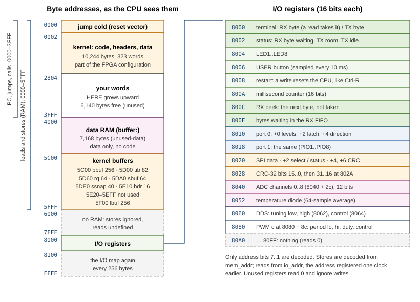
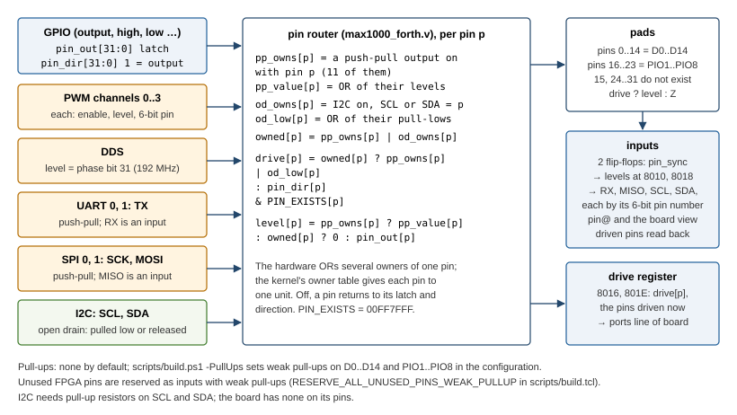

# MAX1000-FORTH — Implementation Details

This document describes how MAX1000-FORTH is built: the HF16 CPU in the FPGA of a Trenz
MAX1000, its memory, the I/O registers and peripherals around it, the Forth kernel that runs
on it and answers the app, and the tools that build and check all of it. It is written for
someone who wants to understand, change or extend the design. How to *use* the Forth is in
the [user manual](Manual.md); the serial protocol the app speaks is protocol 1 of
[ZYNQ-FORTH](https://github.com/andiepp/ZYNQ-FORTH) (its `docs/Protocol.md`).

All figures in this document are those of release 1.3 (firmware 1.3, protocol 1, kernel of
376 words and 12,646 bytes), unless a section names an earlier release for comparison.
Release 1.4 changed only the kernel and the app: it adds the `mem` request (section 5.13),
which brings the kernel to 380 words and 12,930 bytes (3,454 bytes of code space left), and
the app's decompiler (chapter 8). The FPGA's resources and timing are those of 1.3. The PDF
version, `docs/Implementation-Details.pdf`, is generated from this file by
`python tools/manual_pdf.py design`.

## 1 Overview

MAX1000-FORTH turns a Trenz MAX1000 (TEI0001-02), a small board with an Intel MAX 10 FPGA,
into an interactive Forth computer. The Forth runs on **HF16**, a 16-bit stack processor
built in the FPGA's logic, whose instructions are Forth primitives. Everything that makes
Forth Forth runs on HF16: reading the input line, looking words up, compiling new
definitions, executing them, printing numbers.

The CPU, its instruction set and the core of the kernel come from the sister project
[ZYNQ-FORTH](https://github.com/andiepp/ZYNQ-FORTH), where HF16 sits in the programmable
logic of a Zynq and an ARM core loads its kernel, carries its terminal and answers the app.
The MAX1000 has no such second processor, and MAX1000-FORTH does not add a soft one.
Instead:

- the kernel image is the **initial content of the RAM**, part of the FPGA configuration,
  so Forth is ready the moment the MAX 10 has configured itself;
- the CPU talks to the PC **directly** through a UART on the board's FTDI chip, with FIFOs
  in block RAM between them;
- the **kernel itself** answers the app's service requests, between two terminal bytes;
- **Ctrl-R** (byte 0x12) resets the CPU in hardware, so a runaway program can always be
  stopped.



### 1.1 Design goals

- **A real Forth CPU.** Compiled Forth is native HF16 machine code: a colon definition is a
  sequence of 16-bit instructions, primitives are inlined as single instructions, a call
  takes one clock and a return is usually free. There is no inner interpreter.
- **Alone on a small FPGA.** No soft processor, no boot loader, no external memory: HF16,
  24 KB of block RAM and the peripherals in a 10M08, the smallest common MAX 10, with a fifth
  of its logic left free.
- **Always recoverable.** The kernel is never changed by what is typed (`cold` restores the
  dictionary), Ctrl-R works in any loop, and a saved source that misbehaves can be skipped
  at the start with ESC or the user button.
- **Compatible with ZYNQ-FORTH.** The same CPU (the same Verilog, with one synthesis
  attribute added for the MAX 10, section 3.7), the same word names and stack effects for the
  common words, the same saved-source format and the same service protocol, so the
  ZYNQ-FORTH app (2.4 and later) works with the MAX1000. The serial interfaces follow
  ZYNQ-FPGA-FORTH32 3.1, in hardware and in their Forth words.
- **Use the whole board.** 8 LEDs, the user button, 23 digital pins with four PWM channels,
  a DDS square-wave generator, two UARTs, two SPI masters and an I2C master on any pin, nine
  analog inputs and the chip's temperature diode, the LIS3DH accelerometer and the 8 MB
  serial flash.
- **Small and checkable.** About 1,700 lines of Verilog (173 of them the CPU, plus Intel's
  ADC control core), an 896-line kernel, and an instruction-set simulator that runs the
  kernel exactly as the CPU does, against which 122 automatic checks run in seconds; a
  Verilog testbench checks the serial interfaces cycle by cycle.

### 1.2 Who does what

There are three players: the FPGA logic, the Forth kernel running on HF16, and the PC tools
that exist only at build time (and the app, which only talks the protocol).

| | FPGA logic (`rtl/*.v`) | Forth kernel on HF16 (`forth/kernel.fs`) | PC tools (`tools/`, `scripts/`) |
|---|---|---|---|
| Start-up | Configures from the internal flash with the RAM image; holds the CPU in reset until the PLL locks and 255 clocks more | `cold`: restores the dictionary, counts the start, switches the accelerometer on, frees all pins, prints the banner, runs the saved source, enters `quit` | `hf16.py` cross-compiles the kernel into the RAM image; Quartus puts it into the `.pof` |
| Terminal | UART at 115,200 Bd, an 8 KB receive and a 1 KB send FIFO | `key`, `emit`, `accept-line`: reads, echoes, prints | — |
| Interpreting and compiling | — | All of it: parsing, dictionary search, numbers, compiling, executing | — |
| Arithmetic | One-clock ALU with a 16 × 16 multiplier (low and high product) | Division, 32-bit products and quotients, `*/`, the DDS tuning word | — |
| Board I/O | I/O registers: LEDs, button, timer, pins, PWM, DDS, ADC, SPI, CRC; UARTs, SPI and I2C masters for the pins; the pin router | Board words: `led!`, `pin@`, `pwm-hz`, `adc@`, `accel@`, `f-read`, `uart-emit`, `spi-xfer`, `i2c@` …; the pin-owner table | — |
| Service requests | Nothing special: the requests arrive in the same RX FIFO | `service?` answers them whenever Forth waits or polls | — |
| Saved source | SPI master and CRC-32 unit | `store` writes it to the W25Q64 flash, `autoload` runs it at every start | `mforth.py --store` sends it |
| Restart | Ctrl-R or a store to `$8008` resets the CPU, FIFOs and peripherals; the RAM keeps its contents | `cold` makes Forth fresh again | `mforth.py --restart`, `--skip` |

Everything typed after the start is compiled by the kernel itself, on the FPGA.

### 1.3 The life of a line

What happens when `2 3 + .` and Enter are typed in a terminal or the app:

1. The PC writes the bytes to the board's second USB serial port. The FTDI FT2232H passes
   them out of channel B at 115,200 Bd, 8N1, to FPGA pin A4.
2. `uart_rx` samples the line with the 48 MHz CPU clock (417 clocks per bit), assembles each
   byte and pulses `valid` for one clock. The byte is not 0x12, so it is pushed into the
   8 KB RX FIFO; it becomes visible to the CPU two clocks later.
3. HF16 is waiting in `key`, which loops on `key?`. `key?` calls `service?` (nothing to
   serve: the byte at the head of the FIFO is not SOH), sees bit 0 of the status register
   `$8002` set, peeks at the head byte through `$800C`, finds it is not SOH and returns true.
4. `key` reads `$8000`. The CPU has already put the address on the I/O bus in the previous
   instruction, so the byte is there at once; the instruction that consumes it (`@`, ALU
   op 13 with T = `$8000`) also pops the FIFO.
5. `accept-line` stores the character in `tib` and echoes it with `emit`, which waits for
   room in the TX FIFO (bit 1 of `$8002`) and stores the byte to `$8000`. The FIFO hands it to
   `uart_tx`, and the echo reaches the terminal about 87 µs per byte later.
6. At the CR, `accept-line` prints a space and returns. `interpret` takes `2`: not in the
   dictionary, a number, pushed. `3` likewise. `+` is found; it is an inline word, and in
   interpret state its code (one instruction and a return) is executed. `.` prints `5 `.
   Then `quit` prints ` ok` and CR LF, copies the data stack into `ssnap` for the app
   (`snap`), and waits for the next line.

And an app request, say `SOH stack LF` sent while Forth waits at the prompt:

1. The four bytes land in the RX FIFO like any others.
2. `key?` calls `service?`. It sees a SOH at the head of the FIFO (peek `$800C`), and neither
   the flash nor the accelerometer is selected (`$8022` bits 0 and 2), so it calls `serve`.
3. `serve` pops the SOH, sets `serving`, reads the request line up to LF (each byte within
   2 s) into `rq`, takes the first word as the request name and `dispatch`es on it.
4. `answer` runs the payload word `p-stack` twice: once with `counting` set, where `emit`
   only counts bytes, then for real after the header `SOH ok stack <length> LF`. The payload
   is the snapshot `snap` took at the last prompt, e.g. `4 0009 0001 0002 FFFD`.
5. `serving` is cleared, `key?` looks at the FIFO again and goes on waiting for terminal
   input. The answer has appeared between two pieces of Forth's output, never inside one.

### 1.4 Repository map

| Path | Content |
|---|---|
| `rtl/hf16_cpu.v` | the HF16 CPU, 173 lines, ZYNQ-FORTH's with one synthesis attribute added (section 3.7) |
| `rtl/max1000_forth.v` | top level: PLL, reset, RAM, UART and FIFOs, I/O decode and read multiplexer, LEDs, button, timer, pins, the serial units' decode, pin router |
| `rtl/fifo_bram.v`, `rtl/uart.v` | first-word-fall-through FIFOs in M9K, UART transmitter and receiver for the terminal |
| `rtl/pwm.v` | four PWM channels (ZYNQ-FORTH's, with a separate read address) |
| `rtl/dds.v` | DDS square-wave generator on its own 192 MHz clock (after ZYNQ-FPGA-FORTH32's) |
| `rtl/uart_port.v`, `rtl/spi_port.v`, `rtl/i2c_port.v` | UART, SPI master and I2C master for the pins (after ZYNQ-FPGA-FORTH32 3.1's); the top level has two UARTs, two SPI masters and one I2C master |
| `rtl/adc_scan.v` | ADC scanner around Intel's Modular ADC control core |
| `rtl/spi_flash.v` | SPI master for the serial flash and the accelerometer, CRC-32 unit |
| `constr/max1000_forth.sdc` | timing constraints |
| `scripts/build.tcl`, `build.ps1` | Quartus project, pin assignments, build |
| `scripts/program_flash.ps1` | writes the `.pof` (or `.sof`) over JTAG |
| `scripts/Build-Release.ps1` | tests, build, manual PDF, release zip |
| `forth/kernel.fs` | the Forth kernel, 896 lines of Forth |
| `tools/hf16.py` | cross-compiler and instruction-set simulator (ISS) |
| `tools/mforth.py` | line sender, source store, restart from the PC |
| `tools/manual_pdf.py` | builds `docs/Manual.pdf` and `docs/Implementation-Details.pdf` |
| `sim/run_flash_tests.ps1`, `sim/test_protocol.py`, `sim/test_serial.py` | simulator tests: saved source (23 checks), service protocol (56 checks), serial interfaces, pin owners and double numbers (43 checks) |
| `sim/tb_serial.v`, `sim/run_serial.ps1` | testbench of the three serial units in the Vivado simulator (2,016 checks) |
| `examples/bench.fs` | the bench demo of the manual |
| `docs/` | user manual, this document, images |

The app is not in this repository: it is the ZYNQ-FORTH app, which recognises the MAX1000
(chapter 8).

## 2 Platform and resources

### 2.1 The MAX1000 and the 10M08SAU169C8G

The **10M08SAU169C8G** is a MAX 10 FPGA: 8,064 logic elements (a 4-input LUT and a flip-flop
each), 42 M9K block RAMs of 9 Kbit (387,072 bits), 24 embedded 18 × 18 multipliers (48 9-bit
elements), one PLL with five outputs, one 12-bit 1 MSPS ADC with a temperature sensing
diode, and its own configuration flash. "SA" is the single-supply version with the analog
block, "U169" the 169-ball UBGA package, "C8" the commercial temperature range and speed
grade 8. The MAX 10 configures itself from the internal flash at power-up, without an external
configuration device.

The **TEI0001-02** board adds:

| Part | Connection | Used for |
|---|---|---|
| 12 MHz oscillator | FPGA pin H6 | the PLL's input |
| FTDI FT2232H | channel A: JTAG (Arrow USB Blaster); channel B: UART, FPGA TX = B4, RX = A4 | programming; the terminal |
| 8 user LEDs | A8 A9 A11 A10 B10 C9 C10 D8 (LED1..LED8), active high | `led!` |
| USER button | E6, low while pressed (Schmitt-trigger input) | `btn@`, skipping the saved source |
| RESET button | nCONFIG (E7) | reloads the configuration; not an input for the design |
| Winbond W25Q64 | F_S B3, F_CLK A3, F_DI A2, F_DO B2 | 8 MB serial flash: the saved source and free data |
| ST LIS3DH | SEN_CS L5, SEN_SPC J6, SEN_SDI J7, SEN_SDO K5 | 3-axis accelerometer |
| header | D0..D14, AIN0..AIN7, AIN | digital pins and analog inputs |
| Pmod | PIO_01..PIO_08 | eight more digital pins |

The board's flash is **not** used for configuration (the MAX 10 has its own), so all 8 MB are
free for the Forth.

The PLL makes three clocks from the 12 MHz oscillator; its VCO runs at 960 MHz:

| Output | Ratio | Frequency | Used by |
|---|---|---|---|
| c1 | × 4 | 48 MHz | the CPU, RAM, FIFOs, UART, I/O registers, PWM, SPI, the serial interfaces, the ADC core's logic: one clock domain |
| c0 | × 5 / 6 | 10 MHz | the ADC hard block's input clock |
| c2 | × 16 | 192 MHz | the DDS phase accumulator |

The SDC file declares the three outputs and the oscillator as asynchronous groups. Only the
DDS settings cross from c1 to c2, through a toggle handshake (section 4.9); c0 only feeds the
ADC block, whose control core runs on c1.

**Why 48 MHz.** HF16 executes one instruction per clock and addresses its data port with the
*next* top of stack (section 3.5), so the path from the stack RAM through the ALU into the
RAM's address register must fit in one clock. During the development of release 1.0 the
design first ran at 40 MHz, because 48 MHz missed timing by 0.66 ns at the slow corner: the
worst path ran from the data stack's M9K (2.6 ns clock-to-output) through the
read-during-write bypass, the 16 × 16 multiplier (4.0 ns), the ALU multiplexer and the next-T
logic, and then on through the I/O decode and read multiplexer into a registered `io_rdata`. The fix was to register the *address* instead (`io_addr`) and select the I/O
value combinationally in the next cycle, as the M9K does with its own address register. The
next-T path now ends at a register again, and 48 MHz passes with about 1 ns to spare
(section 2.3). 48 MHz also
divides well: 48,000 clocks per millisecond, and 417 clocks per UART bit (115,108 Bd, 0.08 %
slow).

### 2.2 Resources used

From the fitter report of the release 1.3 build (`build/output_files/max1000_forth.fit.rpt`,
Quartus Prime Lite 18.1):

| Resource | Used | Available | % |
|---|---|---|---|
| Logic elements | 6,451 | 8,064 | 80 |
| of which combinational functions | 5,708 | 8,064 | 71 |
| Registers | 2,786 | 8,064 | 35 |
| M9K blocks | 40 | 42 | 95 |
| Block memory bits | 304,896 | 387,072 | 79 |
| Embedded multiplier 9-bit elements | 18 | 48 | 38 |
| PLLs | 1 (3 of 5 outputs) | 1 | 100 |
| ADC blocks | 1 | 1 | 100 |
| UFM blocks | 0 | 1 | 0 |
| Pins | 43 | 130 | 33 |
| Global clocks | 3 | 10 | 30 |

By design unit:

| Unit | Logic elements | Registers | M9K | Multiplier elements |
|---|---|---|---|---|
| `pwm` (4 channels) | 1,753 | 1,220 | – | 16 |
| top level (`max1000_forth.v` itself) | 1,520 | 172 | – | – |
| `hf16_cpu` | 902 | 93 | 2 (the stacks) | 2 |
| `adc_scan` (of which Intel's control core 230) | 432 | 247 | 1 (averaging FIFO) | – |
| `uart_port` u0 / u1 (each with two 1 KB FIFOs of 62 or 63) | 411 / 413 | 192 / 192 | 2 / 2 | – |
| `i2c_port` | 204 | 103 | – | – |
| `spi_port` s0 / s1 | 190 / 175 | 115 / 115 | – | – |
| `dds` | 141 | 137 | – | – |
| `spi_flash` | 95 | 50 | – | – |
| RX FIFO / TX FIFO | 95 / 64 | 42 / 33 | 8 / 1 | – |
| `uart_rx` / `uart_tx` | 89 / 65 | 42 / 31 | – | – |
| RAM (two halves, decode) | 9 | 2 | 24 | – |

The 40 M9K blocks are the RAM (2 × 12), the RX FIFO (8), the TX FIFO (1), the two stacks (1
each), the temperature averaging FIFO of the ADC core (1, 64 × 12 bits) and the four 1 KB
FIFOs of the two UARTs (1 each). The four PWM channels are still the largest unit: four
32-bit counters, comparators and two pipeline stages of 32 × 16 products each. The CPU
itself is 902 logic elements.

The serial interfaces of release 1.3 cost about 2,200 logic elements: the design has 6,451,
release 1.2 had 4,259. 1,393 are in the five units; a UART's own logic (287 logic elements)
is mostly its 24-bit divider and bit counters. Most of the rest is the top level's growth
from 716 to 1,520:
the pin router now chooses among 13 sources for each of the 32 pin positions, six
multiplexers pick the serial inputs from the pins, and the read multiplexer has five more
blocks (section 4.7).

### 2.3 Timing

From the timing analyzer of the 1.3 build (`max1000_forth.sta.summary`), slow model, 1200 mV,
85 °C (the worst corner):

| Clock | Setup slack | Hold slack | Fmax |
|---|---|---|---|
| c1, CPU clock, 48 MHz (20.833 ns) | 1.056 ns | 0.301 ns | 50.56 MHz |
| c2, DDS clock, 192 MHz (5.208 ns) | 1.031 ns | 0.485 ns | 239.41 MHz |

At 0 °C the setup slacks are 2.203 ns and 1.253 ns. All constraints are met. The CPU clock's
worst paths are still the stack RAM → multiplier → ALU → next-T paths of section 2.1. In the
1.3 build they go on from the next T through `mem_addr` and the store decode of the I2C block
(`wr_i2c`) to the enable of `i2c_port`'s stretch counter, which a command clears when it
starts: 1.056 ns of slack, against 1.545 ns in release 1.2, where the worst paths ended at the
RAM's and `io_addr`'s address registers. The 192 MHz domain holds only the 32-bit phase adder
and the handshake.

Quartus reports critical warning 16248 for pins next to the ADC inputs (LED1..LED7, the UART,
the flash pins and D4): switching I/O there may disturb the ADC's sampling. The pins are
fixed by the board; `build.ps1` filters the warning.

## 3 The HF16 CPU

`rtl/hf16_cpu.v`, 173 lines of Verilog, ZYNQ-FORTH's file with one synthesis attribute added
(section 3.7). HF16 follows the
scheme of the J1 Forth CPU (James Bowman, 2010): a dual-stack machine with literal, jump,
conditional-branch, call and ALU instructions, where one ALU instruction can change the top
of stack, move both stack pointers, store to memory and return, all in one clock.



### 3.1 Machine model

- **Cells** are 16 bits. Addresses are byte addresses; a cell is stored little-endian and
  must be even-aligned (the RAM ignores address bit 0 for cell accesses).
- **Instructions** are 16 bits, one per cell. The program counter is a 13-bit *word*
  address, so code runs from the first 16 KB (0x0000–0x3FFF) only.
- **Data stack:** the top item T is a register (`st0`); the items below it (N is the top
  one) are a 32-entry RAM addressed by the pointer `dsp`.
- **Return stack:** a 32-entry RAM addressed by `rsp`; R is its top entry. It holds return
  addresses as **byte** addresses (the PC is R >> 1), the loop index and limit of
  `do … loop`, and whatever `>r` puts there.
- **Memory:** 24 KB of RAM from address 0 (data accesses reach 0x0000–0x5FFF), I/O
  registers from 0x8000 (address bit 15 set).
- **Speed:** one instruction per 48 MHz clock (20.8 ns), every instruction, including the
  multiply and the loads. There are no stalls on the MAX1000: the CPU's `stall` input, which
  the ARM uses on the Zynq to pause it, is tied to 0.

The stacks live inside the CPU, not in RAM: there is no stack pointer a program could read
as an address, and both stacks wrap around silently after 32 entries. The kernel checks the
depth after every word it interprets (section 5.6).

### 3.2 Instruction formats



| Bits 15..13 | Instruction | Effect |
|---|---|---|
| `1xx` | literal | push `insn[14:0]` (0 to 32,767) |
| `000` | jump | PC ← `insn[12:0]` |
| `001` | 0branch | pop T; if it was 0, PC ← `insn[12:0]` |
| `010` | call | push the byte address of the next instruction on the return stack; PC ← `insn[12:0]` |
| `011` | ALU | the fields below, all in one clock |

A literal from 32,768 to 65,535 (a negative number, or an I/O address) does not fit 15 bits;
the compilers emit its complement followed by `invert` (two instructions). `$8000 @` is
therefore three instructions: `literal 32767`, `invert`, `@`.

ALU instruction fields:

| Bits | Field | Effect |
|---|---|---|
| 12 | R2P | return: PC ← R >> 1 (combined with rd = −1 to pop the address) |
| 11..7 | op | the new T (table in 3.3) |
| 6 | T2N | write the old T into N (`swap`; implied by a data push) |
| 5 | N2M | store N at address T (RAM or I/O) |
| 4 | BYTE | the store writes one byte (`c!`) |
| 3..2 | rd | return stack delta: 00 = 0, 01 = +1 (pushes T), 11 = −1, 10 = −2 |
| 1..0 | dd | data stack delta: 00 = 0, 01 = +1 (pushes the old T into N), 11 = −1, 10 = −2 |

### 3.3 ALU functions

| op | new T | op | new T |
|---|---|---|---|
| 0 | T | 13 | the cell at [T] |
| 1 | N | 14 | the byte at [T] |
| 2 | N + T | 15 | data stack depth |
| 3 | N and T | 16 | N − T |
| 4 | N or T | 17 | T + 1 |
| 5 | N xor T | 18 | T − 1 |
| 6 | not T | 19 | T = 0 (−1 or 0) |
| 7 | N = T (−1 or 0) | 20 | T < 0 (−1 or 0) |
| 8 | N < T, signed | 21 | N × T, low 16 bits |
| 9 | N < T, unsigned | 22 | T >> 1, arithmetic |
| 10 | N >> T, logical | 23 | −T |
| 11 | N << T | 24 | N × T unsigned, high 16 bits (for `um*`) |
| 12 | R | 25..31 | T (unused) |

Details:

- **Shifts** by 16 or more give 0: the hardware tests `T[15:4] ≠ 0` and otherwise uses
  `T[3:0]` as the count. There is no arithmetic shift by T; `2/` (op 22) shifts by one.
- **The multiplier** is a single unsigned 16 × 16 → 32-bit product of N and T on an embedded
  multiplier. Op 21 takes its low half, which is also the low half of the signed product, so
  `*` serves signed and unsigned numbers; op 24 takes the high half, from which `um*` builds
  a 32-bit product in two instructions. The product is combinational: one clock.
- **Byte loads** pick the high or low byte of the cell at [T] with `T[0]` (little-endian).
- **Depth** is the 5-bit pointer `dsp`, the number of items on the stack. After an underflow
  it wraps to 31 and below, which the kernel uses to detect underflow.

### 3.4 Primitives

Every Forth primitive is one ALU instruction (two for the stores). The encodings, as
`tools/hf16.py` defines them:

| Word | Encoding | Fields |
|---|---|---|
| `dup` | `6001` | T ← T, dd +1 |
| `drop` | `6083` | T ← N, dd −1 |
| `swap` | `60C0` | T ← N, T2N |
| `over` | `6081` | T ← N, dd +1 |
| `nip` | `6003` | T ← T, dd −1 |
| `>r` | `6087` | T ← N, rd +1 (pushes T), dd −1 |
| `r>` | `660D` | T ← R, rd −1, dd +1 |
| `r@` (and `i`) | `6601` | T ← R, dd +1 |
| `+` | `6103` | T ← N + T, dd −1 |
| `-` | `6803` | T ← N − T, dd −1 |
| `and` / `or` / `xor` | `6183` / `6203` / `6283` | dd −1 |
| `=` / `<` / `u<` | `6383` / `6403` / `6483` | dd −1 |
| `rshift` / `lshift` | `6503` / `6583` | dd −1 |
| `*` | `6A83` | T ← N × T low, dd −1 |
| `(um*)` | `6C03` | T ← N × T high, dd −1 (cross-compiler only) |
| `invert` / `negate` | `6300` / `6B80` | |
| `1+` / `1-` / `2/` | `6880` / `6900` / `6B00` | |
| `0=` / `0<` | `6980` / `6A00` | |
| `@` / `c@` | `6680` / `6700` | T ← [T] |
| `!` | `60A3 6083` | store N at [T], T ← N, dd −1; then `drop` |
| `c!` | `60B3 6083` | the same with BYTE |
| `depth` | `6781` | T ← depth, dd +1 |
| `exit` | `700C` | R2P, rd −1 |

Because a data push writes the old T into N and a pop takes N into T, the "new T" of a pop is
N and the value consumed is the old T: `+` is "T ← N + T, pop".

### 3.5 Memory ports and timing

HF16 sits between the two ports of a synchronous dual-port RAM whose outputs are registered
(the M9K's read data appears one clock after the address). Two tricks give it single-cycle
instructions with such a RAM:

- **Code port.** `code_addr` is the *next* PC, computed combinationally from the current
  instruction (PC + 1, a jump or call target, a taken 0branch, or R >> 1 on a return). The RAM
  registers it at the clock edge, and the instruction at the new PC is on `insn` during the
  next cycle. There is no fetch stage: a jump, call or return costs nothing extra. During
  reset `code_addr` is 0, so the first instruction after a reset is the jump at address 0.
- **Data port.** `mem_addr` is the *next* T. Whatever T becomes at the end of this
  instruction, the RAM is reading the cell at that address meanwhile, so in the next
  instruction `mem_rdata` already holds [T]. That is why `@` (op 13: T ← [T]) takes one
  clock: the load was started speculatively by the instruction before it.

**The store hazard.** A store needs the data port to address the *current* T, so in a store
cycle `mem_addr` is T instead of the next T, and the port writes N there. The instruction
after a store therefore finds the stored address's data on `mem_rdata` (and the RAM is
declared `no_rw_check`, so what it reads during the write is not even defined), not [T]. The
rule, kept by both compilers: the instruction directly after a store does not read memory
(op 13 or 14). `!` and `c!` end with a plain `drop`. The cost is one instruction per store,
and nothing to schedule anywhere else.

**I/O reads with side effects.** Because loads are started speculatively, the I/O decoder
"reads" a register whenever T happens to hold its address. All reads are therefore free of
side effects except three: `$8000`, which pops the RX FIFO, and `$80A0` and `$80B0`, which pop
the receive FIFOs of UART 0 and 1 (section 4.12). They pop only when an instruction actually
consumes [T]: the CPU's `mem_rd` output is set by an ALU instruction with op 13 or 14, and
the top level qualifies it with the full address in T (`rx_pop = mem_rd && T == 16'h8000`,
and `mem_rd && cpu_t == 16'h80A0` or `16'h80B0` for the UARTs). An alias (such as `$8100` or
`$81A0`) reads the byte without taking it.

**Why the I/O read multiplexer sits on `io_addr`.** RAM and I/O behave the same way for the
CPU: the value of an address arrives in the cycle after the address was formed. The RAM does
this with its address register. The I/O side copies the idea: `io_addr` registers `mem_addr`
every clock, and the read multiplexer decodes `io_addr` combinationally in the next cycle;
`io_sel`, the registered address bit 15, then chooses between the multiplexer and RAM port B.
Stores are still decoded from `mem_addr` (which equals T in a store cycle). This keeps all
I/O decoding off the CPU's longest path and is what made 48 MHz possible (section 2.1). The
cost is one register of 16 bits; the CPU sees no difference.

**Returns** use byte addresses, so `>r` and `r>` can move return addresses as ordinary
numbers: `execute` is `>r exit` (push the execution token and "return" into it), and `(.")`
reads the inline string after its call by taking its own return address, skipping the string
and pushing the address back.

### 3.6 Next-state logic

For each instruction class the next state is (from `hf16_cpu.v`):

| Class | T | Data stack | Return stack | PC |
|---|---|---|---|---|
| literal | value | push old T | – | PC + 1 |
| jump | – | – | – | target |
| 0branch | N | pop | – | target if T = 0, else PC + 1 |
| call | – | – | push (PC + 1) × 2 | target |
| ALU | `op` result | `dsp += dd`; write old T if T2N or dd = +1 | `rsp += rd`; write T if rd = +1 | R >> 1 if R2P, else PC + 1 |

The stack RAMs are written at the *new* pointer: a push increments the pointer and writes
the old top there in the same clock. The store, if N2M is set, writes N to address T in the
same clock as everything else.

### 3.7 The stacks in M9K

On the Zynq the two 32-entry stacks are LUT RAM. The MAX 10 has no LUT RAM, so Quartus maps
each stack into one M9K block (512 bits of its 9,216 used), which costs two M9K blocks but
saves several hundred logic elements of flip-flops and multiplexers.

That works because of how the CPU reads them: `N = dstack[dsp]` and `R = rstack[rsp]` are
asynchronous reads, but `dsp` and `rsp` are registers fed by `dsp_n` and `rsp_n`. Quartus
moves the read address register into the M9K (its address register latches `dsp_n` at the
same edge as `dsp`), so the M9K's registered output is exactly N in the next cycle. A push
writes `dstack[dsp_n]` at the same edge at which the read address becomes `dsp_n`, a
read-during-write of the same entry; Quartus adds a small bypass multiplexer for it (two
logic levels behind the M9K, visible in the timing path of section 2.1).

Up to release 1.2 Quartus made that choice by itself. During the work on release 1.3, with
the four FIFO blocks of the new UARTs (38 of the 42 M9K in use without the stacks), it built
the stacks from flip-flops instead: the CPU grew to 2,043 logic elements, the design to
7,553 (94 %), and the CPU clock's slack fell to 0.024 ns, through a 32-way multiplexer behind
`dsp`. Since release 1.3 `hf16_cpu.v` makes the choice explicit with
`(* ramstyle = "M9K" *)` on `dstack` and `rstack`, the only change against ZYNQ-FORTH's file.
The stacks are back in M9K, the design at 6,451 logic elements and the slack at 1.056 ns.

## 4 Memory and I/O



### 4.1 RAM

The RAM is 12K × 16 bits, 24 KB, inferred in `max1000_forth.v` as two arrays of 12,288 × 8
bits, `ram_lo` (the low byte of each cell) and `ram_hi` (the high byte), each in 12 M9K
blocks. The M9K could do byte enables, but two byte-wide halves are simpler to infer
reliably:

- **Port A** fetches instructions: address `code_addr` (13 bits, so only the first 8K cells,
  16 KB, are ever fetched), registered output `insn = {hi_a, lo_a}`.
- **Port B** is the CPU's data port: address `mem_addr[14:1]`, read data `{hi_b, lo_b}`.
- **Byte stores** write one half: `we_lo` for an even address, `we_hi` for an odd one, with the
  byte replicated onto both halves' data inputs. A cell store writes both.
- **Stores to 0x6000–0x7FFF are ignored** (`ram_store` excludes `mem_addr[14:13] = 11`);
  reads there return no defined value. Address bit 15 selects I/O.
- **Initialization:** both halves are loaded with `$readmemh` from `build/forth_lo.hex` and
  `build/forth_hi.hex`, the kernel image as `tools/hf16.py` writes it (section 7.3).

Code and data share the RAM: the Forth compiler, running on HF16, writes new code with
ordinary stores, and the code port fetches it in the next instruction. **The 16 KB code
limit** follows from the 13-bit word addresses in jumps, calls and the PC: a colon
definition must lie below 0x4000. The kernel takes 12,646 bytes of it, leaving 3,738 bytes
for typed definitions. The 8 KB above it (0x4000–0x5FFF) can be read and written but not
executed; the kernel hands out 0x4000–0x5BFF as **data RAM** with `buffer:` and keeps its
own buffers in 0x5C00–0x5FFF (section 5.2). Nothing checks that the dictionary stays below
0x4000: a definition that grows past it lands in the data RAM, where it cannot run.

### 4.2 The I/O read path

I/O registers are 16 bits wide, at even addresses from `$8000`. Only address bits 7..1 are
decoded, so the 128 registers repeat every 256 bytes up to `$FFFF`; unused registers read 0
and ignore writes.

- **Stores** are decoded from `mem_addr`, which is T during a store: `io_store = mem_we &&
  mem_addr[15]`, then per block (`io_pwm`, `io_dds`, `io_spi`, `io_gpio`, `wr_u0`, `wr_u1`,
  `wr_s0`, `wr_s1`, `wr_i2c`, the LED register, the restart register `$8008`, the TX FIFO push
  at `$8000`). The write data is N (`mem_wdata`).
- **Reads** are decoded from `io_addr`, the address of the previous clock. A priority
  multiplexer looks at `io_addr[7:4]`: `$80A0–$80EF` the serial units (UART 0, UART 1, SPI 0,
  SPI 1, I2C, 16 bytes each), `$8040–$805F` the ADC codes (slot 0..9, higher slots 0),
  `$8060–$807F` the DDS, `$8080–$809F` the PWM channels, `$8020–$802F` the SPI master and
  CRC, `$8010–$801F` the two pin ports, `$8000–$800F` the UART, LEDs, button and timer.
  The peripheral modules (`pwm`, `dds`, `spi_flash`, `uart_port`, `spi_port`, `i2c_port`)
  therefore have two register selects: one from `mem_addr` for stores and one from `io_addr`
  for reads. The UARTs also get a read strobe for their data register (section 3.5).
- **The data port's read data** is `mem_rdata = io_sel ? io_rdata : {hi_b, lo_b}`, with
  `io_sel` the registered address bit 15.

### 4.3 I/O map

| Address | Read | Write |
|---|---|---|
| `$8000` | next received byte (pops the RX FIFO) | send a byte (pushes the TX FIFO) |
| `$8002` | bit 0 = a received byte is waiting, bit 1 = the TX FIFO has room, bit 2 = TX idle (FIFO empty and the transmitter done) | – |
| `$8004` | LED1..LED8 (bits 0..7) | the same |
| `$8006` | bit 0 = USER button pressed (sampled every 10 ms) | – |
| `$8008` | – | any value: reset the CPU (as Ctrl-R) |
| `$800A` | millisecond counter, 16 bits, wraps | – |
| `$800C` | next received byte without taking it (peek) | – |
| `$800E` | bytes waiting in the RX FIFO (0..8192) | – |
| `$8010 + 8p` | port p (0, 1): pin levels, synchronized | – |
| `$8012 + 8p` | port p: output latch | the same |
| `$8014 + 8p` | port p: direction, 1 = output (0 after reset) | the same |
| `$8016 + 8p` | port p: pins driven now, by their direction bit or by a peripheral (section 4.7) | – |
| `$8020` | SPI: the byte received last | SPI: send a byte (starts an 8-bit exchange; ignored while busy) |
| `$8022` | bit 0 = flash selected, bit 1 = busy, bit 2 = accelerometer selected | bit 0 = select the flash, bit 1 = select the accelerometer |
| `$8024` | – | reset the CRC |
| `$8026` | – | add the low byte to the CRC |
| `$8028`, `$802A` | CRC-32 bits 15..0, 31..16 | – |
| `$8040 + 2c` | ADC channel c (0..8), 12-bit code | – |
| `$8052` | temperature diode, 12-bit code (64-sample average) | – |
| `$8060` | DDS: tuning word, low 16 bits | the same (held until the high half is written) |
| `$8062` | DDS: tuning word, high 16 bits | the same (takes both halves) |
| `$8064` | DDS: bit 15 on, bit 14 busy (a change not yet taken over), bits 5..0 pin | bit 15 on, bits 5..0 pin |
| `$8080 + 8c` | PWM channel c (0..3): period, low 16 bits | the same (held until the high half is written) |
| `$8082 + 8c` | PWM channel c: period, high 16 bits (48 MHz clocks per cycle, at least 2) | the same (takes both halves) |
| `$8084 + 8c` | PWM channel c: duty in 1/65536 of the period, `$FFFF` = always high | the same |
| `$8086 + 8c` | PWM channel c: bit 15 on, bits 5..0 pin | the same |
| `$80A0 + 16u` | UART u (0, 1): bits 7..0 the next received byte, bit 8 = there was one (the read takes it) | send a byte (pushed into the TX FIFO; dropped when it is full) |
| `$80A2 + 16u` | UART u: bit 0 = a byte received, bit 1 = the TX FIFO has room, bit 2 = transmitter idle, bit 3 = a byte was lost (RX FIFO full), bit 4 = framing error | any value: clear bits 3 and 4 |
| `$80A4 + 16u` | UART u: clocks per bit, bits 15..0 (417 after reset; below 8 works as 8) | the same |
| `$80A6 + 16u` | UART u: clocks per bit, bits 23..16 (in bits 7..0) | the same |
| `$80A8 + 16u` | UART u: bit 15 on, bits 13..8 RX pin, bits 5..0 TX pin | the same (off empties both FIFOs) |
| `$80C0 + 16s` | SPI s (0, 1): the value received by the last transfer | start a transfer with this value (ignored while busy) |
| `$80C2 + 16s` | SPI s: bit 0 busy | – |
| `$80C4 + 16s` | SPI s: bit 0 CPHA, bit 1 CPOL, bit 2 LSB first, bit 4 16 bits (else 8) | the same |
| `$80C6 + 16s` | SPI s: clocks per half SCK period (24 after reset; below 2 works as 2) | the same |
| `$80C8 + 16s` | SPI s: bit 15 on, bits 13..8 MOSI pin, bits 5..0 SCK pin | the same |
| `$80CA + 16s` | SPI s: bits 5..0 MISO pin | the same |
| `$80E0` | I2C: bit 15 busy, bit 9 timeout, bit 8 ACK received (last write), bits 7..0 the byte read | bits 10..8 command (1 start, 2 stop, 3 write a byte, 4 read a byte and ACK, 5 read a byte and NACK), bits 7..0 the byte to write; ignored while busy |
| `$80E2` | I2C: clocks per quarter SCL period (120 after reset; below 4 works as 4) | the same |
| `$80E4` | I2C: bit 15 on, bits 13..8 SDA pin, bits 5..0 SCL pin | the same |

The DDS and the I2C master decode only address bits 2..1, so inside their blocks the
registers repeat every 8 bytes (`$80E8` is the I2C command register again, and `$80E6` reads
the I2C pins). The UART and SPI blocks read 0 above their last register and ignore writes
there.

### 4.4 UART and FIFOs

This is the terminal's UART; the two UARTs for the pins are in section 4.12. `rtl/uart.v`
holds an 8N1 transmitter and receiver with `CLKS_PER_BIT` = (48,000,000 + 57,600) / 115,200 =
417:

- **Receiver:** the RX pin passes a two-flop synchronizer. A low level starts a byte; the
  counter waits half a bit and checks that the start bit is still low (a
  shorter pulse is a glitch and ignored), then samples the eight data bits LSB first in the
  middle of each bit, 417 clocks apart. The byte is delivered (`valid` for one clock) only if
  the stop bit is high; a framing error drops it silently.
- **Transmitter:** takes a byte when `start` is high, shifts out start bit, eight data bits
  and the stop bit, 417 clocks each, and reports `busy` meanwhile.

`rtl/fifo_bram.v` is a single-clock first-word-fall-through FIFO in M9K. `dout` always shows
the oldest byte while the FIFO is not empty; a pop advances the read pointer and reads the
next entry in the same clock. A pushed byte becomes visible two clocks later (the write
pointer is copied into a "visible" pointer one clock after the write, so the synchronous RAM
read has completed). `count` is the number of visible bytes. A push into a full FIFO is
dropped.

- **RX FIFO, 8 KB** (8 M9K). It is that large for the saved source: while `store` erases a
  4 KB sector of the serial flash (about 45 ms) the bytes keep arriving, about 520 of them,
  and the FIFO absorbs them (section 5.12). It also lets the app queue up to 4 KB of text
  (chapter 8). A byte 0x12 is never pushed (section 4.5).
- **TX FIFO, 1 KB** (1 M9K). A register `utx_start` pops a byte into the transmitter
  whenever the FIFO is not empty and the transmitter is idle. Forth's `emit` waits while the
  FIFO is full, so output is never lost; a line of up to 1 KB goes out without Forth waiting.

The UART receiver and transmitter are reset only by the power-on reset; the FIFOs, the CPU
and the peripherals also by Ctrl-R. A byte in flight is therefore never cut by a restart.

### 4.5 Ctrl-R and restart

The top level watches the receiver: `restart <= (urx_valid && urx_data == 8'h12) ||
sw_restart`, a one-clock pulse, and `cpu_rst = sys_rst | restart`. `sw_restart` is a store to
`$8008`, which the kernel uses for the `restart` request.

| Reset by `cpu_rst` (Ctrl-R, `$8008`, power-on) | Not reset |
|---|---|
| the CPU: PC = 0, T = 0, both stack pointers 0 | the RAM: the kernel image and everything typed stay |
| both FIFOs: typed-ahead input and unsent output are discarded | the millisecond counter and the button sampler |
| the LEDs (all off), the pin latches and directions (all inputs) | the UART receiver and transmitter |
| all PWM channels off (all their registers 0) | the ADC scanner (it runs on the power-on reset) |
| the DDS off (tuning and control 0) | the PLL |
| the SPI master: both selects released, CRC reset | |
| the UARTs, SPI and I2C masters for the pins: off, FIFOs empty, rates and modes as after power-up | |

The byte 0x12 is not pushed into the RX FIFO (`push = urx_valid && urx_data != 8'h12`), so
Forth never sees it. The reset clears the FIFO in the same clock, which removes whatever was
queued before the 0x12; bytes after it (the app's ESC that skips the saved source) arrive in
an empty FIFO. Since the check is in hardware, Ctrl-R works whatever the CPU does, including a
tight loop that never polls anything. The flip side: a byte 0x12 can never be data. The
terminal and the service protocol carry only text, and the app and `mforth.py` send printable
ASCII and CR only.

The **power-on reset** `sys_rst` holds everything until the PLL reports lock and an 8-bit
counter has run 255 more CPU clocks. The board's **RESET** button is the MAX 10's nCONFIG
pin: it reloads the whole configuration from the internal flash (logic and RAM image), which
is why it cannot serve as a user input.

### 4.6 LEDs, button and millisecond timer

- **LEDs:** an 8-bit register, written at `$8004`, read back there; LED1 is bit 0. Cleared by
  `cpu_rst`; `cold` turns LED1 on as a sign of life.
- **Timer:** a divider counts 48,000 clocks (`MS_DIV = CLK_HZ / 1000`) and increments the
  16-bit millisecond counter at `$800A`, which wraps after 65.5 s. `ms` waits by comparing
  signed differences, so it is correct across the wrap for waits up to 32,767 ms.
- **Button:** the USER button passes a two-flop synchronizer and is sampled every tenth
  millisecond tick into `btn_state` (1 = pressed, since the pin is low while pressed). That
  debounces it: a bounce shorter than 10 ms cannot produce two changes. Until its first
  sample, 10 ms after configuration, the button reads "not pressed", which matters for the
  autostart check (section 5.12).

### 4.7 Pins and pin ownership



The digital pins form two 16-bit ports in 32-bit registers: `pin_out` (latch), `pin_dir`
(direction, 1 = output) and `pin_sync` (levels through a two-flop synchronizer). Pin n is bit
n mod 16 of port n / 16:

| Pin numbers | Port bits | Connector | FPGA pins |
|---|---|---|---|
| 0..14 | port 0 bits 0..14 | header D0..D14 | H8 K10 H5 H4 J1 J2 L12 J12 J13 K11 K12 J10 H10 H13 G12 |
| 16..23 | port 1 bits 0..7 | Pmod PIO_01..PIO_08 | M3 L3 M2 M1 N3 N2 K2 K1 |

Pin 15 and pins 24..31 do not exist: `PIN_EXISTS = 32'h00FF_7FFF` masks them, so they read 0,
ignore writes and are never driven; the Forth word `pin` refuses them. All pins are inputs
after reset.

**Ownership.** Thirteen peripheral outputs can drive a pin: eleven push-pull ones (PWM
channels 0..3, the DDS, TX of the two UARTs, SCK and MOSI of the two SPI masters) and two
open-drain ones (SCL and SDA of the I2C master). Each names its pin in a register; switched
on, it *owns* that pin. For each of the 32 pin positions the top level computes,
combinationally:

```
pp_owns[p]  = a push-pull source that is on names pin p
pp_value[p] = OR of their levels
od_owns[p]  = the I2C master is on and SCL or SDA is pin p
od_low[p]   = OR of their "pull low" outputs
owned       = pp_owns | od_owns
pin_drive   = ((pin_dir & ~owned) | pp_owns | od_low) & PIN_EXISTS
pin_level   = (pin_out & ~owned) | (pp_value & pp_owns)
```

An owned pin ignores its latch and direction bits: a push-pull owner drives its level, an
open-drain owner drives the pin low or leaves it to the pull-up resistor. Switched off, the
pin returns to its latch and direction. The hardware does not arbitrate: several owners of
one pin are ORed. Since release 1.3 the kernel's owner table gives each pin to one unit at
most (section 5.11); in release 1.2 two generators on one pin were ORed.

**Inputs.** The serial inputs (RX of each UART, MISO of each SPI master, SCL and SDA) read the
synchronized levels at the pin number in their pins register: `pin_in = {32'd0, pin_sync}`,
indexed with the 6-bit number, so numbers 32..63 read 0. Six such multiplexers feed the
units. A pin is read whether it is driven or not; with TX and RX (or MOSI and MISO) on the
same pin a unit reads back what it sends. The levels of driven pins come back through the
synchronizer like inputs, so `pin@` on a PWM pin shows the waveform.

**Drive register.** `$8016` and `$801E` (offset +6 of each port) read `pin_drive`: the pins
driven at that moment, by their direction bit or by a peripheral. An I2C pin counts while it
is pulled low. The `board` answer reports it (section 5.13); up to release 1.2 the kernel
worked the same out from the PWM and DDS control registers.

**Pull-ups.** By default the pins have none, so an open input reads at random.
`scripts/build.ps1 -PullUps` sets the MAX 10's weak pull-ups on D0..D14 and PIO1..PIO8 in the
configuration; Forth cannot switch them. The option is off by default because the bench has
LEDs with 1 kΩ to ground on D3..D5, which a pull-up keeps faintly lit while the pin is an
input. Pins the design does not use at all are reserved as inputs with weak pull-ups
(`RESERVE_ALL_UNUSED_PINS_WEAK_PULLUP`). I2C needs pull-up resistors on SCL and SDA
(section 4.12); the board has none on the header and Pmod pins.

### 4.8 PWM

`rtl/pwm.v` is ZYNQ-FORTH's PWM block with one change: separate register selects for reads
(`rd_ch`, `rd_reg` from `io_addr`) and stores (from `mem_addr`). Four channels, each with:

- a **32-bit period** in 48 MHz clocks, written in two halves (the low half is held in
  `lo_hold` until the high half arrives, so a period never changes halfway); values below 2
  count as 2;
- a **16-bit duty**, the fraction of the period in 1/65536; `$FFFF` means always high;
- a **control** register: bit 15 on, bits 5..0 the pin.

Each channel counts from 0 to period − 1 and is high for the first ⌊period × duty / 65536⌋
clocks. The 32 × 16 product is pipelined in two register stages (two 18 × 18 multipliers per
channel, 16 multiplier elements for the four). New period and duty values are taken at the
end of the running cycle, so no pulse is ever cut short; while a channel is off it keeps its
counter at 0 with the first cycle's level prepared, so enabling starts a fresh cycle at once.
Frequency range: 24 MHz (period 2) down to 0.0112 Hz (period 2³² − 1). All registers read
back what was written; a CPU reset clears them, which turns every channel off.

### 4.9 DDS

`rtl/dds.v` (release 1.1, after ZYNQ-FPGA-FORTH32's DDS) is a 32-bit phase accumulator on
PLL output c2, 192 MHz. Its top bit is a square wave: f = tuning × 192 MHz / 2³², in steps of
0.0447 Hz. Edges fall on the 5.21 ns grid of the 192 MHz clock, so a period that does not
divide 192 MHz evenly alternates between two lengths one step apart. The kernel allows up to
65.535 MHz; above some tens of MHz the pin and its wiring limit what arrives.

The registers live on the CPU clock: the tuning word (low half held until the high half is
written, as with the PWM period) and the control word (bit 15 on, bits 5..0 the pin). A
**toggle handshake** carries them to the 192 MHz side:

1. A write of the high half or of the control register flips `req` (if no request is in
   flight).
2. The generator side passes `req` through two flip-flops, detects the change, copies the
   tuning word and the on bit (both stable, because the CPU side does not send again before
   the acknowledgement) and returns the toggle as `ack`.
3. The CPU side passes `ack` through two flip-flops; while `req ≠ ack`, the change is busy.
4. A change written while one is in flight sets `dirty`, and the request is sent again after
   the acknowledgement, so the last value always arrives.

Bit 14 of the control register reads "busy or dirty"; the kernel's `dds-sync` waits for it to
clear. Turning the DDS on (or off) restarts the phase at 0; a new tuning word while it runs
keeps the phase going, so a frequency change has no glitch. The output bit is registered on
the 192 MHz clock. Like a PWM channel the DDS owns its pin while on (section 4.7), and a CPU
reset turns it off: the reset clears both registers and sends them across like a write.

The DDS uses 141 logic elements in its own unit (1.3 build) and no RAM; the 32-bit adder
meets 192 MHz with 1.03 ns of slack. Release 1.1 also narrowed the ADC's read decode to
`$8040–$805F` to make room for the DDS at `$8060`.

### 4.10 ADC and temperature diode

`rtl/adc_scan.v` drives Intel's **Modular ADC control core** (`altera_modular_adc_control`).
It is instantiated directly from the Quartus installation's IP folder, without Platform
Designer: `build.tcl` adds its six Verilog files, and `adc_scan.v` sets the parameters the IP
editor would: ADC clock divider for 1 MSPS from the 10 MHz PLL output, the temperature
sensor's clock divider for 50 kSPS, the internal reference (on the single-supply 10M08SA that
is VCCA, 3.3 V), and `analog_input_pin_mask` = 65,791 (`0x100FF`: CH1..CH8 in bits 0..7, CH0
in bit 16). The core needs that mask as an integer; a sized Verilog vector is not accepted.

The scanner keeps the core's command interface busy (`cmd_valid` always high):

- **Channels CH8 down to CH0**, each converted **four times in a row** as one packet
  (start-of-packet on the first command, end-of-packet on the fourth). Only the result flagged
  with end-of-packet is stored. The reason: a high-impedance source, such as the bench
  potentiometer, does not recharge the sample capacitor in one 1 µs conversion after a
  different channel, and a floating input simply shows the previous channel's charge. With
  four conversions the fourth has settled.
- **Then one temperature (TSD) command** (channel 17 of the core). For it the core switches
  the ADC into temperature mode and back by itself and returns a running average of the last
  64 samples (its averaging FIFO is the one M9K of the ADC unit).

The results land in a 10 × 12-bit register (`codes`): slots 0..8 = CH0..CH8, slot 9 = the TSD.
A CPU read at `$8040 + 2c` picks a slot through `io_addr[4:1]` and never waits; it gets the
newest code of that channel.

The header labels do not follow the ADC channel numbers. From the Quartus pin report, and
confirmed with a potentiometer on AIN3:

| Header | AIN | AIN0 | AIN1 | AIN2 | AIN3 | AIN4 | AIN5 | AIN6 | AIN7 |
|---|---|---|---|---|---|---|---|---|---|
| FPGA pin | D2 (ANAIN1) | E1 | C2 | C1 | D1 | E3 | E4 | F1 | B1 |
| ADC channel | 0 | 8 | 2 | 5 | 1 | 3 | 4 | 7 | 6 |
| `adc@` input | 8 | 0 | 1 | 2 | 3 | 4 | 5 | 6 | 7 |

The kernel's table `ain` maps the header input numbers (`adc@`, `mv@`) to channels;
`adc-ch@` reads a channel directly. The order was found with the potentiometer: before the
four-fold conversion its value leaked into the channel converted next, and the open inputs
copied their predecessor's charge, which hid which input was really wired.

**Temperature.** The TSD code falls as the chip warms. Intel's code-to-temperature table could
not be obtained while the kernel was written, so `temp@` interpolates linearly between two of
its points, −40 °C = 3798 and 96 °C = 3510, and gives tenths of a degree; it is approximate.
The board read about 31.7 °C on the bench. `temp-code@` returns the raw code.

### 4.11 SPI master, serial flash, accelerometer and CRC-32

`rtl/spi_flash.v` (not to be confused with the SPI masters for the pins, section 4.12) is a
byte-wide SPI master shared by two devices, each on its own pins: the
clock and data-out signals go to both, data-in comes from the selected one (`miso_sel =
cs2_n ? F_DO : SEN_SDO`). Forth drives the select bits and every command byte; the hardware
only shifts.

- **Timing:** SPI mode 0. Each half period of SCK lasts three CPU clocks, so SCK = 48 MHz / 6
  = 8 MHz, and an exchange of 8 bits takes 48 clocks (1 µs). MISO is sampled three clocks
  (62.5 ns) after the falling edge that changed it, as SCK rises; MOSI changes at the falling
  edge. 8 MHz is chosen for the accelerometer, which allows at most 10 MHz; the flash would
  allow far more.
- **Registers:** a store to `$8020` (ignored while busy) loads the shift register and starts
  the exchange; `$8022` bit 1 reads busy; afterwards `$8020` holds the byte received. Writing
  `$8022` sets both chip selects at once: bit 0 = flash (F_S low), bit 1 = accelerometer
  (SEN_CS low).
- **CRC-32 unit:** the standard reflected CRC-32 (polynomial 0xEDB88320, initial value and
  final XOR all ones), the same as zlib's and the one the app computes. A store to `$8026`
  adds one byte in one clock (the eight bit steps are unrolled); `$8024` resets it; `$8028`
  and `$802A` read the two halves of the finished (inverted) value. On the board the unit
  gave 0x66D2DB21 for `examples/bench.fs`, as zlib does.

The **Winbond W25Q64** (JEDEC ID EF 40 17) has 8 MB in 4 KB sectors, 64 KB blocks and
256-byte pages; it is blank on delivery. The kernel uses the commands 03 read, 02 page
program, 06 write enable, 05 read status (bit 0 busy), 20 4 KB sector erase, D8 64 KB block
erase and 9F JEDEC ID.

The **ST LIS3DH** speaks SPI with a first byte holding the register address, bit 7 = read and
bit 6 = auto-increment. `accel-on` (run by `cold`) writes CTRL_REG1 (`$20`) = `$57` (100 Hz,
X, Y and Z on) and CTRL_REG4 (`$23`) = `$88` (block data update, high resolution, ±2 g).
`accel@` reads OUT_X_L..OUT_Z_H (`$28..$2D`) in one burst (`$E8` = read + auto-increment +
`$28`) and shifts each left-justified 12-bit value right by 4, giving 1 mg per digit.
WHO_AM_I (`$0F`) answers `$33` (`accel?`). The board lying flat reads z ≈ +1024 mg.

### 4.12 Serial interfaces: UART, SPI and I2C

`rtl/uart_port.v`, `rtl/spi_port.v` and `rtl/i2c_port.v` (release 1.3) are ZYNQ-FPGA-FORTH32
3.1's `uart.v`, `spi.v` and `i2c.v`, rewritten for the 16-bit bus. The top level has two
UARTs (`u0` at `$80A0`, `u1` at `$80B0`), two SPI masters (`s0` at `$80C0`, `s1` at `$80D0`)
and one I2C master (`i2c0` at `$80E0`), each in a 16-byte block of its own. All five run on
the 48 MHz CPU clock. Each names its pins in a register; the pin router connects its
outputs to those pins, and its inputs read the pins' synchronized levels (section 4.7). The
registers are in the I/O map (section 4.3) and in each file's header comment. A CPU reset
switches all five off.

The 16-bit bus changed the register layout:

| | ZYNQ-FPGA-FORTH32 3.1 | MAX1000-FORTH 1.3 |
|---|---|---|
| UART divider | one register | 24 bits in two registers: +4 bits 15..0, +6 bits 23..16 |
| UART FIFOs | 64 bytes | 1 KB in M9K (`fifo_bram.v`) |
| SPI pins | one register: on, MISO, MOSI, SCK | +8 on, MOSI and SCK; +10 MISO |
| SPI width | 8, 16 or 32 bits | 8 or 16 bits |

Three 6-bit pin numbers and an enable bit do not fit 16 bits, hence the second SPI pins
register; a 32-bit SPI transfer would not fit the data register.

**UART.** 8N1 at any rate: the divider is the number of clocks per bit, 24 bits wide, so
from 6,000,000 Bd (8 clocks, the smallest; smaller values work as 8, but the register reads
back as written) down to about 3 Bd. After reset it is 417 (115,108 Bd for 115,200).

- **Transmitter:** when it is idle and the TX FIFO is not empty it takes a byte and sends the
  start bit, eight data bits LSB first and the stop bit, a divider's worth of clocks each.
  Status bit 2 (idle) is set when the FIFO is empty and the stop bit is out.
- **Receiver:** a high-to-low change of the synchronized RX level starts a byte. Half a bit
  later the start bit must still be low (else it was a glitch); the eight data bits and the
  stop bit are then sampled in the middle of each bit. A low stop bit sets the framing-error
  flag (status bit 4) and drops the byte; a byte that finds the RX FIFO full sets the overrun
  flag (bit 3) and is dropped. Writing the status register clears both flags.
- **FIFOs:** 1 KB in each direction, each a `fifo_bram` with `DEPTH_LOG2` = 10 in one M9K. The
  data register shows the next byte in bits 7..0 and sets bit 8 when there was one; the
  instruction that consumes the read pops it (section 3.5), as `$8000` does for the
  terminal. A byte written while the TX FIFO is full is dropped; `uart-emit` waits for room
  instead (section 5.11). While the UART is off, both FIFOs are held empty and transmitter
  and receiver are idle, so closing a UART discards what it had.

**SPI master.** Modes 0..3 (control bit 0 CPHA, bit 1 CPOL), 8 or 16 bits per transfer
(bit 4), MSB or LSB first (bit 2). SCK = 48 MHz / (2 × half), with half at least 2: at most
12 MHz; after reset half is 24 (1 MHz). Chip selects are ordinary pins that Forth drives.

- A store to the data register starts a transfer (ignored while busy). Each bit has two
  halves of `half` clocks. With CPHA 0 the first bit is on MOSI when the transfer starts and
  SCK makes its leading edge in the middle of each bit, its trailing edge at the end; with
  CPHA 1 the leading edge comes at the start of each bit and the trailing edge in the middle.
  MOSI changes at the end of each bit, and SCK rests at CPOL between transfers.
- **MISO** is sampled at the end of each bit, just before the next change edge: in every mode
  that is after the slave has set the bit. Because MISO passes the pin synchronizer, the
  slave has 2 × half − 2 clocks between its shift edge and the sample for its output delay
  and the wiring, 2 clocks (42 ns) at 12 MHz.
- After the last bit, busy clears and the data register holds the received value, in the low
  8 bits for an 8-bit transfer.

**I2C master.** A command (bits 10..8 of `$80E0`) is one of: start (also a repeated start),
stop, write a byte and read the ACK, read a byte and send ACK, read a byte and send NACK.
Busy (bit 15) is set until it is done; then bit 8 holds the ACK of the last write and bits
7..0 the byte read.

- **Timing:** a command is a sequence of steps of quarter + 1 clocks. A bit takes four: SDA
  set while SCL is low, SCL released, SDA sampled once SCL reads high, SCL low again. SCL is
  therefore 48 MHz / (4 × (quarter + 1)): the kernel's quarter 120 for 100 kHz gives
  99.2 kHz, 30 for 400 kHz gives 387 kHz. After a byte the master keeps SDA low, ready for a
  stop.
- **Clock stretching:** after releasing SCL the master waits until SCL reads high, so a slave
  that holds SCL low stretches the bit. After 2²⁰ clocks (21.8 ms) of waiting within one
  command the command ends with the timeout bit (9) set and both lines released.
- **Open drain:** the unit has no output levels, only `scl_low` and `sda_low`; the pin router
  drives a pin low or leaves it floating (section 4.7). SCL and SDA need pull-up resistors,
  which the board does not have on its pins. The I2C pins are named in the pins register
  (`$80E4`) like any other unit's: the MAX1000 has no dedicated SCL and SDA pins.

The five units together use 1,393 logic elements and 4 M9K (section 2.2).
`sim/tb_serial.v` checks them cycle by cycle (section 6.6), `sim/test_serial.py` the
kernel's words for them in the simulator (section 6.5).

## 5 The Forth kernel

The kernel is one Forth source file, `forth/kernel.fs` (896 lines). It compiles to a
12,646-byte image (6,323 cells) with 376 words, and everything a user meets is in it: the
interpreter, the compiler, number conversion, the board words, the saved source and the
answers to the app. About a third of the words are internal.

### 5.1 Two compilers that produce the same code

The kernel is written in Forth but has to exist before any Forth runs, so it is built in two
stages:

- **At build time**, `tools/hf16.py` reads `kernel.fs` on the PC. Its compiler understands
  what the kernel needs and no more: outside definitions numbers, `:` `:inline` `variable`
  `constant` `create` `allot` `,` `c,` `immediate` and comments; inside definitions the
  primitives (compiled inline), calls, literals and the control structures `if else then begin
  until again while repeat do loop +loop i unloop recurse ." s" [char] ['] [op]`. Calls to
  words defined further down are allowed and patched at the end. It sets cell 0 to a jump to
  `cold`, stores the final `dp` and `latest` into those variables and into their copies `dp0`
  and `latest0`, computes the image's checksum into `kcheck`, and writes the RAM image.
- **At run time**, the kernel carries its own compiler (`:`, `;`, `literal`, `if`, …) as
  ordinary Forth words. It compiles everything typed later, and the saved source.

Both produce the same kind of code: inlined primitives, calls, literals and branches. The
cross-compiler adds two optimizations the target compiler does not make: a definition's last
call becomes a jump (tail call), and a final ALU instruction without a return or a
return-stack change gets the return folded in (R2P and rd = −1), unless the end of the
definition is a branch target. `: rot >r swap r> swap ;` is therefore four instructions in the
kernel, the last `swap` returning; typed at the terminal it would be five.

`[op]` is a host word that compiles a primitive's instruction as a literal number; the kernel
uses it where it must *emit* an instruction rather than execute one, as in
`: exit [op] exit , ; immediate`. `s"` exists only in the cross-compiler (the kernel uses it
for the request names); the target compiler has no `s"`.

### 5.2 Memory layout

| Address | Content |
|---|---|
| `$0000` | jump to `cold` (the reset vector) |
| `$0002`–`$3165` | the kernel: headers, code and variables, 12,646 bytes with the vector |
| `$3166` | HERE after a cold start: new definitions grow upward |
| `$3FFF` | the end of the code space: 3,738 bytes free (`unused`) |
| `$4000`–`$5BFF` | data RAM handed out by `buffer:` (`dp2`, 7,168 bytes, `unused-data`) |
| `$5C00`–`$5FFF` | the kernel's buffers, below |
| `$6000`–`$7FFF` | no RAM |

| Address | Name | Size | Use |
|---|---|---|---|
| `$5C00` | `pbuf` | 256 | one flash page while a source is stored |
| `$5D00` | `tib` | 82 (80 used) | the input line |
| `$5D60` | `rq` | 64 (63 used) | a service request line |
| `$5DA0` | `sbuf` | 64 | `.s` parks the stack here (32 cells) |
| `$5DE0` | `ssnap` | 40 | the data stack at the last prompt, 20 cells, for the `stack` request |
| `$5E10` | `hdr` | 16 | the saved source's header |
| `$5E20` | `pin-owner` | 32 | the owner of each pin position (release 1.3, section 5.11) |
| `$5E40`–`$5EFF` | – | 192 | not used, not handed out |
| `$5F00` | `lbuf` | 256 | the piece of saved source being interpreted |

The buffers are constants, not allotted space, so they cost no dictionary space and
survive any amount of typed code. The same holds for the owner table: it takes 32 bytes of
data RAM and no code space. The variables (`dp`, `latest`, `state`, `base`, `fsrc` …)
are in the kernel image in the code space, as `variable` makes them.

### 5.3 Dictionary headers

```
header:  link       cell: address of the previous header (0 ends the list)
         count      byte: bits 4..0 = name length, $80 immediate, $40 hidden, $20 inline
         name       the name's bytes, padded with a zero to an even address
xt:      code       the word's machine code
```

Words are found newest first by following the links from `latest` (`find-name`); a hidden
word is skipped, and names are compared without regard to case (`same?` through `upper`).
`name>xt` is the header address + 3 + length, aligned. A `create`d word's code is a literal
of its data address and an `exit`, so its data starts 4 bytes after its execution token; a
`variable` is a `create` with one cell, a `constant` a literal and an `exit`. Names may be up
to 31 characters.

### 5.4 The layers

| Section of `kernel.fs` | Bytes | Words | What it holds |
|---|---|---|---|
| Primitives | 378 | 35 | `dup + @ ! …` as `:inline` words of one instruction each; `exit`, `execute` |
| Stack and arithmetic | 708 | 32 | `rot`, `min`, `umin`, `abs`, `u/mod /mod / mod`, `um* um/mod */`, `within`, the `do` runtime |
| Variables | 406 | 28 | `dp latest dp0 latest0 kcheck starts state base >in #tib`, `tib`, `here allot , c,`, `hex decimal` |
| Board I/O | 426 | 15 | `key? key emit`, `led! led@ led-on led-off led-toggle btn@ ms@ ms` |
| Digital pins | 430 | 16 | `pin output input high low toggle pin@ pin!`, the owner table `pin-owner owner (free) claim (claim) release` |
| PWM | 358 | 8 | `pwm-hz pwm-khz pwm-duty pwm-pin pwm-off`, `ud/u` |
| DDS | 248 | 8 | `dds-hz dds-khz dds-tuning dds-pin dds-off`, `(dds-hz)` |
| Serial interfaces | 1,676 | 37 | `uart-open uart-close uart-emit uart-key? uart-key uart-type uart-status`, `spi-open spi-close spi-khz spi-mode spi-lsb spi-bits spi-xfer spi-write spi-read`, `i2c-open i2c-close i2c-start i2c-stop i2c-write i2c-read i2c-addr i2c! i2c@ i2c-probe i2c-scan`, `uart-div d2/u m+u units-off` |
| Analog inputs | 186 | 7 | `adc-ch@ adc@ mv@ temp-code@ temp@ .temp`, the table `ain` |
| Accelerometer | 196 | 8 | `acc@ acc! accel? accel-on accel@` |
| Serial flash | 348 | 15 | `spi f-read f-prog f-erase f-erase64 flash-id crc-reset crc+ crc@` |
| Saved source | 1,572 | 37 | `store autostart erase-source .source source? load-source`, `autoload`, `fkey lfill` |
| Service requests | 2,828 | 50 | `service? serve dispatch answer`, the payload words `p-…`, `port-word fn2`, `rq-store dec16 rq-restart` |
| Output | 440 | 17 | `cr space type (.") . u. .s ?`, `unused unused-data buffer:` |
| Parsing | 208 | 4 | `parse-name parse` |
| Dictionary search | 266 | 6 | `find-name name>xt same?` |
| Numbers | 416 | 6 | `digit? >number number?`, double numbers `dnumber? >dnumber d*base+` |
| Compiler | 730 | 36 | `header : ; literal create variable constant if then do loop ( \ ."` |
| Interpreter | 824 | 11 | `words abort ?stack interpret-word interpret accept-line snap quit cold` |

Together with the 2-byte reset vector that is the 12,646 bytes. Release 1.3 added 2,132
bytes and 46 words: the serial interfaces (1,676 bytes), the owner table's words, the double
numbers and the `fn` line of the `board` answer. More than a fifth of the kernel is the
service protocol, which on the Zynq is the ARM's job; with the saved source it is 35 %.

### 5.5 Primitives, inlining and execute

The bottom layer turns machine instructions into words:

```forth
:inline dup dup ;          :inline + + ;          :inline @ @ ;
:inline i r@ ;
:inline unloop r> drop r> drop ;
```

A `:inline` word's body is copied into a new definition instead of being called: `inline,`
copies cells up to the first `exit`. That is why `: sq dup * ;` becomes three instructions
(`dup`, `*`, `exit`), and it is essential for the words that touch the return stack: `>r`
inside a called word would push onto the wrong frame. `exit` itself cannot be inline (the copy
would stop at once); it is an immediate word that compiles the return instruction. In
interpret state an inline word is simply executed: its code is the instruction followed by a
return.

HF16 has no instruction to call an address held in a register, so `execute` pushes the
execution token on the return stack and returns into it:

```forth
: execute ( xt -- ) >r ;      \ ; compiles exit, which "returns" into xt
```

### 5.6 The interpreter

```forth
: quit ( -- )
  0 state !
  begin snap accept-line interpret echo? if state @ 0= if ."  ok" then cr then again ;
```

- **`accept-line`** reads characters with `key` into `tib` until CR or LF, echoes them,
  handles backspace and DEL, keeps at most 80 and prints a space at the end. While a saved
  source is being read (`echo?` false) it echoes nothing, and `quit` prints no ` ok`.
- **`interpret`** loops `parse-name` → `interpret-word` → `?stack` until the line is used up.
- **`interpret-word`** decides what a name is:

```forth
: interpret-word ( a n -- )
  2dup find-name ?dup if
    nip nip dup name>xt swap 2 + c@      ( xt count )
    state @ if
      dup $80 and if drop execute
      else $20 and if inline, else compile, then then
    else drop execute then
  else
    2dup number? if
      nip nip state @ if literal then
    else
      drop 2dup dnumber? if
        >r >r 2drop r> r> state @ if swap literal literal then
      else
        2drop type ."  ?" cr abort
      then
    then
  then ;
```

- **Numbers** (`number?`): an optional `-`, an optional `$` for hex, digits in `base`.
  Overflow is not detected; values wrap at 16 bits.
- **Double numbers** (release 1.3, `dnumber?`): a token that is not a number but ends in a
  dot, such as `115200.`, is an unsigned double number, pushed as two cells ( lo hi ). An
  optional `$` selects hex; there is no sign. `>dnumber` accumulates the digits with
  `d*base+`, which multiplies the double by `base` (the low cell with `um*`, the high cell
  with `*`) and adds the digit with `m+u`; overflow wraps at 32 bits. Compiled, a double
  number becomes two literals,
  low cell first. The serial words need it for baud rates (section 5.11): 115,200 does not
  fit a cell. The token is tried as a single number first, so `12` stays a single number and
  only the trailing dot makes a double.
- **`?stack`** guards the 32-entry hardware stack, which wraps silently. A dictionary search
  needs up to 9 data cells of its own (`find-name` → `match?` → `same?` → `upper`), so more
  than 20 user items count as overflow, and a depth above 28 means the pointer wrapped below
  zero (underflow). Both print a message and `abort`.
- **`abort`** stops a running saved source (printing ` (in the saved source)`), empties the
  data stack and calls `quit`. The return stack needs no clearing: `quit` never returns, and a
  stale return stack only wraps.
- **`snap`** copies the data stack into `ssnap` for the app (section 5.13): it sets `sdepth`
  to −1, pops the stack into the buffer, pushes it back bottom first, and writes the depth.
  The `stack` request refuses with `busy` while `sdepth` is negative.
- **`cold`** restores `dp` and `latest` from `dp0` and `latest0` (so the dictionary is the
  kernel's again), clears the load and answer state (`fsrc fcr serving counting`), counts the
  start (`starts`), resets the data RAM pointer `dp2` to `$4000`, switches the accelerometer
  on, clears the pin-owner table and runs `units-off`, sets decimal and interpret state,
  prints `HF16 Forth on MAX1000`, lights LED1, runs `autoload` and enters `quit`. Typed,
  `cold` (or `0 execute`) does the same without the hardware reset: the pin latches and
  directions keep their state, but `units-off` switches the PWM channels, the DDS and the
  serial interfaces off, so the empty owner table and the hardware agree. Up to release 1.2
  a typed `cold` left PWM and DDS running.

### 5.7 The compiler

The compiler words are short because the instruction encoding is simple:

```forth
: compile-call ( xt -- ) 2/ $4000 or , ;
: inline, ( xt -- ) begin dup @ dup [op] exit <> while , 2 + repeat 2drop ;
: literal ( n -- )
  dup 0< if invert $8000 or , [op] invert , else $8000 or , then ; immediate
: header ( a n -- )
  align here >r
  latest @ ,
  dup c,
  here swap dup allot cmove
  align
  r> latest ! ;
: : parse-name header hide ] ;
: ; [op] exit , reveal 0 state ! ; immediate
: create parse-name header here 4 + literal [op] exit , ;
: constant ( n -- ) parse-name header literal [op] exit , ;
```

- `:` builds the header, marks it **hidden** (so the word cannot find itself, and an aborted
  definition stays invisible, although its space is not reclaimed) and enters compile state;
  `;` compiles `exit`, reveals the word and leaves compile state. `recurse` compiles a call
  to the newest word.
- A literal holds 15 bits; a negative one (or one of 32,768 and above, which is the same
  thing in 16 bits) costs two instructions, the inverted value and `invert`.
- **Control structures** compile branch instructions with an empty target and resolve them
  later. A placeholder already carries its opcode (`$2000` for 0branch, `$0000` for jump), so
  resolving is an OR of the target's word address:

```forth
: >resolve ( orig -- ) dup @ here 2/ or swap ! ;
: if here $2000 , ; immediate          : then >resolve ; immediate
: else here 0 , swap >resolve ; immediate
: begin here ; immediate               : until 2/ $2000 or , ; immediate
: again 2/ , ; immediate               : while here $2000 , swap ; immediate
: repeat 2/ , >resolve ; immediate
```

- **`do … loop`** keeps the limit and the index on the return stack, index on top. `do`
  inlines `swap >r >r`; `loop` compiles a call to `(loop)` (which increments the index and
  returns a done flag), a 0branch back to the start of the body and an inlined `unloop`. `i`
  is therefore `r@`, one instruction; `j` reaches past the inner loop's frame. `+loop` ends
  when the index reaches or passes the limit, counting upward only.
- `."` compiles a call to `(.")` followed by the counted string, aligned; `(.")` prints it and
  returns past it by adjusting its own return address.

There is no check that a compile-only word is used inside a definition, and no check for a
full code space.

### 5.8 What lands in RAM

Definitions typed on the simulated HF16 (`tools/hf16.py run`), and the RAM after them (the
first new header follows `cold`'s, whose header is at `$30C8`):

```
: sq dup * ;
3166  30C8  header: link = 30C8 (cold's header)
3168        count 02, "sq", padding
316C  6001  dup                     inlined primitive
316E  6A83  *                       inlined, one clock
3170  700C  exit

: big? 1000 > if 40000 else -1 then ;
317A  83E8  literal 1000
317C  40EF  call 01DE >
317E  38C3  0branch 3186            resolved by else
3180  E3BF  literal 25535           40000 = not 25535
3182  6300  invert
3184  18C5  jump 318A               resolved by then
3186  8000  literal 0               -1 = not 0
3188  6300  invert
318A  700C  exit

: count5 5 0 do i . loop ;
3196  8005  literal 5
3198  8000  literal 0
319A  60C0  swap   ┐
319C  6087  >r     │ do
319E  6087  >r     ┘
31A0  6601  i = r@
31A2  5377  call 26EE .
31A4  41F6  call 03EC (loop)
31A6  38D0  0branch 31A0
31A8  660D  r>     ┐
31AA  6083  drop   │ unloop
31AC  660D  r>     │
31AE  6083  drop   ┘
31B0  700C  exit

variable v
31B6  B1BA  literal 31BA            the variable's address
31B8  700C  exit
31BA  0000                          the value

: baud 115200. ;
31C4  BDFF  literal 15871           low cell 49664 = not 15871
31C6  6300  invert
31C8  8001  literal 1               high cell: 115200 = 1 × 65536 + 49664
31CA  700C  exit
```

The cross-compiled kernel shows the two optimizations of section 5.1:

```
: led! ( n -- ) $8004 ! ;
06C6  FFFB  literal 32763           $8004 = not 32763
06C8  6300  invert
06CA  60A3  store N at [T]          !
06CC  708F  drop + return           the drop of ! with the exit folded in

: rx? ( -- f ) $8002 @ 1 and 0<> ;
05DC  FFFD  literal 32765
05DE  6300  invert
05E0  6680  @                       reads the I/O register the invert addressed
05E2  8001  literal 1
05E4  6183  and
05E6  00F9  jump 01F2 0<>           tail call
```

A compiled Forth word is real machine code for HF16. One pass of `count5`'s loop is four
instructions (`i`, two calls, the 0branch) plus the work of `.` and `(loop)`.

### 5.9 Integer arithmetic

The hardware multiplies in one clock but does not divide; division is Forth. Figures are
instruction counts measured in the simulator, so they are clocks on the board (one clock is
20.8 ns):

- **`u/mod`** ( u d -- rem quot ): shift and subtract, 16 iterations of a `do` loop, about
  700 instructions (15 µs).
- **`/mod`, `/`, `mod`** divide the absolute values with `u/mod` and fix the signs
  afterwards: symmetric division, the quotient rounds toward zero (`-7 2 /` is −3, `-7 2 mod`
  is −1).
- **`um*`** (16 × 16 → 32 bits) is `2dup * -rot (um*)`: the low and the high cell of the
  unsigned product, about 13 instructions with the call.
- **`um/mod`** ( ud u -- rem quot ): 32 / 16 long division, 16 iterations, the quotient must
  fit in 16 bits. The bit shifted out of the high cell is kept on the return stack, so
  divisors up to 65,535 work. About 790 instructions (16 µs).
- **`*/`** ( n1 n2 n3 -- n4 ) uses `um*` and `um/mod` on the absolute values with the sign
  of the result kept on the return stack, so n1 × n2 never overflows in between; about 850
  instructions.
- **`ud/u`** ( ud u -- ud' ), two `um/mod`s, divides a 32-bit number by a 16-bit one with a
  32-bit quotient; `pwm-hz` uses it for 48,000,000 / hz, `uart-div` for 48,000,000 / baud.
- **`m+u`** ( ud u -- ud' ) adds a single cell to a double, **`d2/u`** ( ud -- ud' ) halves a
  double (release 1.3, for the double numbers and `uart-div`).
- A double cell is ( low high ), high on top, as in Forth-2012.

```forth
: um/mod ( ud u -- rem quot )
  -rot
  16 0 do
    dup 0< >r 2* over 0< if 1+ then swap 2* swap
    rot 2dup u< 0= r> or if tuck - rot 1+ swap else -rot then
  loop
  rot drop swap ;
```

### 5.10 The DDS tuning word

`dds-hz ( hz -- )` must compute tuning = round(hz × 2³² / 192,000,000) without a 64-bit
type. Since 192,000,000 = 46,875 × 2¹² and 2³² = 2²⁰ × 2¹², this is round(hz × 2²⁰ / 46,875).
`(dds-hz)` takes hz as a double (`dds-khz` multiplies kilohertz by 1000 with `um*`), forms
hz × 2²⁰ as four 16-bit digits (two shifts by 4 and 12 bits, the lowest digit 0), adds half
the divisor (23,437) to the lowest digit, and divides by 46,875 one digit at a time with
`um/mod`, the remainder of each step becoming the high cell of the next:

```forth
46875 constant dds-d                  \ tuning = hz * 2^20 / 46875 at 192 MHz
: (dds-hz) ( ud -- )
  over 12 rshift over 4 lshift or >r 12 rshift >r 4 lshift
  r> 0 dds-d um/mod drop
  r> swap dds-d um/mod drop
  dds-d um/mod
  swap 23437 swap dds-d um/mod nip swap dds-tuning ;
```

The quotient digits of the two upper steps would be bits 32 and up of the result; they are
zero for any frequency below 192 MHz and dropped. The last two digits are the 32-bit tuning
word, which `dds-tuning` writes low half first and then waits for the handshake
(`dds-sync`). Adding 23,437 instead of 23,437.5 gives the same rounding for every integer
input. The result matches Python's `round(hz * 2**32 / 192e6)` from 1 Hz to 65,535 kHz
(`test_protocol.py` checks 1 Hz, 1 MHz and 65,535 kHz; 1,000 Hz gives 22,370). It costs four
`um/mod`s, about 3,160 instructions (66 µs).

### 5.11 Board words

Every board word is a few accesses to the I/O registers:

```forth
: led! ( n -- ) $8004 ! ;
: ms ( n -- ) ms@ + begin service? dup ms@ - 0< until drop ;
: pin ( n -- mask a )
  dup 0 15 within over 16 24 within or 0= if ."  bad pin" cr abort then
  dup 15 and 1 swap lshift swap 4 rshift 3 lshift $8010 + ;
: output ( n -- ) pin 4 + bset ;
: high ( n -- ) pin 2 + bset ;
: pin@ ( n -- f ) pin @ and 0<> ;
```

`pin` checks the number and turns it into a bit mask and the port's level-register address;
`output`, `input`, `high`, `low`, `toggle` read-modify-write the direction or latch register
next to it. Further words:

- **LEDs** (release 1.2): `led-mask` does for an LED number what `pin` does for a pin, and the
  three single-LED words read-modify-write the LED register through `led@` and `led!`:

  ```forth
  : led-mask ( n -- mask )                \ LED n (1..8) as its bit in LED!
    dup 1 9 within 0= if ."  bad led" cr abort then 1- 1 swap lshift ;
  : led-on ( n -- ) led-mask led@ or led! ;
  : led-off ( n -- ) led-mask invert led@ and led! ;
  : led-toggle ( n -- ) led-mask led@ xor led! ;
  ```

  HF16 has no interrupts and the service answers only read the LEDs, so nothing can change
  the register between the read and the write.

- **Pin owners** (release 1.3): a pin given to a unit belongs to it until the unit lets it
  go. `pin-owner` is a 32-byte table in the kernel's buffer area (`$5E20`, section 5.2), one
  byte per pin position: 0 free, 1..4 PWM channels 0..3, 5 and 6 UART 0 and 1, 7 and 8 SPI 0
  and 1, 9 the I2C master, 10 the DDS. The same ids and words as in ZYNQ-FPGA-FORTH32:

  ```forth
  : owner ( pin -- id ) dup pin 2drop pin-owner + c@ ;
  : (free) ( pin id -- pin ) over owner ?dup if <> if ."  pin taken" cr abort then else drop then ;
  : claim ( pin id -- ) 2dup (free) drop swap pin-owner + c! ;
  : (claim) ( pin id -- pin ) over swap claim ;
  : release ( id -- ) 32 0 do i pin-owner + c@ over = if 0 i pin-owner + c! then loop drop ;
  : pwm-pin ( pin ch -- )
    dup pwm drop >r r@ 1+ (free) r@ 1+ release r@ 1+ (claim) $8000 or r> pwm 6 + ! ;
  ```

  Every word that gives a unit pins works in three steps: it checks all new pins with
  `(free)` (a pin the unit has already passes), then releases the unit's old pins, then claims
  the new ones, and writes the unit's pins register last. A refused pin (` pin taken`) aborts
  before anything has changed. `pwm-pin`, `dds-pin` and the three open words work this way;
  `pwm-off`, `dds-off` and the close words switch the unit off and `release` its pins.
  `owner` also checks the pin number (` bad pin`). The hardware would OR two owners of one
  pin (section 4.7); in release 1.2, without the table, that happened.
- **PWM:** `pwm ( ch -- a )` checks the channel and gives its register address;
  `pwm-hz ( hz ch -- )` writes the period 48,000,000 / hz (`ud/u`), `pwm-khz` 48,000 / khz
  (1..24,000 kHz), `pwm-duty ( permille ch -- )` the duty permille × 65,535 / 1000,
  `pwm-pin ( pin ch -- )` claims the pin (above) and writes it with bit 15 (on), `pwm-off`
  clears the control register and releases the pin.
- **DDS:** `dds-hz`, `dds-khz` (section 5.10), `dds-pin ( pin -- )` (claims the pin with
  owner 10, writes control with bit 15, waits for the handshake), `dds-off` (also releases
  the pin).
- **Analog:** `adc-ch@ ( c -- u )` reads `$8040 + 2c`; `adc@ ( n -- u )` maps the header
  input through `ain` (section 4.10); `mv@` is `adc@ 3300 4096 */`; `temp@` is
  `3798 temp-code@ - 1360 288 */ 400 -` in tenths of a degree; `.temp` prints it.
- **Accelerometer:** `acc@ ( reg -- c )` and `acc! ( c reg -- )` select the LIS3DH (`2 $8022
  !`), exchange two bytes and deselect; `accel@ ( -- x y z )` reads the six output bytes in
  one burst and converts them with `mg` (`8 lshift or` and four `2/`, an arithmetic shift of
  the left-justified value).
- **Serial flash:** `spi ( c -- c' )` stores the byte, waits while busy and reads the answer;
  `f-cmd` selects the flash and sends a command, `f-end` deselects, `f-adr ( lo hi -- )` sends
  a 24-bit address given as a double, `f-wait` polls status bit 0, and on top `f-read`
  (then `0 spi` per byte), `f-prog ( a n lo hi -- )` (within one page), `f-erase`,
  `f-erase64`, `flash-id`, `crc-reset crc+ crc@`. These keep their names: `spi` and `spi-cs`
  are the flash's master, the serial interfaces' SPI words start with `spi-` and take a unit
  number.
- **Serial interfaces** (release 1.3): names and stack effects as in ZYNQ-FPGA-FORTH32, except
  for the rates, the SPI widths and `i2c-open` (section 9.1). `uart-a ( u -- a )` and
  `spi-a ( s -- a )` check the unit number (` bad uart`, ` bad spi`) and give its block's
  address; the variable `cid` holds the owner id of the unit being opened.

  `uart-open ( ud-baud tx rx u -- )` checks both pins, sets the divider with `uart-div`, then
  releases and claims the pins and writes the pins register (bit 15, RX << 8, TX). Opening an
  open UART moves it to the new pins and rate. `uart-div` computes the clocks per bit:

  ```forth
  \ clocks per bit = 48000000 / baud, rounded; both halve until the baud fits in a cell
  : uart-div ( ud-baud u -- )
    uart-a >r 2dup or 0= if ."  bad baud" cr abort then
    >r >r $6C00 $02DC r> r>
    begin dup while d2/u >r >r d2/u r> r> repeat drop
    dup >r 1 rshift m+u r> ud/u
    dup $FF00 and if ."  bad baud" cr abort then r@ 6 + ! r> 4 + ! ;
  ```

  `ud/u` divides by a single cell only, so the dividend (48,000,000 = `$02DC6C00`) and the
  baud rate are halved together until the rate fits a cell; half the rate is added for
  rounding. 115,200 Bd is halved once: (24,000,000 + 28,800) / 57,600 = 417. The bits lost in
  halving change the divider by less than 0.01 %. 0 Bd and dividers above 24 bits (below
  3 Bd) give ` bad baud`; above 6,000,000 Bd the hardware runs at 6 MBd (section 4.12).

  `uart-emit ( c u -- )` waits for room in the TX FIFO, `uart-key ( u -- c )` for a byte, and
  both call `service?` while they wait, so the app's requests are answered meanwhile, as in
  `key` and `ms`:

  ```forth
  : uart-emit ( c u -- ) uart-a begin service? dup 2 + @ 2 and until ! ;
  : uart-key ( u -- c ) uart-a begin service? dup 2 + @ 1 and until @ $FF and ;
  ```

  The `@` in `uart-key` takes the byte from the FIFO (section 3.5); `$FF and` drops the valid
  bit 8. Further: `uart-key?`, `uart-type ( a n u -- )`, `uart-status ( u -- bits )` (bits
  2..4 of the status register, followed by a store that clears bits 3 and 4) and
  `uart-close` (pins register 0, pins released).

  `spi-open ( sck mosi miso s -- )` takes the same three steps for three pins; it writes the
  MISO pin to +10, then on, MOSI and SCK to +8. `spi-close` clears both registers.
  `spi-khz ( khz s -- )` takes 1..12,000 and writes half = ⌈24,000 / khz⌉, so the clock is
  never faster than asked (7,000 kHz gives half 4, 6 MHz). `spi-mode ( mode s -- )`,
  `spi-lsb ( f s -- )` and `spi-bits ( n s -- )` (8 or 16, else ` bad bits`) change their bits
  of the control register through `spi-ctl ( bits mask s -- )`. `spi-xfer ( out s -- in )`
  stores the value and waits until busy clears; `spi-write` and `spi-read ( a n s -- )` move
  bytes.

  `i2c-open ( khz scl sda -- )` takes 1..1000 kHz, writes quarter = ⌈12,000 / khz⌉ and claims
  both pins with owner 9. Every bus action goes through `(i2c)`:

  ```forth
  : (i2c) ( cmd -- status )
    $80E0 ! begin $80E0 @ dup 0< while drop repeat
    dup $200 and if ."  i2c timeout" cr abort then ;
  : i2c-write ( b -- ack? ) $FF and $300 or (i2c) $100 and 0<> ;
  : i2c-addr ( addr rw -- ack? ) i2c-start swap 2* or i2c-write ;
  ```

  On these sit `i2c-start`, `i2c-stop`, `i2c-read ( ack? -- b )`, `i2c! ( b reg addr -- )` and
  `i2c@ ( reg addr -- b )` for register-style devices (with a repeated start before the read;
  without an ACK they send a stop and abort with ` no ack`), `i2c-probe ( addr -- f )`,
  `i2c-scan` (prints the addresses 8..119 that answer, in hex) and `i2c-close`. The waits in
  `spi-xfer` and `(i2c)` do not call `service?`; an SPI transfer takes at most 16 ms (16 bits
  at 1 kHz), an I2C byte at most about 30 ms (9 bits at 1 kHz and the stretching timeout).

  `units-off` switches every unit that can own a pin off; `cold` runs it (section 5.6):

  ```forth
  : units-off ( -- )
    4 0 do i pwm-off loop dds-off 2 0 do i uart-close i spi-close loop i2c-close ;
  ```

### 5.12 Saved source and autostart

One Forth source lives in the serial flash, in ZYNQ-FORTH's format:

| Flash address | Content |
|---|---|
| `$000000` (4 KB sector) | header, 16 bytes, little-endian: magic `HF16`, length (32 bits, at most 65,535), CRC-32 of the text (32 bits), flags (bit 0 = autostart) |
| `$010000` (64 KB block) | the text, lines ending in CR |

Everything else in the 8 MB is free for programs (`f-read`, `f-prog`, `f-erase`).

**Storing.** `store ( len flags -- )` erases the header sector first (so an interrupted store
leaves no valid source), prints ` ready`, and calls `receive`, which reads `len` raw bytes
from the UART (`rx-t`: each within 2 s, else the store ends with ` store timeout`). The bytes
go into `pbuf` and through the CRC unit; at every 4 KB boundary the next sector is erased,
and each 256-byte page is programmed as soon as it is complete. At the end `make-hdr` and
`write-hdr` write the header, and `source?` re-reads the whole text and checks it against the
CRC before ` stored n bytes` is printed. The 8 KB RX FIFO absorbs the flash times: 4 KB arrive
in 355 ms at 115,200 Bd, a sector erase takes about 45 ms and 16 page programs about 12 ms.
On the board a 49 KB source was stored in 4.9 s, which is the UART's time. `mforth.py --store`
and the app's `store` request (section 5.13) use the same `receive`.

Lengths are unsigned: `receive` takes the page length with `umin`, not `min`. During
development a signed `min` turned the remaining length of a source over 32 KB negative, and
the copy ran over the whole RAM, kernel included.

**Boot.** `autoload`, called by `cold`:

```forth
: autoload ( -- )
  0 last-start ! scan-source
  s-state @ 1 = s-auto @ and 0= if exit then
  skip1 @ 0 skip1 ! esc? or btn@ or if     \ btn@ after the wait: the button is
    ."  autostart skipped" cr 2 last-start ! exit   \ sampled every 10 ms
  then
  1 last-start ! s-len @ (load) ;
```

- `scan-source` reads the header and checks the text's CRC over the whole length; it caches
  the result (`s-state` 0 none, 1 stored, 2 damaged; `s-len`, `s-auto`, `s-crclo/hi`) for the
  `status` request. A damaged source does not run. Checking 64 KB takes roughly 0.1 s.
- `esc?` waits up to 200 ms for an ESC. It peeks at `$800C`, so other bytes stay in the FIFO,
  and calls `key?`, so requests are answered meanwhile. `skip1` is set by `restart skip`.
- `btn@` is read **after** the 200 ms wait: right after a reconfiguration the button sampler
  has not taken its first 10 ms sample, and an earlier read always said "not pressed".
- `(load)` sets `fsrc` to the length. From then on `key` takes its bytes from the source:

```forth
: lfill ( -- )
  fsrc @ 256 umin lend ! 0 lpos !
  loff @ 1 f-read lend @ 0 do 0 spi lbuf i + c! loop f-end
  lend @ loff +! ;
: fkey ( -- c )
  lpos @ lend @ = if lfill then
  lbuf lpos @ + c@ 1 lpos +! -1 fsrc +!
  fsrc @ 0= if dup 13 <> fcr ! then ;
: key ( -- c )
  fcr @ if 0 fcr ! 13 exit then
  fsrc @ if fkey exit then
  begin key? until $8000 @ ;
```

The text is copied into `lbuf` 256 bytes at a time, and the flash is selected only while a
piece is copied. A source may therefore use the flash and the accelerometer on any line.
(An earlier version kept the flash selected for the whole load; a line that used `accel@`
or the flash words broke the read.) If the last byte is not a CR, `fcr` makes `key` supply one.
While `fsrc` or `fcr` is non-zero, `echo?` is false: no echo, no ` ok`. The final CR sets
`fsrc` to 0 before the last line is interpreted, so the last line's output is followed by
` ok`, which serves as the first prompt. An error stops the source through `abort`, which
clears `fsrc` and prints ` (in the saved source)`; the words defined before the error stay.

### 5.13 Service requests

The ZYNQ-FORTH app talks **protocol 1** of ZYNQ-FORTH: a request is SOH (0x01), a line, LF;
the answer is `SOH ok <name> <length> LF <payload>` or `SOH err <name> <reason> LF`; a 0x01 in
Forth's own output is sent twice. On the Zynq the ARM answers; here the kernel does, on the
one CPU, between two bytes of Forth's own input and output.

**Where requests are answered.** Requests arrive in the RX FIFO between terminal bytes.
`service?` answers every request at the head of the FIFO; the words that wait call it:

```forth
: soh? ( -- f ) rx? if $800C @ 1 = else 0 then ;
: key? ( -- f )
  serving @ if rx? exit then
  begin service? rx? while
    $800C @ 1 <> if -1 exit then
    $8022 @ 5 and if 0 exit then
  repeat 0 ;
: service? ( -- )
  serving @ if exit then
  $8022 @ 5 and if exit then        \ a word is talking to the flash or the accelerometer
  begin soh? while serve repeat ;
```

`key` (through `key?`), `ms`, the wait in `emit` (while the TX FIFO is full) and, since 1.3,
the waits in `uart-key` and `uart-emit` call `service?`, so answers come at the prompt and
whenever a program waits in `ms`, polls `key?`, reads `key`, prints a lot or waits for a
UART. A word that only computes answers nothing until it ends; Ctrl-R
always works because it is hardware. A request queued behind terminal input waits until Forth
has read that input, which is why the app sends text in pieces of at most 4 KB (chapter 8).

**The head-byte decision.** `key?` decides on the byte at the head of the FIFO itself: a SOH
there is served, anything else is terminal input. An earlier `key?` called `service?` and then
tested "a byte is waiting"; a SOH arriving between the two tests was then read by `key` as a
terminal character, and the rest of the request ended up in the input line. The simulator
showed that race (section 6.8).

**The guards.** `serving` keeps an answer from starting another (inside an answer `key?` is
the raw test and `service?` returns at once). And nothing is answered while a word has the
flash or the accelerometer selected (`$8022` bits 0 or 2): the `board` answer reads the
accelerometer and `source` reads the flash, which would break a transfer that word has open.
Such requests wait until the word deselects. A SOH at the head of the FIFO then can neither
be served nor passed as terminal input, so `key?` answers false in that case (the second test
in its loop). Up to release 1.1 it looped instead: a program that polled `key?` while it kept
the flash or the accelerometer selected hung there as soon as a request arrived, and only
Ctrl-R got out. Now such a program goes on; terminal input queued behind the request is seen
once the word deselects. `key` in the same situation still waits, for the request and the
input behind it, until the device is released. The kernel's own words never wait for input
with a device selected.

**Serving.** `serve` pops the SOH, sets `serving`, and reads the request with `rq-line`: bytes
up to LF into `rq` (at most 63 kept), each within 2 s, so an unfinished request is dropped and
the terminal goes on. `rq-word` splits off the name, `dispatch` compares it with the known
requests (`s" echo" rq=` …) and calls the handler.

**Answers in two passes.** The length must be in the header, before the payload, and the
kernel has no buffer for a payload of several kilobytes. So `answer ( xt -- )` runs the
payload word twice: first with `counting` set, where `emit` only counts bytes into `acount`,
then for real after the header:

```forth
: answer ( xt -- )
  base @ >r decimal
  -1 counting ! 0 acount ! dup execute 0 counting !
  1 tx ." ok " rqn-a @ rqn-n @ type space acount @ (u.) lf
  execute r> base ! ;
```

The payload words must produce the same bytes both times. They print hexadecimal values with
a fixed width (`hex4`, `hex8`), so live readings such as the ADC codes may change between the
passes without changing the length. The decimal numbers of the `status` answer have variable
width; of those only `input` can change between the passes (when bytes arrive during the
roughly 90 µs of a pass), which made the announced length wrong by a digit up to release 1.1.
Since 1.2 `dispatch` takes the count once, into `s-in`, before `answer` runs, and both passes
print that. `source`
uses the stored length directly and generates its payload once (`answer-n`). Inside an answer
`emit` does not double 0x01, since the reader counts bytes.

| Request | Answer payload |
|---|---|
| `echo <word>` | the word |
| `version` | `firmware max1000-forth 1.4`, `protocol 1`, `kernel <cells> <kcheck>` (6465 and the image's cell sum in hex, `5187`, set by the cross-compiler; 1.3: 6323 `A098`) |
| `mem <addr> <cells>` | (1.4) `rq-mem` takes a hex address (`number?` in base 16, made even) and a decimal count 1..256 (`dec16`), refuses `args` otherwise and `range` beyond `$5FFF` (no I/O register is read: a fetch of `$8000` or of a UART's data register would take a byte); `p-mem` sends each cell as 4 hex digits and LF, length known in advance (`answer-n`) |
| `status` | `state running`, `pc 0000` (always: the PC is not readable), `input` = RX FIFO bytes (`$800E`) plus the unread rest of a saved source, `starts`, `source` (`none`, `stored` or `damaged`), `length`, `crc`, `autostart` (`on` or `off`), `last` (`none`, `fed` or `skipped`) |
| `words` | `here <hex>`, then one line per word, newest first: execution token, flags (`-` or `i` immediate, `h` hidden, `n` inline), name |
| `stack` | the snapshot of the last prompt: depth, then the cells bottom first in hex; `err stack busy` while `snap` copies |
| `board` | the board lines below |
| `source` | the saved text (`err source none` or `damaged`) |
| `store <len> <crc> on` (or `off`) | erases the header, receives `len` bytes like `store`, checks the CRC; `err store args` (also for a length that is not decimal digits or above 65535, checked by `dec16`; up to 1.1 such a length wrapped), `timeout`, `crc` or `flash` |
| `erase` | erases the header sector |
| `autostart on` (or `off`) | rewrites the header's flag; `err autostart none` without a source |
| `restart [skip]` | answers, waits until the TX FIFO and transmitter are idle (`$8002` bit 2), sets `skip1` for `skip`, and stores to `$8008` |
| anything else | `err <name> unknown` |

The `board` answer, as the app parses it:

```
board 000000A5                 bits 7..0 = LED1..LED8, bit 16 = USER button
ports 00280048 00000000        pins 0-15, 16-31: bits 15..0 levels, 31..16 driven
pwm 00000051                   bits 3..0 enabled, then 6 bits per channel's pin
adc 0000 0800 ... 0FFF         the 12-bit codes of ADC channels 0..8
temp 0E38                      the temperature diode's code
accel 0000 0000 03E8           x y z in mg, 16-bit two's complement
dds 8009 01555555              control register, tuning word
fn 0000 0000 8000 8001 800D 800B 800C 0000 0000 0000 0000 0000
```

"Driven" in `ports` is the hardware's drive register at port offset +6 (section 4.7): the
outputs and every pin a peripheral drives at that moment, so the app shows the pin of a
generator or a serial interface's output as an output. `port-word` just reads it:

```forth
: port-word ( p -- lo hi ) 3 lshift $8010 + dup @ swap 6 + @ ;
```

Up to release 1.2 the kernel computed the same from the PWM and DDS control registers
(`pwm-own`, `dds-own`). The `fn` line (release 1.3) gives the pins of the serial interfaces:
twelve hex words, UART 0 TX and RX, UART 1 TX and RX, SPI 0 SCK, MOSI and MISO, SPI 1 SCK,
MOSI and MISO, I2C SCL and SDA, each with bit 15 = on and bits 5..0 = the pin. `fn2` splits
a pins register into its two functions (bits 5..0 and bits 13..8, each with the on bit) and
`fnx` prints one word; an SPI master's MISO word joins the on bit of +8 with the pin of +10.
A closed unit shows `0000`. The example above has UART 1 on D0 (TX) and D1 (RX) and SPI 0
on D13, D11 and D12. The app looks the lines up by name, so app 2.4.4, which does not know
the `fn` line yet, ignores it (chapter 8).

The app usually restarts with Ctrl-R (and ESC) rather than with the `restart` request,
because Ctrl-R also works during a tight loop. There is no HASE mode on the MAX1000.

### 5.14 What is left out

To keep the kernel within about 12 KB of the 16 KB code space, some standard Forth is not
there: most double-cell words (`d+`, `d.`, `m*`, `*/mod`, pictured output `<# # #>`; double
numbers can be typed since 1.3, but not printed), `char`, `[char]` and
`s"` at run time, `accept`, `evaluate`, `?do`, `leave`, `case`, `does>`, `postpone`, `defer`,
`marker`, `forget`, `pick`, `roll`, `2swap`, `2over`, `fill`, `move`, `see`, `dump`.
Chapter 7 of the [manual](Manual.md) lists the differences. Each would be some tens to a few
hundred bytes of Forth, in the kernel or in the saved source.

## 6 Tools and verification

### 6.1 `tools/hf16.py`

One Python file (1,045 lines) with two parts.

**The cross-compiler** (`Compiler`, section 5.1). `python tools/hf16.py build forth/kernel.fs -o
build/forth` writes:

| File | Content |
|---|---|
| `build/forth_lo.hex`, `forth_hi.hex` | the low and high bytes of all 12,288 cells, for `$readmemh` into the two RAM halves |
| `build/forth.hex` | the same as whole cells |
| `build/forth_image.h` | the image and the addresses of `latest`, `dp`, `sdepth`, `ssnap` (kept from ZYNQ-FORTH, where the ARM needs them) |
| `build/forth.map` | every word's execution token |

**The instruction-set simulator** (`Machine`) executes HF16 instructions as the RTL does:
the same encodings, the same 32-entry stacks with wrap-around, the same store semantics and
the RX pop only for op 13/14 with T = `$8000` (and for op 13 with T = `$80A0` or `$80B0`, the
UARTs). `python tools/hf16.py run forth/kernel.fs -i "2 3 + ."` (or `-f file`, one line per
line, CR appended) runs a session in a fraction of a second, which is how the kernel is
developed. It models:

| Part | Model |
|---|---|
| UART (terminal) | the input bytes; the TX FIFO always has room and the transmitter is always idle |
| LEDs, button | the register; `--button` holds the USER button |
| Timer | 1 ms per 100 instructions (so `ms` runs about 480 times faster than on the board) |
| Pins | latch, direction and the drive register (`driven()`); inputs read low except D6 (the bench button's pull-up); `--wire A-B` joins two pins (repeatable), as a jumper wire on the header |
| PWM, DDS | the registers and the pin ownership; a PWM pin reads high only at full duty, the DDS pin low (its output is not modelled) |
| UART 0, 1 | class `Uart`, at the transfer level, without timing: a byte sent (`uart_send`) reaches every UART that is on and whose RX pin is joined to the TX pin (`net`; the same pin counts), as data if both dividers are equal (below 8 counting as 8), else as a framing error; 1 KB RX FIFO with overrun; the TX FIFO always has room and the transmitter is always idle; `uart_feed` delivers bytes from outside at 115,200 Bd; the TX pin reads high |
| SPI 0, 1 | class `Spi`: a transfer (`spi_xfer16`) completes at once and reads back what it sent when MISO is joined to MOSI, else the MISO pin's level in every bit; SCK reads its idle level (CPOL), MOSI low |
| I2C | `i2c_cmd`: `--i2c-dev ADDR` adds a 256-byte register memory at a 7-bit address (repeatable); after the address byte the first byte written sets the register pointer, which counts up with each byte; other addresses give no ACK; the devices are on the bus whatever pins the master uses, and released lines read high (pull-ups) |
| ADC | AIN3 (CH1) = 2048 (1.65 V), AIN0 (CH8) = 4095 (3.3 V), the rest 0; temperature code 3640 (34.6 °C) |
| LIS3DH | WHO_AM_I `$33`, x = 0, y = 0, z = 1000 mg; other registers keep what is written |
| W25Q64 | JEDEC ID, status, write enable, read, page program (within the page), 4 KB and 64 KB erase; `--flash image` keeps the first 128 KB in a file between runs |
| CRC | zlib's `crc32`, as the hardware |
| SPI (flash) | an exchange completes at once (never busy) |
| Restart | a store to `$8008` resets CPU, LEDs, pins, PWM, DDS, the serial interfaces and the SPI selects and clears the RX FIFO (as the hardware); the RAM stays |

`serial_read` and `serial_store` decode the serial units' registers; everything a UART or an
SPI master sends is logged (`uart_log`, `spi_log`) for the tests. The ISS does not model the
store hazard's undefined read (the compilers never use it), the Ctrl-R byte, bit timing on
the serial lines, a `c@` of a UART data register (which pops in hardware), or any timing
below an instruction. A run ends when all input is consumed and Forth has polled the empty
FIFO 2,000 times, or after `--steps` instructions.

### 6.2 `tools/mforth.py`

A line sender for the board (pyserial): each line goes out with a CR, and the tool waits for
the answer (ending in CR LF, or a second of silence) before it sends the next, so long files
never overrun the FIFO. Lines are limited to 80 characters, as Forth's input line. `--store
file` sends `<len> <flags> store`, waits for ` ready`, sends the text with CR line ends (at
most 65,535 bytes) and waits for ` stored`. `--restart` sends Ctrl-R first, `--skip` Ctrl-R
and ESC.

### 6.3 `sim/run_flash_tests.ps1`

23 checks of the flash words and the saved source in the simulator, through a flash image
file kept between runs: the JEDEC ID; `store`; autostart runs the source without echo and its
variables exist; `.source` lists it; autostart off; `load-source` by hand; the button and an
ESC skip it; `cold` restores the dictionary; an error stops the source (words before it
exist, words after it not); a source without a final CR; flash and accelerometer words inside
a saved source, and the terminal after it; a 41 KB source (more than 32 KB, many pages) stored
and run; `erase-source`.

### 6.4 `sim/test_protocol.py`

56 checks of the service requests and the board words around them, driving the simulator
byte by byte and splitting its output into terminal text and answers as the app does: the
banner; `echo`; `version` (with the checksum recomputed from the image); `status`; `stack` and
the empty stack; `words` (all 376 words, flags, a new word first); `board` at the start, with
pins, PWM and LEDs, with the temperature and the accelerometer, with the DDS on pin 9 at
1 MHz; the `fn` line at the start (twelve `0000`), with UART 1, SPI 0 and I2C open (TX, SCK
and MOSI driven; RX, MISO and the released SCL not) and after closing them; DDS tuning words
at 1 Hz and 65,535 kHz against Python; the data RAM and its end, `buffer:` and its
alignment; no answer while the flash is selected, and `key?` false meanwhile instead of
looping; `led-on`, `led-off`, `led-toggle`, ` bad led`, the other LEDs kept; the `input`
count of `status`; `store` lengths 65536, 70000, 99999, `1x`, `-5` and
`$100` refused; `store` (also with a wrong CRC), `source`, `restart` (also clearing the input
queued behind it) and `restart skip` with their effect on `status`; `autostart` on, off and
with bad arguments; `erase`; an unknown request; an answer during `ms` that comes before the
line's ` ok`; a SOH printed by Forth arriving doubled; an unfinished request dropped after
2 s; a 15 KB store.

### 6.5 `sim/test_serial.py`

43 checks of the serial interfaces, the pin owners and the double numbers in the simulator,
with jumper wires and an I2C register memory modelled as in section 6.1:

- **Double numbers:** `115200.`, `65535.`, `$10000.` and `1.` interpreted and compiled; `1x.`
  refused; single numbers unchanged.
- **Owners:** a PWM pin refused to a second channel, released by `pwm-off` and taken again;
  a UART refused on a PWM pin; after a refusal nothing is half claimed; the DDS moves from
  pin to pin; `dds-off` releases; pin 15 is not a pin.
- **UART** (D0 joined to D1): divider 417 and the pins register after `uart-open`; loopback
  through the wire; `uart-type`; the idle status and the owners; UART 1 refused on a pin of
  UART 0; UART 1 at 9,600 Bd (divider 5000) receiving from UART 0 at 115,200 Bd (a framing
  error, cleared by reading `uart-status`), then at the same rate (the byte arrives);
  ` bad baud` for 0 and 2 Bd, ` bad uart`; the dividers at 300, 57,600, 921,600, 1,000,000
  and 3,000,000 Bd; bytes arriving from outside.
- **SPI** (D11 joined to D12): loopback at 1 MHz; 16 bits; ` bad bits`; mode and bit order
  in the control register; `spi-khz` rounding (7,000 kHz to half 4, 12,000 to 2, 1 to 24,000)
  and its range; `spi-write` and `spi-read`; an open MISO reading its idle level; SPI 1
  refused on a pin of SPI 0, and the refused re-open keeping SPI 1's old pins; closing and
  ` bad spi`.
- **I2C** (a register memory at `$50`): `i2c-open` at 100 kHz (quarter 120, pins, owners);
  `i2c-probe` of a present and an absent address; `i2c!` and `i2c@`; `i2c-scan`; ` no ack`;
  400 kHz (quarter 30) and the range; moving to other pins.
- **Restart and `cold`:** a Ctrl-R restart clears the owners and the units; a typed `cold`
  switches PWM, DDS, UART and SPI off and frees their pins.

### 6.6 `sim/tb_serial.v` and `sim/run_serial.ps1`

`sim/tb_serial.v` checks the Verilog of the three serial units, cycle by cycle at 48 MHz,
after ZYNQ-FPGA-FORTH32's `sim/tb_periph.v`. The pin inputs pass a two-flop synchronizer as
in the top level, and the I2C lines are open drain with a pull-up. `sim/run_serial.ps1`
compiles and runs it in the Vivado simulator (xsim of Vivado 2023.2, given with `-Vivado`,
found through `XILINX_VIVADO` or under `\Xilinx\Vivado\2023.2` on any drive; the units are
plain Verilog), with its output in `build\sim_serial`. 2,016 checks:

- **UART:** UART 0 sends to UART 1 all 256 byte values at 1 MBd (divider 48) and again at the
  smallest divider (3 written, 8 used: 6 MBd); the divider registers after reset and as
  written; an overrun after 1,024 bytes (1,030 sent without reading: the flag is set, cleared
  by a write, and 1,024 bytes come out in order); a framing error (the receiver at twice the
  sender's rate); switching the UART off empties its FIFO.
- **SPI:** modes 0..3 × 8 and 16 bits × MSB and LSB first at the fastest clock (half 2,
  12 MHz), eight transfers each, alternately a MOSI → MISO loopback and a slave model that
  changes MISO on its shift edges (with a check of what the slave captured from MOSI); for
  each transfer the number of SCK edges (two per bit) and the idle level of SCK.
- **I2C:** at 400 kHz and 100 kHz against a 24Cxx-style slave model at `0x50` with an address
  pointer, which holds SCL low for 3 µs after each ACK it gives: three bytes written, read
  back after a repeated start with ACK, ACK and NACK; the pointer wrapping from `FF` to `00`;
  no ACK from an absent address; the bus released after the stop.

`scripts/Build-Release.ps1` runs the three simulator test scripts of sections 6.3 to 6.5
before every release build. The testbench needs Vivado and is run on its own.

### 6.7 Checks on the board

- **Boot:** after `program_flash.ps1`, RESET (a reconfiguration from the internal flash)
  starts MAX1000-FORTH with the kernel image from the `.pof`.
- **Flash:** `flash-id` reads EF 40 17; the board's W25Q64 was blank on delivery; the CRC unit
  gives 0x66D2DB21 for `examples/bench.fs`, as zlib; a 49 KB source is stored in 4.9 s.
- **Accelerometer:** WHO_AM_I reads `$33`; the board lying flat gives z ≈ +1024 mg.
- **Temperature:** about 31.7 °C on the bench.
- **ADC:** a potentiometer on AIN3 confirmed the channel table and the settling fix.
- **DDS:** a Forth loop counted the edges on the DDS pin with `pin@` for one second: 100 Hz
  gave 200 edges, 1 kHz 2001, 10 kHz 20,010 and 20,015.
- **App protocol:** with ZYNQ-FORTH's `tools/zforth.py` and with the app itself, including
  the live board view while a program runs.
- **Release 1.2:** the single-LED words on the board's LEDs (133, then 130, ` bad led` for 0
  and 9); a word polling `key?` with the flash selected while a `board` request arrived
  counted to its end (`kq 50`), and the answer followed at `f-end`; `store` lengths 65536,
  99999 and `1x` refused.
- **Release 1.3** (configuration loaded into the FPGA's SRAM, checks run by a script over
  COM5): `version` answered `firmware max1000-forth 1.3` and `kernel 6323 A098`; a double
  literal; UART 0 with TX and RX on the same pin (the pad reads back what it drives) at 9,600,
  115,200, 1,000,000 and 3,000,000 Bd; both UARTs at once on D9 and D10; ` pin taken` and the
  owners; SPI 0 with MOSI and MISO on D12 at 1 and 12 MHz, and 16 bits in mode 3, LSB first;
  16 SCK edges on D13, counted with `pin@`, for one 8-bit transfer at 1 kHz; the `fn` line
  with everything closed and with UART 1 on D0/D1 and SPI 0 on D13/D11/D12
  (`fn 0000 0000 8000 8001 800D 800B 800C ...`); I2C on open pins without pull-ups:
  `i2c-probe` returned 0 and Forth went on; a typed `cold` freed the pins. Not yet checked on
  the board: I2C with a real device, and wired connections from pin to pin.

### 6.8 Found on the way

The simulator, the board, the Quartus reports and the testbench found these, and each is now
covered by a check or a rule:

| Finding | Cause | Fix |
|---|---|---|
| a request byte appeared in the input line | `key?` tested for a SOH and then for "a byte waiting"; a SOH in between was read as terminal input | `key?` decides on the head byte (peek `$800C`) |
| a source over 32 KB overwrote the whole RAM | a signed `min` made the remaining length negative | `umin`; lengths are unsigned throughout |
| the button never skipped the autostart | it was read before its first 10 ms sample | read after the 200 ms ESC wait |
| a saved source could not use the flash or the accelerometer | the flash stayed selected during the whole load | the source is copied into `lbuf` 256 bytes at a time; no answers while a device is selected |
| a `buffer:` of odd size misaligned the next one | sizes were taken as given | `buffer:` rounds the size up to even |
| inputs read the wrong channel, open inputs copied others | one conversion did not settle after another channel; the header labels are not in channel order | four conversions per channel, the last kept; the `ain` table |
| 48 MHz missed timing by 0.66 ns | the I/O read multiplexer was behind the next-T path | the multiplexer works from the registered `io_addr` |
| the ADC core did not take the channel mask | `analog_input_pin_mask` was given as a sized vector | an integer, 65,791 |
| `key?` could hang (found while writing this document) | a request at the head of the FIFO while a word kept a device selected was neither served nor passed | `key?` answers false then (1.2) |
| the `status` length could be off by one (same) | `input` was read in each of the two passes | read once into `s-in` (1.2) |
| a `store` length above 65535 wrapped (same) | `number?` keeps 16 bits | `dec16` refuses it (1.2) |
| the CPU grew to 2,043 logic elements, the design to 7,553 (94 %), and the CPU clock's slack fell to 0.024 ns (1.3) | with the four UART FIFO blocks (38 of 42 M9K) Quartus built the two stacks from flip-flops; the worst path ran from `dsp` through the 32-way stack multiplexer, the multiplier and the ALU to `mem_addr`, the store decode and a PWM period register | `(* ramstyle = "M9K" *)` on `dstack` and `rstack` (section 3.7): 6,451 logic elements, 1.056 ns |
| a refused re-open left the unit's old pins marked free while the hardware still drove them (1.3) | the open words released the unit's own pins before checking the new ones, the order of ZYNQ-FPGA-FORTH32 3.1's kernel | check all new pins, then release, then claim (section 5.11) |
| after a typed `cold` the owner table was empty while PWM, DDS and serial units kept running (1.3) | `cold` cleared the table but did not touch the units | `cold` runs `units-off` |
| the `fn` line still showed the MISO pin of a closed SPI master (1.3) | `spi-close` cleared only the first pins register | it clears both |
| the testbench's UART checks failed (1.3, testbench only) | ZYNQ-FPGA-FORTH32's testbench drained the receiver after a fixed time, enough for 64-byte FIFOs; with 1 KB FIFOs the sender queues everything at once | the testbench drains until the transmitter is idle; the RTL was right |

## 7 Building, flashing and releasing

### 7.1 The build chain

```
forth/kernel.fs  --tools/hf16.py build----->  build/forth_lo.hex, forth_hi.hex, forth.map
rtl/*.v, constr/max1000_forth.sdc,
Intel's ADC control core,
forth_lo/hi.hex  --scripts/build.tcl (Quartus)-->  build/output_files/max1000_forth.sof, .pof
.pof or .sof     --scripts/program_flash.ps1--->  the MAX1000 (JTAG, Arrow USB Blaster)
```

`scripts/build.ps1` runs the first two steps: it builds the kernel image, then
`quartus_sh -t scripts/build.tcl` with the output in `build/quartus.log`, prints errors,
critical warnings (except 16248 and 16562, which are expected) and the slack and resource
lines of the reports. It finds Quartus through `-Quartus`, `QUARTUS_ROOTDIR` or
`<drive>:\Quartus\18.1\quartus`. It needs **Quartus Prime Lite 18.1** with MAX 10 support and
Python 3. Because the kernel is part of the configuration, every kernel change needs a new
Quartus build; the simulator is the fast path for kernel work.

### 7.2 `scripts/build.tcl`

It creates the project in `build/` and compiles it:

- device `10M08SAU169C8G`, family MAX 10, core supply 3.0 V, VCCA 3.3 V, default I/O standard
  3.3-V LVTTL (the USER button as 3.3 V Schmitt trigger);
- `INTERNAL_FLASH_UPDATE_MODE "SINGLE IMAGE WITH ERAM"`: the configuration flash holds one
  image *with* the initial RAM contents, so the `.pof` carries the kernel;
- `RESERVE_ALL_UNUSED_PINS_WEAK_PULLUP` as inputs with weak pull-ups;
- the eleven Verilog files of `rtl/` (since 1.3 with `uart_port.v`, `spi_port.v` and
  `i2c_port.v`), the six files of the Modular ADC control core from the
  Quartus installation (`ip/altera/altera_modular_adc/control`), the SDC file;
- the parameters `INIT_LO` and `INIT_HI` set to the two hex files (with absolute paths);
- all pin locations (section 2.1, 4.7);
- with the environment variable `MAX1000_PULLUPS=1` (set by `build.ps1 -PullUps`), weak
  pull-ups on `D[*]` and `PIO[*]`.

### 7.3 The kernel in the configuration

The RAM halves are declared with `initial $readmemh(INIT_LO, ram_lo)` and
`$readmemh(INIT_HI, ram_hi)`. Quartus turns the files into the M9K blocks' initial contents
(the fitter report lists them), and with "single image with ERAM" the assembler puts those
contents into the `.pof` next to the logic. At every power-up or RESET the MAX 10 copies both
into the chip, and the CPU, released from reset, finds the jump to `cold` at address 0. There
is no loader anywhere: the RAM simply starts out holding the kernel.

The same holds for the `.sof` loaded over JTAG for a quick try. Since a Ctrl-R does not touch
the RAM, a kernel damaged by a program (a store into the code space) survives Ctrl-R; RESET,
which reloads the configuration from the internal flash, restores it.

### 7.4 Getting it onto the board

`scripts/program_flash.ps1` (in a release: `firmware\program_flash.ps1`) finds
`quartus_pgm` (in `-Quartus`, `QUARTUS_ROOTDIR`, the PATH, or the usual install folders of the
Quartus Prime Programmer or Quartus on every drive), runs `jtagconfig` and programs over the
Arrow USB Blaster (cable 1 by default):

- without options, `max1000_forth.pof` into the internal flash: MAX1000-FORTH starts at every
  power-up; press RESET or replug USB to start it now;
- with `-Sram`, `max1000_forth.sof` into the FPGA only, until power-off.

It takes the files from its own folder (a release) or from `build\output_files` (the
repository). The serial flash with the saved source is not touched by either.

### 7.5 Releases

`scripts/Build-Release.ps1 -Version 1.3` runs the three simulator test scripts, builds the
kernel and the configuration, rewrites the manual's contents list from its headings
(`tools/manual_contents.py`), builds `docs/Manual.pdf` and `docs/Implementation-Details.pdf`
with `tools/manual_pdf.py` (Python `markdown` and Microsoft Edge; `-SkipPdf` uses the
committed PDFs) and writes `dist/MAX1000-FORTH-<version>.zip` with:

| Folder | Content |
|---|---|
| `firmware/` | `max1000_forth.pof`, `max1000_forth.sof`, `program_flash.ps1` |
| `docs/` | `Manual.pdf`, `Implementation-Details.pdf`, `design.md`, `images/` |
| `tools/` | `mforth.py`, `hf16.py` |
| `examples/` | `bench.fs` |
| top | `README.md`, `CHANGELOG.md`, `LICENSE` |

Release **1.0** (2026-11-05) was the first: CPU, kernel, terminal, board words, saved
source, app support. Release **1.1** (2026-11-06) added the DDS and the `dds` line of the
`board` answer. Release **1.2** (2026-11-06) added the single-LED words and fixed the three
kernel findings of section 6.8; its zip is the first with this document as a PDF and with
the manual's detailed contents. Release **1.3** (2026-11-06) added the serial interfaces:
two UARTs, two SPI masters and an I2C master on any pin (section 4.12), the pin-owner table,
double-number literals, the drive register behind the `ports` line and the `fn` line of the
`board` answer; a typed `cold` now switches the units off. All are published at
[github.com/andiepp/MAX1000-FORTH](https://github.com/andiepp/MAX1000-FORTH).

## 8 The MAX1000-FORTH app

The app lives in `app/` (C#, WPF, .NET 10). `scripts/Build-Release.ps1` publishes it as one
self-contained program, `Max1000Forth.exe`, into the release zip (`app\`). Its source began
as a copy of the HF16's earlier Windows app (release 2.4.4), renamed: product and window
title MAX1000-FORTH, program `Max1000Forth.exe`, settings in `%LocalAppData%\MAX1000-FORTH`,
and the Manual button opens this repository's `docs/Manual.pdf`, embedded at build time. The
internal project and namespace names (`ZynqForth.*`) were kept, and the code for the other
board (its board view and pattern editor) is still there but never shown with a MAX1000.
Everything the app shows comes through protocol 1, so any other program can do the same
(`tools/mforth.py` is a command-line example). `dotnet test app\Max1000Forth.slnx` runs its
59 tests.

| Part (`app/src`) | What it does for the MAX1000 |
|---|---|
| `ZynqForth.Core/Board/BoardModels.cs` | `BoardVersion.Kind`: the `firmware` line of the `version` answer names `max1000-forth`, so the board is a `BoardKind.Max1000` (else `Zynq`); `Product` gives "MAX1000-FORTH" for messages |
| `ViewModels/MainViewModel.cs` | after connecting, `SetBoardKind`; for a MAX1000 it sets `client.InputWindow` = 4 KB and `client.RestartByCtrlR` = true, hides the Pattern tab (the MAX1000 has no pattern generator) and remembers the kind; the board view polls `board` every 250 ms, the status line `status` every 1.5 s |
| `ZynqForth.Core/Board/BoardClient.cs` | `SendTextAsync` ("Run all") sends text only while `InputWindow` minus the `input` of `status` leaves at least 1 KB, so a piece is at most 4 KB and the 8 KB RX FIFO never overflows; `RestartAsync` sends Ctrl-R, or Ctrl-R and ESC for "Restart clean", instead of the `restart` request |
| `ZynqForth.Core/Board/Max1000State.cs` | parses the `board` answer: LEDs, button, both ports (levels and driven), PWM enables and pins, the 9 ADC codes mapped to AIN0..AIN7 and AIN (the same table as the kernel's `ain`), the temperature (the same interpolation as `temp@`) and the accelerometer; the `dds` and `fn` lines are not decoded, but the DDS pin and the serial output pins show as driven pins |
| `Controls/Max1000View.cs` | draws the MAX1000: 8 LEDs, the USER button, the chip temperature and the tilt in g, the PWM channels and their pins, the 23 pins (input, output high/low, PWM), bars for the 9 analog inputs in volts |
| `Views/MainWindow.xaml.cs` | `OpenManual` (Manual button, F1): opens the manual embedded in the app (`docs/Manual.pdf`), written to `%LocalAppData%\MAX1000-FORTH`; `See_Click` opens the decompiled word in a `SeeWindow` |
| `ZynqForth.Core/Board/Decompiler.cs` | (1.4) "See": reads the `words` answer again, finds the word's code range (up to the next header in memory, or HERE), fetches it with `mem` and decompiles it. Literals (with a following `invert`: negative) become numbers, `$xxxx` from `$4000` on, or `['] name` when they equal a word's address; calls become names; ALU instructions become primitives (the table of `tools/hf16.py`; `!` and `c!` are two instructions); a return merged into the last instruction and a final call turned into a jump (cross-compiler) are undone. Control flow from the jump patterns: a forward 0branch is `if`, with `else` when a forward jump ends right before its target, or `while` when a backward jump ends there (that jump is `repeat`); a backward 0branch is `until`, after a call of `(loop)`/`(+loop)` it is `loop`/`+loop` with `swap >r >r` before the target shown as `do` and the following `r> drop r> drop` hidden; a backward jump is `again`. `(.")`/`(s")` calls with their counted string become `."`/`s"`; `create`/`variable` (literal of xt+4, `exit`, data) and one-literal words (`constant`) are recognised. `tools/make_see_fixture.py` builds the test data: the kernel in the simulator with typed definitions, decompiled by `SeeTests` (24 cases, and every kernel word without an unknown instruction) |

Why the smaller input window: on the Zynq the ARM keeps a 64 KB input ring and answers at
once; on the MAX1000 a `status` request queued behind 16 KB of text would be answered only
after Forth has compiled all of it. With 4 KB pieces each answer comes quickly and the
progress display stays live. Why Ctrl-R: the `restart` request is answered only when Forth
waits, Ctrl-R always.

The app looks up the lines of the `board` answer by name and does not read the `fn` line
yet: the output pins of a serial interface
(TX, SCK, MOSI, and SCL or SDA while pulled low) appear as plain outputs through the drive
mask of `ports`, and its input pins as inputs, without their function.

## 9 Design decisions and room for growth

### 9.1 Decisions

| Decision | Why |
|---|---|
| HF16 as in ZYNQ-FORTH (one synthesis attribute added) | one CPU, one instruction set, one cross-compiler and simulator for both boards; the kernel's core carries over |
| No soft processor; the kernel answers the app | the 10M08 has room for HF16 and the peripherals but not for a second CPU with its memory; the protocol is simple enough for Forth |
| The kernel as the RAM's initial content | no loader, no boot time, nothing to go wrong between power-up and the banner; the cost is a Quartus build per kernel change |
| Ctrl-R in hardware | the only way to stop a tight loop when no other processor watches the CPU |
| I/O read multiplexer on the registered address | takes the I/O decode off the critical path: 48 MHz instead of 40, at the cost of one 16-bit register |
| Two byte-wide RAM halves | byte stores without relying on inferred byte enables; 24 M9K either way |
| Stacks in M9K, by attribute since 1.3 | the MAX 10 has no LUT RAM; two M9K blocks are cheaper than 1,024 flip-flops with multiplexers, and the attribute keeps Quartus from giving them up when the M9K get scarce |
| 16 KB of code, 8 KB of data RAM | the 13-bit addresses of HF16 reach 16 KB; the rest of the RAM is still useful as data (`buffer:`, the kernel's buffers) |
| 8 KB RX FIFO | flash erase times during `store`, and room for the app's 4 KB pieces |
| Answers generated twice | no payload buffer in a 24 KB machine; fixed-width hex keeps both passes the same length |
| No answers while a device is selected | the `board` and `source` answers use the SPI bus; interleaving would corrupt a transfer in progress |
| The saved source in 256-byte pieces | the source may use the flash and the accelerometer itself |
| Four ADC conversions per channel | high-impedance sources settle; costs only conversion rate, of which there is plenty |
| DDS on its own 192 MHz clock | 5.2 ns edge resolution and 0.045 Hz steps from a single adder; the handshake keeps the CPU side at 48 MHz |
| Pull-ups off by default, a build option | LEDs on the bench pins; Forth cannot switch the MAX 10's pull-ups |
| Serial interfaces after ZYNQ-FPGA-FORTH32 3.1, on the 16-bit bus | the same units and nearly the same words on both FPGA boards; the 16-bit registers split the UART divider in two, limit SPI to 8 or 16 bits (no 32) and give the MISO pin a register of its own |
| Baud rates as double numbers, SPI and I2C rates in kHz | 115,200 or 400,000 do not fit a 16-bit cell; double literals with a trailing dot (unsigned only) make `115200.` typeable, and kHz keeps the SPI and I2C rates in one cell |
| 1 KB UART FIFOs in M9K | the MAX 10 has no LUT RAM: a 64-byte FIFO in flip-flops would cost several hundred logic elements, and an M9K holds 1 KB anyway |
| `i2c-open` takes its pins | the MAX1000 has no dedicated SCL and SDA pins |
| A pin-owner table in data RAM | one owner per pin, checked before anything changes, so a pin is never driven by two units; 32 bytes of the free buffer area and no code space |
| The drive register at port +6 | the `board` answer reads what the hardware drives instead of working it out in Forth from 13 control registers |
| Word names and stack effects as in ZYNQ-FPGA-FORTH32 | sources move between the boards; the exceptions are the rates (`uart-open`'s double baud rate, `spi-khz` instead of `spi-hz`, I2C in kHz), `spi-bits` (8 or 16) and `i2c-open ( khz scl sda -- )`, which takes its pins (ZYNQ-FPGA-FORTH32: `i2c-open ( hz -- )` on the shield's SCL and SDA pins, `i2c-open-pins ( hz scl sda -- )`) |

### 9.2 Room for growth

The 1.3 design leaves, of the 10M08:

- **Logic:** 1,613 logic elements free (20 %). The four PWM channels use 1,753, the serial
  interfaces about 2,200; a unit of the DDS's size (about 140 logic elements) still fits
  several times.
- **Block RAM:** 2 M9K free (2 KB as byte-wide memory). Enough for a bigger FIFO or a deeper
  return stack, not for much more.
- **Multipliers:** 30 of 48 9-bit elements free.
- **PLL:** 2 of 5 outputs free, for another clock domain.
- **UFM:** the user flash block inside the MAX 10 is unused.
- **Code space:** 3,738 bytes for typed words; the missing Forth words (section 5.14) would fit
  in the kernel at some tens to hundreds of bytes each, but not all of them.
- **Data RAM:** 7,168 bytes for `buffer:`, plus 192 unused bytes among the kernel's buffers.
- **Pins:** the header's analog pins are taken by the ADC; all 23 digital pins and the Pmod
  are in use as GPIO, and each can carry a PWM channel, the DDS or a signal of a serial
  interface.

Natural extensions that need no change to what exists: decoding of the `dds` and `fn` lines
in the app, and words for particular devices (sensors, displays, memories) written in Forth
on top of the `uart-`, `spi-` and `i2c-` words, in the saved source. A further hardware unit
has to fit into the remaining 1,600 logic elements and 2 M9K.

### 9.3 What would not fit

- **More than 16 KB of code.** The PC and the branch targets are 13-bit word addresses; more
  code space means a different instruction format, a different CPU.
- **More RAM.** 24 KB uses 24 of the 42 M9K; 32 KB would need 8 more, and only 2 are free.
- **HF32.** The 32-bit CPU of ZYNQ-FPGA-FORTH32, with its FPU and divider, takes 8,321 of
  the Zynq's 6-input LUTs, more than the whole 10M08 offers in 4-input logic elements.
- **The pattern generator** of the Zynq designs: its 4,096 × 80-bit pattern memory alone is
  more than the free block RAM.
- **A second core.** Another HF16 with its own 24 KB would need 24 more M9K.
